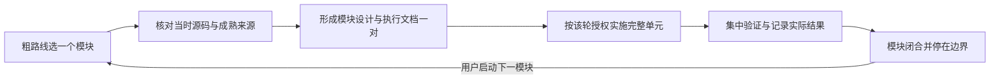

# EEngine Renderer Feature Completion：功能扩展粗路线

## 1. 目标与本轮边界

用户在 2026-10-14 明确选择：**先完善渲染能力和画面效果，再对完整组合集中优化性能**。长期目标仍为 GPU-Driven、WebGPU Native、AAA 画面方向、GTX 1650 Ti 4GB / 1080p 与可持续扩展，不提前承诺全效果原生 60FPS。

推进方式为：**粗路线记录目标和次序 → 用户启动一个模块的细设计 → 建立该模块唯一设计/执行一对文档 → 按该轮授权实施与验证 → 模块闭合后停在边界，回到粗路线选择下一模块**。粗路线建立时只完善文档/导航机制，不实现基础设施，也不预建未来模块详案、空类、固定 GPU ABI 或占位资源；用户之后启动的模块按此流程单独细设计。

本文与[粗执行总计划](../next-execution/eengine-feature-expansion-execution-2026-10.md)记录总体方向和模块入口；[workstream](../../project/workstreams/active/eengine-next-clean-rebuild.yaml)的 `roadmap` 始终指向这一对，`authority` 只指向当前正在设计/实施的那一对。用户启动模块细设计后才切换 authority，已有细文档入口只在粗执行表维护。它们有不同层次，不能成为两份竞争的施工指令。

全局不变量沿用 [V4 母稿](eengine-v4-native-shading-2026-10.md)，生产事实以源码和直接消费者为准。已落地 Native/VG/Lighting/Texture/Temporal 底座保留；旧计划继续为 history，V5 等正式性能资格保持未完成，不成为新效果统一启动前置。

## 2. 代码提供的事实与约束

初次在 `aa04fd65` 再查生产调用，其生产代码与前次 `2caf5fe2` 相同；下表AO/配置两行随首个模块实际切换更新，结果只回链模块执行文。类、旧 shader、注释、debug 名称和历史测试均不能单独证明功能接入。

| 领域 | 当前源码事实 | 对粗路线的影响 |
|---|---|---|
| 主帧与配置 | `RendererCore` 创建 owner；`FrameProgram`/Lowering 形成唯一生产图；`RendererConfig` 已有AO初值与运行期独立快照，尚无SSR/GI/VT设置；`RenderFeatureRegistry` 不在生产选择链 | 继续扩展真实设置→需求→图/PSO→绑定链，不先加 EffectsManager 或第二个 feature scheduler |
| AO | scalar XeGTAO完整链实际进入Native diffuse IBL；七项设置、Medium/High/0..3去噪和独立AO debug已接通，noise仍固定0，原开关已退休；结果只读模块执行文 | 后续按真实画面需求决定专属temporal/bent normal/specular occlusion，不重新发明或再实施一套AO |
| HZB | `HierarchicalZBuffer`/`hzb_reduce` 为反向深度 RG16F 保守 min/max，首级从内部尺寸的一半开始，有 current/previous；FrameProgram 目前仅由几何 HZB 需求触发构建，late recheck 后可再构建 final HZB | 可作为 tracing 的候选粗层；SSR 需核对最终可见性版本与精度，裁决是否结合全分辨率 Depth 精细验证或新增必要层级。已有纹理不等于任意效果都拿到了正确版本/精度 |
| 深度/法线 | XeGTAO 有私有五级 weighted view-depth 和深度重建法线；Native invocation 内有真实材质 normal/roughness/coat | AO weighted depth 与遮挡 HZB 数学不同，不能强行合一；深度法线也不等于 normal-map/coat 法线 |
| Native 间接光 | `native_surface.native_environment` 已计算 diffuse IBL×AO/material occlusion、DFG-weighted specular IBL、coat 与底层衰减；输出转工作色域并预曝光 | 新 GI/SSR 需要明确替换/补充的光照分量及颜色域，不能直接 HDR 加法；baseline 不自动提供新反射的材质响应 |
| 颜色金字塔/SSR | `SharedColorPyramidPass` 与旧 SSR shader 存在，当前 FrameProgram/Renderer 无生产调度；旧 opaque pyramid 的 stage 名只是原合同 | 核对数学后复用；新的颜色版本/读写顺序从当前 consumer 设计，不恢复旧 owner 或照抄旧 stage |
| 纹理 | metadata3 为 plane/mip chunks；`TextureResidency` 创建完整尺寸/mip array segments，支持 tail-first 上传与 promote，并不随细 mip 缺失而释放对应分配 | 已有压缩产品和渐进上传基础，尚无 tiled Product、页表、feedback、逐 tile 淘汰；当前体系不能叫完整 VT |
| Coverage | exact R8 plane 已独立；`nativeMaterialCoverageProgram` 从任意 graph 提取 alpha 子图，Main/VSM 共用语义 | alpha 可能依赖 RGB/其他 sample，VT v1 排除 coverage 时要保护整个依赖闭包，不能只保护标为 alpha-mask 的贴图 |
| Probes/GI | 旧 `GPULightProbeVolume`/atlas 是可选惰性数据，record 含低阶系数；没有当前局部镜面反射或 world GI 的生产消费链 | 旧 diffuse probe 数据不等于预滤波 specular probe；不能直接宣布 box-projected reflections 已具备，也不能据此选定 GI |
| 阴影/透明/介质 | LocalLightWork 有点/聚光照明与完整 overflow；当前 VSM 服务 Physical Sun；无透明/局部体积主图 stage，transmission>0 仍拒绝 | 局部阴影是独立能力；BLEND、透射、水面和参与介质分别定范围，不只取消拒绝或接一个旧类 |
| Temporal/显示 | Native 1:1、FSR3 upscale、bypass 各有实际路径；Present 已消费静态 SDR/HDR LUT 与 GT7/曝光，独立 ColorGradingPass 未调度；MotionBlurPass 和 DRS 类不在实际控制链 | 保留现行 AA/FSR/显示；后续完善公开调色控制、DRS、运动模糊等，不把“独立 pass 未调度”误判为“没有色彩分级” |

主要核对入口：[主图](../../OEngine/src/render/program/FrameProgramLowering.ts)、[HZB](../../OEngine/src/render/HierarchicalZBuffer.ts)、[Native 光照](../../OEngine/src/shaders/native_surface.ts)、[纹理](../../OEngine/src/gpu/TextureResidency.ts)、[coverage](../../OEngine/src/gpu/NativeMaterialBindings.ts)、[Present](../../OEngine/src/render/surface/SurfacePresentPass.ts)。这张表是决策快照，持续生产事实由 domains 随真实代码更新。

## 3. 对讨论方案的裁决

| 讨论中的建议 | 本轮结论与修正 |
|---|---|
| Feature Completion 优先、复用已有 AO | 采纳；新效果允许必要有界 ADD，完整图性能集中优化 |
| 先独立建设 Screen-Space Effect Foundation | 调整为随 SSR 的真实消费建立有限基础；AO 只补自身需要。首个 consumer 完整闭合后，SSGI 再复用已成立合同，算法确实不同则保留局部实现，不强迫所有效果共用一个 kernel |
| 一张 normal+roughness sidecar 就够 | 仅为候选。它不能完整表达 F0/coat/BRDF response、语义身份与重投影；也可能无需全屏物化。字段、格式、全/半分辨率和重算取舍留细设计裁决 |
| Surface 顺手固定输出 indirect baseline | 防双计能量的思路采纳，固定全屏 baseline 输出不采纳。SSR/GI 细设计比较发布必要 response/baseline、调整原生合成边界或有限重算，选择合法且成本有界的产品 |
| 直接选 FidelityFX SSSR 全套 | 列为优先研究参考，未选定完整移植 profile；其 wave/占用率退出、depth hierarchy、环境采样和 denoiser 假设需适配 WebGPU 与目标 GPU。不能删关键阶段后声称完整 SSSR |
| SSR 顺手完成 Local Probes | 分成相邻完整模块；SSR 可先用现有 Global IBL 合法补缺，随后补局部反射。Probe 的数据来源/预滤波/空间选择和更新成本不能被“顺手”省略 |
| Streaming VT v1 暂不虚拟化 coverage | 采纳保守范围，但明确为 shading VT profile。所有影响 alpha 的样本/坐标依赖保持完整可用，含 custom graph；无法安全分离时保留该依赖为 resident，或显式拒绝不支持输入，不能默改 coverage |
| SSGI 后直接固定 Cascaded SDF+Probe | 只采纳“近场 screen diffuse→独立 world-space GI”的推进层次。SDF+Probe 是优先候选，尚无足够的动态几何、薄墙、alpha、hit radiance 和 4GB 成本依据作为最终选择 |
| 先建通用 SceneTraceProvider，未来只换硬件 RT | 延期。screen depth、SDF、occupancy、triangle query 的可见域/命中信息/误差不同；occupancy 也不能直接作为可 sphere-trace 的 SDF。先让实际算法闭合，再按真实公共合同抽取，硬件 RT 不作为当前底座 |
| 固定一条未来 frame topology | 只保留职责方向；SSGI/SSR 的 radiance 版本、world 更新与主视图的关系、Sky/透明/介质的物理合成、Native/FSR 分辨率域必须在相应模块明确，不能将概念图当可执行无环图 |

**间接光合成的必要条件：** `H' = H + w × (S − B)` 只在 `B` 是 H 中实际已有的对应光照贡献、`S` 是同一 lobe、颜色域、预曝光和材质响应下的新贡献时成立。`S` 不能直接是 trace 得到的未加权 incident radiance。base/coat、粗糙度积分/采样 PDF、AO 与材质 occlusion、置信权重及 fp16 减法误差均要在细设计核对；不重复乘 AO，不以 clamp 遮盖数值错误。这个等式表达语义，不规定存储三张全屏纹理。

## 4. 粗粒度推进顺序

默认顺序调整为 **AO → SSR → Local Reflection Probes → Streaming VT → Screen-Space Diffuse → Local Shadows → World GI → Transparency/Refraction → Media → 重建/显示/后处理 → 集中组合与性能优化**。Decals/RVT 等保留为明确候选扩展。

这是画面收益和工程风险的默认排序，不是硬依赖链。SSR 不需要先完成 VT；SSGI 不强依赖 VT 或局部镜面 probe；VT 在 World GI 前可降低未来采样体系重复改造风险，但不能替 GI 解决场景表示/命中着色。当前只有 Sun 阴影，故将局部阴影置于复杂 World GI 之前，先补常用直接光遮挡和可信的场景光照基线；不宣称所有 GI 都必须消费 local shadow maps。透明或局部阴影若是目标场景主要缺口，可在模块边界进一步提前；不让庞大 World GI 成为它们的统一门禁。每次只细设计和实施一个大模块。

### 4.1 AO：完善已有 scalar 功能

设置/世界尺度、真实半径与强度/曲线语义、现有质量与去噪、启停/调节/诊断进入真实 bindings/图/PSO。finalValuePower 不能直接冒称线性强度；固定 noise 的改变也要对应稳定性设计。按场景薄物体、轮廓、运动与生命周期核对。专属 temporal、bent normal、specular occlusion 按需要另定，不打包为设置开放的前置。

### 4.2 SSR：以第一个效果建立需要的屏幕空间合同

目标为当前 Native 材质可用、运动稳定且边界诚实的屏幕反射，退屏/遮挡缺信息时使用已有环境补缺。已从当前源码与固定SDK形成[SSSR细设计](eengine-sssr-2026-10.md)和[执行计划](../next-execution/eengine-sssr-execution-2026-10.md)，算法/profile、产品与预算只由该对文档裁决；本粗路线不复制实施细节或状态。

细设计须裁决真实法线/roughness/响应、最终 Depth/HZB、可采样辐射及最小产品、主/coat lobe、trace/resolve/denoise/history/composition 和调试。receiver motion/identity 不能自动解决反射命中物体的运动和遮挡失效；SSR 自己管理可靠性与历史，不借用 Native AA 的内部 history 冒充反射 history。首个消费者所需的配置、需求声明、资源关闭/退休随本模块闭合，不另造基础设施大项目。

### 4.3 Local Reflection Probes：补齐屏幕外反射来源

独立设计 authored/baked 或 runtime capture 的实际数据来源、预滤波镜面 mips、影响体/空间选择/混合、视差校正、atlas/容量/更新/退休。box projection、octahedral atlas 是候选，既有 diffuse probe coefficient 不能替代镜面数据。

SSR 高置信结果与 local/global environment 形成明确的混合或替换关系；其补缺方向是 SSR→local probe→global IBL/sky，选择/混合应在实际 GPU 工作中完成，不强制成为三个串行全屏 pass。静态 probe 不宣称覆盖全部动态反射。若选 runtime capture，需计入多视图 VG/VT 驻留、阴影/材质可用性与捕获成本，不能依赖主相机可见域充当完整场景。

### 4.4 Streaming VT：先做 shading 纹理分页

目标为离线/冷准备压缩 tiled Product→有界 provider→物理页/页表→Native 采样→有界延迟 feedback→读页/上传/淘汰的完整链。沿 TextureProduct/WebCook 的身份、压缩和资产责任扩展；RVT 属运行时场景结果缓存，是另一能力。不得照用256KiB几何页 ABI 或造万能 VirtualResourceOS。

v1 范围为可与 coverage 安全分离的 baseColor RGB、normal、ORM、emissive 等 shading samples；完整 alpha 依赖闭包继续 resident。这个范围必须如实计账，可能限制 foliage/coverage 很重场景的节省。一个纹理同时服务 shading/coverage 时，路由、重复存储和 identity 由细设计明确，不能在 residency 改变时悄悄换 alpha 数值；Main/VSM/MASK/custom graph 全部直接消费者仍须闭合。这是同一 Native 体系的合法资源类型，不是新旧 Renderer 兼容桥。

细设计裁决 BC block/border、跨页/跨 mip/各向异性与地址模式、粗 mip 完整覆盖、overflow、网络/CPU/GPU 预算及 device loss。内容身份、物理页位置和 residency revision 分开，不能每 tile 上传重编材质或全局重置 Temporal；必要局部质量变化要有真实消费者处理。页尺寸/反馈频率/cache 策略不在本轮冻结。

### 4.5 Screen-Space Diffuse：有限近场间接光

先明确选 SSIL 式补充照明还是更完整的 SSGI profile，二者不能仅凭名称视为等价。目标是近场动态色溢出/屏幕内发光反馈，承认可见域与方向信息局限；研究取样、响应、radiance 来源、可靠性、去噪/history、上采样及与 AO/diffuse IBL 的关系。半分辨率是待比较配置，不是预定正确性捷径。

复用 SSR 已成立的深度/投影/颜色域/资源合同，不强制共用不适合 diffuse 的 traversal 或历史。若未来同时存在 world indirect，screen 项作为替换或补充的哪一部分须说明，避免 AO、IBL 和 GI 重复计能量。

### 4.6 Local Shadows：补齐常用直接光遮挡

独立补点/聚光的真实 caster、空间/容量、过滤、更新和采样链。LocalLightWork 分区不等于阴影空间索引已经可直接复用；与 world GI 的查询/辐射更新是否共享真实产品，在对应模块按实际消费者判断。基本直接光遮挡缺口不留给后续 GI 掩盖。

### 4.7 World GI：先选完整可落地的场景表示

优先比较 cascaded SDF/occupancy + radiance/irradiance probes 与其他满足目标的方案，按静态场景、移动刚体/变形、薄墙/alpha、动态灯光/发光源、距离/漏光、加载与4GB同时工作集裁决。SDF/occupancy 只解决部分空间查询，仍缺命中处辐射来源、材质/VT采样与照明更新；不能用“cook 少量属性”代替完整光照语义，也不预先修改 GeometryProduct schema。

是否离线生成、运行时体素化、clip/cascade 数量、probe 表示与更新预算，在该模块细设计。明确 screen/world/environment 的合成与可见域，不把它们伪装为一个无差别 miss 链。成熟实现的静态/动态限制必须转成本项目的显式范围；ReSTIR、Lumen Surface Cache、硬件 ray query 均非本阶段预选地基。

### 4.8 透明与介质

Transparency 先明确 BLEND、排序/混合、Depth、opaque/sky/reflection 输入与 motion/reactive，再扩展透射/折射、吸收和水面。MomentOitReference 不代表选定 OIT，也不因文件存在而恢复旧 owner。

Media 明确局部密度/参与介质、灯光/阴影、积分/透射、history 和 HDR 合成；与已存在 Sky/Aerial 的散射/消光不重复。具体前后顺序服从物理积分与所采样辐射版本，不照抄概念 topology。透明与介质分别拥有各自细设计/执行，不能一次跨模块全部启动。

### 4.9 重建、显示和候选扩展

保留 Native/FSR 的实际分辨率域、曝光和提交事务。新增效果的 motion/reactivity、pre-exposure、disocclusion 随该效果闭合；后续再专门完善 DRS、Motion Blur、公开调色/显示控制及场景需要的后处理，不额外叠加已有的 LUT/GT7。每次选一个连贯模块，不能把“后处理”作为一次实现所有效果的授权。

Decals 保留为场景表达扩展，需考虑对 Native 材质/法线及 SSR/GI 产品的影响，不能只后加 HDR 色块。RVT 是否值得作为独立能力根据 terrain/场景材质缓存需求决定，Streaming VT 完成不自动代表 RVT 已完成或必做。ReSTIR、高级 world specular、AI Upscaling 为后续研究候选，不创建占位 provider。

### 4.10 完整组合与性能收口

功能集合稳定后冻结真实 quality/feature/profile，集中查动态画质、完整 consumer、GPU/CPU 归因、加载/交互长尾、同时 live/retiring 峰值、4GB OS 驻留与同条件帧时。优先解决实际最大成本，届时再决定压 Surface、VSM、Temporal、feedback、GI 更新或其他项；不从这张粗路线预选 cache/低频/megakernel 作为必需优化。

## 5. 公共基础的设计方向

**配置与需求分层。** 设备能力/创建期预算、可调效果设置、shader/图结构与逐帧常量分开；开关或输出结构进入必要 topology/program identity，纯数值调节不导致无意义 PSO 重编。沿 RendererConfig/公开设置→FrameProgram request/product→bindings→owner 接线，保留缓存图的真实资源身份和关闭后退休，不先创建所有未来 feature 的配置空壳。

**共享合同，按 consumer 物化。** Depth/HZB、材质辅助信息、radiance pyramid 由实际需求声明 producer/consumer、坐标/颜色/分辨率、版本、写域、容量和寿命。现有 culling HZB 能满足精度时复用；不满足时允许有依据的效果专属层级/精细验证，不能为了“只有一份”损失语义。AO weighted depth 保留自己的数学。`surface-effect-data`、`opaque-color-pyramid`、`indirect-specular/diffuse` 仅是语义示例，不是本轮新增 enum、固定格式或统一 SurfaceRecord。

**颜色依赖必须无环。** SSGI/SSR 读取的当前帧 radiance 版本不得包含自身尚在求解的结果。可以选择明确的 opaque baseline、先 diffuse 后 specular 的有限版本，或有曝光/身份/拒绝合同的历史来源，具体在模块细设计裁决。共享 pyramid 只在来源版本/过滤语义相同且收益成立时共享；不能既要求 SSR 看见新 GI，又让 GI 读同一份 SSR 最终输出，或把回灌当作免费多跳。Sky/透明/Media 是否进入被采样的来源也必须明确。

**公共基础也要计账。** 1080p 一张8B/pixel目标约15.82MiB；normal/roughness 加 baseline 两张约31.64MiB，尚未包含读写、mips、去噪/历史、同时退休资源。sidecar 不天然便宜，preallocate 不因叫 Foundation 而免费。按真实模块记录必要 ADD 与上界，候选之间比较工作/质量/能力；不以相对关闭效果的净提速为验收条件。history/cache 留各效果；不扩 Surface/TemporalFabric 为统一效果操作系统。

## 6. 粗计划如何进入细设计和实施

| 文档/导航 | 唯一职责 |
|---|---|
| 本文 | 目标、优先级理由、能力边界、待决问题和横向约束；不写未来模块具体实现阶段 |
| 粗执行总计划 | 模块级状态与已存在的细设计/执行入口、延期责任；不复制细执行单元表或测试结果 |
| 模块设计 | 真实源码/消费者、场景与质量范围、成熟来源、方案比较与决定、产品/owner/生命周期、必要成本和旧依赖退休边界 |
| 模块执行 | 设计对应的完整 architecture units、必要验证、原失败与分类、实际结果/限制和停止点；唯一细单元状态 |
| workstream | `roadmap` 导航粗记录，`authority` 导航当前一对，`currentSlice` 导航当前大模块；不复制模块内状态 |
| domains / contracts / porting | 分别记已经实现的事实、实际稳定的合同、真实研究/采用；本轮不把未来目标写成实现 |

用户以后提出“细设计 SSR”时，先重新读代码和来源，只创建/完善 SSR 的一对文档，设计文回链本文的该模块，粗执行表只加实际文件链接，workstream 切换该模块 authority。文件名/版本沿既有 next-design/next-execution 规则选择，不预建所有模块空文件。此时规划好的 shared data 仍属于 SSR 的真实 consumer 闭包，不另立并行 Foundation authority。

仅授权设计不自动编码；已有执行授权则按既定范围连续完成，不额外重复索要许可。细设计形成后按其设计/执行闭合 producer→产品→全部直接 consumers、绑定/reset/capacity、提交/中止/重试与退休。若实际源码推翻原假设，先更新同一对文档的决定/受影响单元，不暗开第二条计划或重复 progress/status。

模块结束将实际验证与未完成项记在细执行文，粗执行表只记录模块结论和链接；已实现事实再更新 domains。细文档不因模块关闭立即全变 history：仍定义生产合同者继续按明确 scope 维护，已被替代的迁移/优化方案退出 current。当前模块关完停在边界；下个模块由用户启动，届时依据源码再设计。

## 7. 验证、延期与来源范围

通用合同统一读 [VALIDATION](../VALIDATION.md)。日常按需编译/targeted；模块连通后集中核对真实 GPU、独立数值/画质、启停/组合、完整容量/overflow、resize/cut/普通motion、abort/retry/replacement/device loss 与 fence 退休，以及资源上界和必要成本。新增效果允许有界工作；性能候选另算 break-even，失控容量、漏像素、错误或实际无法运行不能留到最终阶段。

V5 Phase6/条件Phase7、VSM R4、Minimal GPU Work 未获资格项和 Texture Compression 开放限制仍保持原结论，延期路由见粗执行文。没有新代码/GPU 结果，不提升 adoption、Feature Complete 或性能资格。

本轮对外只做粗路线层面的事实核对，未选择完整 donor/profile、未移植算法；模块细设计时再固定完整源码与来源映射。访问日期为2026-10-14，参考入口和范围如下：

| 来源 | 本轮使用范围 |
|---|---|
| [AMD SSSR 技术说明](https://gpuopen.com/manuals/fidelityfx_sdk/techniques/stochastic-screen-space-reflections/)与[项目说明](https://gpuopen.com/fidelityfx-sssr/) | 支持 inverted depth、完整 tracing/validation/denoise 及平台假设的研究入口；不证明本地 HZB 可直接替代上游 hierarchy，亦不证明在 GTX1650Ti 上更快 |
| [SSSR 源码](https://github.com/GPUOpen-Effects/FidelityFX-SSSR/blob/34dcacd1feefcfab2855b82e76c7d711f2020a75/ffx-sssr/ffx_sssr.h) | MIT，revision `34dcacd1feefcfab2855b82e76c7d711f2020a75`；仅核读 HierarchicalRaymarch/ValidateHit 及 wave occupancy 相关路径，未研究完整 SDK1.5 profile，未采用 |
| [Epic Streaming VT](https://dev.epicgames.com/documentation/en-us/unreal-engine/streaming-virtual-texturing-in-unreal-engine) | tiled streaming 与过滤/border/反馈代价的参考，不等于本项目已支持 SVT 或 RVT |
| [Godot SSIL](https://docs.godotengine.org/en/stable/tutorials/3d/environment_and_post_processing.html#screen-space-indirect-lighting-ssil)与[SDFGI](https://docs.godotengine.org/en/stable/tutorials/3d/global_illumination/using_sdfgi.html) | SSIL 是间接照明补充；SDFGI 的动态灯光不代表动态遮挡/发光体支持，因此不能直接承诺全部动态 World GI |
| [Lumen 技术说明](https://dev.epicgames.com/documentation/en-us/unreal-engine/lumen-technical-details-in-unreal-engine)与[ReSTIR GI](https://research.nvidia.com/publication/2021-06_restir-gi-path-resampling-real-time-path-tracing) | 分层场景查询、path resampling 的候选研究入口，不直接采用其 Surface Cache、预算或 ray-query 假设 |
| [WebGPU GPUFeatureName](https://www.w3.org/TR/webgpu/#enumdef-gpufeaturename)与[wgpu 原生实验能力](https://wgpu.rs/doc/wgpu/struct.FeaturesWGPU.html#associatedconstant.EXPERIMENTAL_RAY_QUERY) | 当前浏览器核心能力不以硬件 RT 为基线，wgpu experimental/native-only 不当作本项目 browser 能力；未来加入 RT 仍需重新协商和设计 |

完整来源 adoption 继续只按实际来源核对、独立 oracle 和生产 GPU 消费证据提升；研究方向、文档链接或成熟引擎的功能名单都不代替本项目实现。
