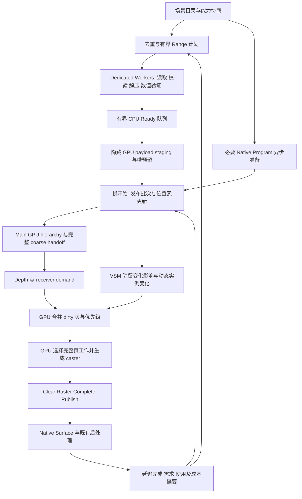

# 初始化调度：并行准备、帧事务发布与 VSM 有界更新

## 1. 本轮决定

源码起点为 `30292e0e`。用户本轮只授权设计，实施与详细状态唯一入口为[执行计划](../next-execution/eengine-initialization-scheduling-execution-2026-10.md)。这是功能路线中插入的一次真实可用性修复，不启动延期的全 Renderer 性能资格，也不启动 Local Probes、VT 或其他效果。

选择重新组织整个 Cooked 启动关键路径，而不是给现有逐页循环增加线程数：**并行准备与 GPU 发布脱耦；几何只在正式帧事务中成批发布；VSM 消费实际驻留变化影响，合并失效并按完整阴影页分批重建；纹理与 Pipeline 准备和几何并行，细 mip 不再挤进首个可见帧。** 初始化和运行时流送共用同一套机制，首屏前后只改变优先级与额度，不保留另一条加载路径。

优先删除重复 GPU 工作，其次解除 IO/解码串行，最后缩短首屏关键路径。默认保持当前材质、coverage、阴影零误差几何选择、最终纹理 mip 与渲染尺寸；Worker 不拥有 GPU，最终画面不能靠停止精化或关闭 VSM 达成。目标是早出现可交互且定义清楚的 bootstrap 画面，并尽快收敛到完整目标；不是只把首屏计时提前而把两分钟工作藏起来。

## 2. 源码与诊断事实

| 当前事实 | 设计含义 |
|---|---|
| `loadCookedScene` 先等待全部纹理 Product，再打开四个几何包、加载 root、准备 Native Material；RAF 在其后启动 | 没有必要把互不依赖的 CPU 读取、几何准备与 PSO 等待串起来 |
| 405 个纹理条目，202 个不同 identity；条目文件约1250.8MiB，唯一文件约988.3MiB | 在请求入口按期望 identity 合并；不是把 GPU 已有去重再做一遍 |
| `openTextureProduct` 依赖外层 section hash，再验证纹理结构/身份；Product 合法性通过 realm 内 WeakSet 记录 | Worker 传回一个声称 verified 的普通对象不能直接被 GPU 信任；须重建本地验证品牌 |
| OEGPACK 已有合并 Range 的 `readPages`，bootstrap 使用它；持续 scheduler 只调用 `readPage` | 复用现有范围合并算法，持续路径采用同样的批处理，不再逐页 HTTP 往返 |
| 稳定相机 `floor(2×0.7)=1`；IO throughput 用上次 GPU 上传量除当前回调间隔；GPU frame time 字段未更新 | 分离网络/解码/发布反馈；不能把零上传当作慢网络，也不能用假 GPU 压力调度 |
| 完整启动约26s有首帧，约171s才完成4779个后续页面；前后纹理上传总量不再增长 | 首屏等待和流送长尾是两条不同瓶颈；不能都叫 compile 或 runtime cook |
| 保持读回、只停页面上传约60FPS；上传+VSM约41FPS；正式关闭VSM并继续上传约60FPS | 主要 GPU 放大器是发布触发的 VSM 更新；暂停整个反馈环的早期测试不足以独立归因 |
| 该短窗口VSM raster均值约8ms、最大约51ms；暂停发布后接近零；完整长尾CPU约123/171s idle | 有主线程工作，但不能把长尾主要定性为主线程解压阻塞；Worker收益不可夸大 |
| 上传页改变 assetContentRevision，VSM source stamp 比较后对整个实例 bounds 产生 damage | 当前不是全 atlas generation reset；问题是细页变化被放大成实例空间范围变化 |
| Shadow Geometry `sseThreshold:0`，整clipmap union遍历；`encode`收allocation却未用于遍历筛选；receiver主动请求完整mip5 coarse覆盖 | 仅加dirty page过滤不保证减少全部几何请求；稳定缓存页仍需要维护缺页需求与使用反馈 |
| 纹理先上传tail/coverage约106.9MiB，首帧又promotion约880MiB；full-size/full-mip texture早已分配 | 渐进上传目前既不真正减少首帧上传，也不降低完整纹理分配；本轮必须准确区分两者 |
| `settled: async()=>{}`；first/full texture readiness不等于geometry/VSM settled | 改成可取消、带view epoch的真实收敛事件，不再以空Promise宣称完成 |

上述数字来自2026-10-15本机1920×1080、RTX2060SUPER 8GB、AO/SSSR默认关闭的诊断。机器有其他GPU负载；完整171s记录没有逐帧pass归因，短对照也不代表4GB机器最终收益。无evict/reload/overflow证明的是当次owner行为，不能推断驱动无显存压力。早期脚本写`vsm_enabled`的off对照无效，本文只采用正式`shadowVisibilityEnabled`及无VSM pass证据。

## 3. 所有权与总体数据流

图中隐藏 staging 可跨CPU tick，位置表和相关失效只在该帧提交后正式前进；不创建独立上传submit。GPU在当前帧内决定visible/caster/dirty-page工作，CPU只用旧帧反馈和资产元数据决定将哪些不可变内容准备好，不生成当前可见列表。

| owner | 本轮职责与边界 |
|---|---|
| Cooked asset session（assets） | 目录去重、取消/epoch、输入credit、预取/读取批次与Worker。无长期GPU资源，无effect算法 |
| 既有 `AssetWorkerPool` | 复用有界队列、失败/取消与transfer机制；增加Cooked任务协议和会话注册，不复用WebCook的几何生成协议，不再造另一个通用线程池 |
| `GeometryPageScheduler` / streaming runtime | 合并延迟需求，维护读取/ready/隐藏staged/published阶段、预算和公平性；发布入口从completion callback移至frame prepare |
| `VirtualGeometryResidency` / multi-runtime | 唯一payload槽、metadata地址、generation、位置表、事务提交及fence退休owner；提供小而明确的prepare/encode/commit/abort闭包 |
| VSM现有owners | 保守几何变化影响、GPU dirty队列、当前页工作选择、完整页发布与有效性；不让加载器维护第二份阴影状态 |
| `TextureResidency` / Native publication | 唯一resident mip范围、纹理拷贝与采样绑定事务；保持PSO结构key与资源内容版本分离 |
| Renderer / FrameCoordinator | 接入时序、共享预算输入和现有唯一frame submit；不接管IO、Worker、页优先级或shader算法 |

不建立全能 ResourceOS / EffectsManager。CPU几何与纹理任务可共享总临时内存额度和Worker pool，但Product身份、residency、effect history各有真实owner。

## 4. Worker 与批量准备

### 4.1 执行模型

使用 Dedicated Module Worker 池，默认 `max(1,min(4,hardwareConcurrency-2))`，核心信息不可用时1；它是可调起点而非吞吐承诺。一个池处理Cooked任务，各worker一次只执行一个有界CPU批次，网络并发与worker数独立。启动目录后立即预热需要的worker，几何critical任务和coverage优先于细纹理；以字节credit、deadline与aging防止大任务永久饥饿。

Worker负责fetch/Range、CRC/SHA、LZ4、布局和resident数值验证；不创建WebGPU device，不生成材质GPU命令。采用普通transferable `ArrayBuffer`，不要求cross-origin isolation或SAB；转移后发送方不可再读写。可用一个worker运行同协议，不保留主线程同步解码后端；Worker不可创建时显式报告能力失败。自定义只在宿主可用的Product source仍由原source owner准备数据，不能静默把Cooked大解码切回主线程。

已有`AssetWorkerPool`会在取消正在执行的任务时终止worker。注册的pack descriptor只复制一次到worker并按session+generation寻址；worker重建后必须重新注册，不能误以为注册状态仍在。每次传输按唯一backing buffer列transfer list，避免subarray共享buffer重复转移；不同任务不共享可变解码输出。

### 4.2 信任与重复验证

几何将`OegPackV3.decodeAndValidateEncodedPage`和`prepareProductResidentAttributes`的真实验证拆成CPU资产层可复用kernel，所有provider仍用同一数学/布局验证。worker返回独占bytes、identity、integrity policy、payload extent和必要变化元数据。主线程内部receipt importer校验协议、task/session/source epoch、目录中的期望identity、大小与返回域后重建本地品牌。只有经过内部pool实际成功的任务可走该入口，不接受公开对象上的`verified:true`。

原`preverifiedIntegrityPages` WeakMap不会随structured clone转移，原`validatedProducts` WeakSet也不会；不能因为收到了hash字符串就跳过真实哈希。Texture worker完整调用现有container/texture校验，接收端走受限receipt importer重建immutable Product及品牌，只做小的身份/结构接线核验；不再次hash大payload。外部自定义provider仍保留现有unverified snapshot/digest验证路线，这是不同信任边界，不是另一条生产架构。

默认完整texture SHA与当前几何CRC/可选decoded SHA策略保持原样，不用skip hash换时间。CRC不是认证，optional SHA不是新安全承诺。receipt或epoch不匹配拒绝发布；确定性损坏直接失败，网络重试有界且不发布部分页。

### 4.3 IO粒度与内存credit

几何先按GPU反馈优先级选有界候选，再在相同Product内按文件offset形成Range span，沿用现有gap/max-block合并语义。**不能为合并而把紧急页排到大量无关数据后面。** 默认并发从4个range起步，上限8；span以现有上限为准，实施核定后统一配置；读前同时预留encoded、decoded峰值和结果空间。低延迟也允许只有1个请求；不用固定0.7向下取整永久压到1。

初始化已知root、coverage和当前GPU延迟需求之外，允许读相邻span预取；预取单独计bytes/命中率，不能自动要求完整Product常驻。bootstrap与持续流送都通过同一batch reader，不再由bootstrap单独串行遍历64页、持续路径逐页fetch。

初始建议总CPU临时credit256MiB，几何ready64MiB，encoded window32MiB，分配按任务真实峰值而非独立相加后超总额；texture单个完整Product可达128MiB，需要预留输入及hash/结果峰值。达到高水位停止低优先级读取，不把数百Promise的结果无界留在main或worker。不可变且供device replay保留的texture payload单列长期CPU成本；本轮不把约1GiB已加载texture称作256MiB总内存。

几何解码仍按256KiB逻辑页验证。worker输出可选一个内部独占批次slab，仅转移已验证的4B对齐有效prefix与逐页extent；未用尾部只在完整验证完成后丢弃。公开`GeometryPageProductV1`仍保持256KiB输入合同，外部provider无需改变；内部prepared结果不重新伪装成完整Product。这能让ready/staging按有效payload计费，避免1.5GiB零填充输出跨线程流转。若receipt尚未形成完整安全闭包，先转完整页并受相同credit限制，不能凭测得收益先放宽验证。

## 5. 几何物理准备与可见发布分离

### 5.1 页面状态

`queued → reading/validating → CPU-ready → GPU-staged(hidden) → publication-candidate → published → retiring`。同一个key包含source/session epoch、product slot+generation和pageId；阶段之间转移唯一ownership，cancel/replace/loss使旧结果不可再发布。槽与CPU ready受同一发布背压保护。

payload可先写入从未发布且未被任何consumer引用的新槽，但**位置表不立即写入**。主帧prepare选择候选批次，编码位置表/变化记录，并让本帧hierarchy、VSM失效和后续consumer按encoder顺序读取。主线程的resident集合、asset版本和scheduler完成状态只在submit成功时提交；abort不使未提交页面可见，candidate可重试，隐藏槽最终释放。已有`ShadeGPUCommandContext.writeBuffer`通过staging+copy支持这种顺序；禁止直接queue.writeBuffer修改已经公开的位置表再声称abort可回滚。

初始化没有可渲染scene前沿用场景正式publication事务，只有critical集合齐全才发布；此后全部纳入普通frame submit，不创建新功能独立submit。evict先撤销映射和对应content有效性，再等已提交消费者fence后复用槽；hidden槽也不能跨generation串用。

### 5.2 批次与成本

按紧急程度、受影响空间域和最老等待时间组批，避免同一区域页面跨几十个帧到达时每帧都触发同样失效。默认publication机会不超过每50ms一次；cut/critical可提前，组批等待期限默认100ms且有进展下限。二者是初始调优值，不是质量门槛；100ms到期意味着有可用frame/容量时必须进入公平选择，不代表GPU阻塞、故障或容量不足时仍能保证墙钟完成。不得等完整资产/整个pack齐全才让任何精化生效。

可上传很多hidden payload，但只提交适合本轮更新额度的版本变化。批次在CPU只做资产级保守空间聚合，不读回本帧可见页；真正dirty union由GPU决定。同一次发布对一个asset最多递增一次内容版本；同一shadow page只加入dirty集合一次。只按字节控制发布不足，预算还须考虑预计damage页数、caster-pair/triangle工作及最老等待。

## 6. VSM：从驻留变化扩大失效，改为真实影响驱动

### 6.1 两种变化必须分开

动态transform、add/remove、实例identity、coverage/WPO、sun/clip namespace改变继续沿现有正确失效语义。几何页resident/retire则提供单独的**驻留变化集合**；不能用全局sourceRevision推断整个asset变了就无条件重画实例全部bounds。depth-range更新只为会改变完整caster bounds的事件运行，普通细节页入驻在已包含的资产bounds内不反复重建range。

驻留变化的保守影响必须包含：新进入的group、被替代/重新启用的coarse meshlet及其refine依赖。**只投影新页的group bounds不充分**，因为coarse父几何可能覆盖更大区域。worker在验证resident页时，提取`refineGroupId → coarse meshlet bounds`依赖；residency按generation维护已驻留依赖索引。发布/退休某group的页时，合并新group bounds和全部相关coarse predecessor bounds，对使用该asset的instances变换后投影。无需完整全世界预解码，已能绘制的coarse数据必已驻留；缺失、损坏或无法证明的关系对受影响asset保守扩展至完整实例bounds，并单独计数，不遗漏damages。

物理页是搬运单元，不是渲染cut。变化只保证可能影响的空间，是否真的影响当前shadow cut由GPU检查；与任何已缓存页/当前需求不相交的变化不触发光栅。共享页、多实例、refine DAG多父、退化变换、negative scale和跨页coarse handoff必须完整覆盖。相关metadata不改变geometry identity，不把静态当成可以忽略所有细节变化。

### 6.2 需求、使用和本帧重绘不是同一个域

保留GPU receiver fine需求和当前完整mip5 coarse需求。给阴影hierarchy增加由这些需求构建的保守light-space tile索引；只有确定不与任何需求（含filter/gutter、跨level/coarse）相交才剪掉node。光方向保持无限拉伸，不用主相机frustum/HZB/cone剪掉离屏遮挡物。

**需求遍历覆盖requested域，重绘遍历覆盖selected-dirty域。** 前者继续生成缺页/使用反馈，后者只为本帧要完成的阴影页构建raster work。尽量共享同次层级遍历的标记/选择结果，避免为每个shadow tile单独遍历整场景。不能只遍历dirty页然后停止对缓存页所用几何的touch，也不能因为一页暂时clean而不继续请求尚缺的精化页。

当前coarse覆盖涵盖整个clipmap且SSE为0，所以保留这些合同时，即使tile索引完美，仍可能读完整个Bistro。**本轮不承诺少于6085页，也不改SSE或取消coarse coverage。** 非零shadow texel误差、分层coarse geometry LOD和减少coarse覆盖属于画质/表示选择，未来另设计并验证，不能混成这次纯优化。

### 6.3 有界完整页重建

GPU持久dirty bitset记录全部失效。每帧按coarse可用性、receiver需求、age选择有界完整页列表，再执行现有clear→完整caster pair→完整raster→complete/content-ready发布。dirty页没有被选中仍保持dirty，不能被无条件清零；不能截断pair或triangle后把页标ready。selected列表容量、显式pair溢出时既有implicit完整路径、失败标志和content commit一并核对。

失效即撤销content-ready；延后处理的页不能继续当fresh采样。采样只退到**仍满足当前内容身份**的有效coarse页；coarse也被影响时不能把旧depth当正确fallback，沿现有missing/no-content合同并显示诊断，直到完整重建。优先恢复coarse可以缩短缺内容窗口，但不能保证始终没有可见变化。本轮不引入双份atlas、静态/动态双缓存或影子residency快照来掩盖旧内容，4GB下其额外资源与复杂性不合适。

批次合并只减少重复版本变化，不能保证单页重建便宜。一个大caster可能让一页本身超过时间目标：软预算允许该**完整页**作为最小进展单位，记录over-budget原因，不永久饥饿、不部分提交；按dirty页数量不能提供严格ms上限。若真实数据证明单页仍不可交互，需在本模块内评估有界pair/triangle分段+私有页构建及最终原子commit，先更新本对设计/Cost Card，不能悄悄降低阴影质量。

## 7. 调度与首屏关键路径

### 7.1 四个独立credit

| credit | 依据 | 明确不使用的伪依据 |
|---|---|---|
| 读取 | 实际encoded字节/网络elapsed、RTT/并发、ready空间 | 上帧GPU上传字节/当前RAF delta |
| 解码 | worker busy时间、每批encoded+decoded峰值、ready排队 | CPU总核数越大越无限并发 |
| GPU传输/发布 | 可用新槽、payload bytes、staging峰值、旧fence压力 | fetch完成立刻修改公开表 |
| VSM更新 | delayed dirty/pair/triangle数量与可选pass时间、age | 未更新的`_streamingGpuFrameTimeMs`或把queue等待当GPU timestamp |

目标帧时间只用于软额度，如60Hz先留约2ms给新增流送/阴影更新；既有baseline已超过目标时仍有最小进展额度并诚实报告baseline成本。采用慢增快减、平滑窗口与hysteresis，不每帧因一个零上传或主线程唤醒间隔改变所有预算。不得增加frames-in-flight掩盖排队。

时间戳可用时以低频小摘要采样copy/VSM成本；无timestamp时用工作量模型+现有completion压力保守校准，不额外map整图。所有新摘要并入现有延迟readback/submit，有空帧不强制读回。Main/VSM各自使用反馈完整性继续保护retirement；CPU反馈吞吐按实际packet记录数计，不把同页跨帧重复请求计作真实IO。

### 7.2 首屏依赖图

目录/能力协商完成后并行启动：几何metadata与root、按identity唯一的纹理读取验证、基于真实材质图/物理layout的必要PSO准备、已有环境必要准备。Native compiler必须检查它当前依赖纹理resident binding的哪些内容，拆成结构编译和实例资源绑定；只能在结构key完整后并行，不编译一套占位layout再编第二套。GPU Pipeline仍由同一个device/owner异步创建，不能把device发送给Worker或换device编译后搬回来。

首屏critical集合为完整scene/材质字典、当前所有实例所需bootstrap coverage、正确采样的texture tail与全部coverage依赖、该frame所需PSO。coverage并非一张alpha图：凡影响opacity、alpha cutoff、UV变换或自定义coverage的纹理/计算依赖都保持现有完整精度。首屏不等待全部shading fine mips和全部leaf geometry。root不完整或必要PSO失败时保留loading，不以漏实例换首屏。

第一帧只运行此集合和其正常阴影链。shading mip按空间需求/材料优先级渐进补齐，无现成需求时先用有界公平队列；本轮不新造texture feedback系统或VT。每次只上传新增区间`[newMinMip, oldMinMip)`，完整mip不可拆语义但可分块物理拷贝，全部块齐全并提交后才降低resident minMip。sampler clamp、MASK/Main/VSM binding都在同一publication提交，不能读未上传mip。texture初始/更新统一走staging+copy事务，首帧不再执行全材质无预算`promote()`。

完整container验证仍可能是早期主要等待。已有`TextureProduct`要求全部chunks且为replay保留，本轮先去重、Worker和重叠，不伪称已实现按mip网络流送。真正tail-only HTTP/chunk source虽然现有manifest已有offset/hash，仍需新的partial Product、受校验metadata、按需读取与replay合同；留给后续选定模块，不以不完整chunks冒充合法Product。完整GPU纹理分配也不因渐进上传减少。

## 8. 收敛、取消和内存上界

公开阶段为`catalog-ready / bootstrap-ready / first-presented / refining / view-settled / failed / cancelled`。`first-presented`以实际GPU完成/呈现定义的证据记录，不能把CPU提交叫present；无法证明scanout时明确称first-completed。纹理full-mip和几何target分开。

`view-settled(epoch)`要求：该view/light/content epoch的最新完整Main/Shadow需求反馈已被处理、必需IO/ready/staged/publication归零、该需求的几何达到当前quality、当前requested shadow页有效或显式容量受限、coverage完整；至少跨一次后续完成帧确认没有新target需求。容量受限记录`limited`而非settled成功；有物理预算不能达到整个target时保留合法coarse并报告限制，不永远Promise挂起。相机移动、sun/scene变化使旧epoch失效并重新refining，`settled()`不得承诺永远全场景加载完成。

物理slot预算、CPU ready、encoded、worker scratch、staging、texture replay payload、GPU texture完整分配、geometry bank/metadata及fence-retained峰值分别计账，最后求和；预算上界不等于OS显存可用量。当前Bistro1521MiB槽对应242MiBpayload，只约16%占用；root约1.6%。这不是线程可以解决的。**本轮保留单页单256KiB槽ABI**，避免同时改GPU寻址和Cooker；记录真实填充率和4GB峰值。后续若仍不符合设备预算，优先单独评估Cooker跨资产页填充/更紧凑bootstrap，再评估可变size GPU分配；不得仅扩大geometryMiB或降低场景规模宣称解决。

session cancel/worker crash/late receipt不发布；重试保留hash与epoch检查；scene release取消所有任务并关闭本会话排队credits；device loss撤销所有GPU候选与计时状态，保留设备无关source/已校验不可变Product用于新device按同路径重放，旧device fence不授权新device复用。readback完整性失败不得授权evict。

## 9. Cost Card 与候选取舍

| 机制 | 删除/收益 | 新增税与上界 | 理想/预期/最坏与break-even |
|---|---|---|---|
| identity去重 | Bistro约262.4MiB重复container读取、hash与持有 | O(unique products)映射与alias元数据；无GPU税 | 0/50/100%重复消除分别0/131.2/262.4MiB；metadata成本须小于减少的读取/校验，零重复仍只一次小目录遍历 |
| Range+worker | 小HTTP往返、主线程CRC/LZ4/numeric扫描，transfer避免structured-clone大bytes | W份pack必要metadata、worker调度/消息、credit内scratch；本轮不加几何ALU/texture samples | 0/50/100%可并行CPU收益为0/0.5C/C上限，实际还有串行/带宽；批次收益需大于消息+元数据复制，tiny任务同批不单发 |
| 合并publication | 同区域页到达时重复版本/dirty/raster | ready/隐藏槽与最多默认100ms等待，CPU空间分组 | K次相同域更新变1次，理论删(K-1)R；50%合并删约0.5(K-1)R；无重叠时0收益，必须限制等待，不常规延迟critical |
| 精确保守damage | 从asset范围缩至新增+coarse替换影响，去掉无关caster重绘 | 驻留refine依赖metadata O(resident meshlets)，GPU变化记录O(batch)，投影/并集ALU；坏关系扩大到asset | 0/50/100%可删damage时仍须比较新增索引成本；无变化帧无新增全页扫描，空间重叠大时主要依赖batch与页预算 |
| 阴影tile域/页额度 | 无需求区遍历、无dirty区raster；只构造选中完整页pairs | 层级requested/dirty标记，bitset/prefix/间接args，GPU节点tile查询，新增有限dispatch/barrier | 全覆盖最坏不删读取，只多查询税；用每level小mask与union快速全覆盖分支免细查。0/50/100%剪除分别0/0.5N/N，要求剪除收益覆盖索引成本 |
| texture分批 | 删除首帧约880MiB集中promotion及重复tail上传 | bounded staging、mip完成mask与多次资源publication；full纹理分配不减 | 理想首帧只critical bytes；总bytes不因切批变少，额外拷贝/对齐须计；相同mip不能重复上传换简单状态机 |

VSM新dirty bitset按现有virtualEntryCount每位计，工作选择/age每resident slot约O(4～16B)，metadata在创建前求实际descriptor；不能固定假设常驻全场景的巨大history。CPU dependency索引、GPU事件header/stride和binding数在INIT-1编码前据真实数据核定，不能超过当前最宽Native route限制而偷加buffer；尽量合入现有几何metadata/VSM内部绑定。GPU时间收益不以CPU采样、字节减少或理论公式代替。

拒绝的主方案：全部预加载完成才首屏（大场景扩展性差）、只加workers（GPU放大不解）、整renderer搬OffscreenCanvas worker（不减少GPU工作且扩大device/UI迁移）、SAB/WASM pthreads先行（额外部署/并发合同，现有LZ4 kernel足够先迁Dedicated Workers）、GPU解压（占当前瓶颈GPU且改变数据链）、忽略streaming失效/保留stale页（阴影不正确）、默认降低shadow SSE或取消coarse（画质改变）、双atlas/双几何快照（4GB峰值和一致性成本）、永久缓存一切（内存不可控）。WASM SIMD可在真实worker decode仍显著后独立替换kernel并同语义验证，非本轮先决条件。

## 10. 参考、完整性与实施边界

本方案是EEngine本地调度/事务设计，不声称移植了一个开源VSM算法。已下载固定源文件并研究相关任务链：three.js r180 `DRACOLoader.js`/`WorkerPool.js`，固定commit `0af9729d0c143a86a1d725d6e2c3ad83301f3f34`，MIT；The-Forge `ResourceLoader.cpp`，固定commit `cd5046893faba2dc7869243873bf01f02a6f0df9`，Apache-2.0。前者参考有界Worker与transfer/按任务cost分配，后者参考准备/上传/完成阶段和staging ownership；不带入DRACO解码器、无界promise队列、native copy queue/semaphore、多GPU或阻塞wait。详细映射见[来源账本](../porting/next-renderer.md#初始化调度研究2026-10-15)。

浏览器依据为[HTML transfer语义](https://html.spec.whatwg.org/multipage/structured-data.html#transferable-objects)、[Worker fetch](https://developer.mozilla.org/en-US/docs/Web/API/WorkerGlobalScope/fetch)、[WebGPU规范](https://www.w3.org/TR/webgpu/)。WebGPU可以在Worker使用不代表既有device/pipeline可transfer；本方案GPU owner留在现宿主。Epic[VSM caching/invalidation资料](https://dev.epicgames.com/documentation/en-us/unreal-engine/virtual-shadow-maps-in-unreal-engine)只用来核对cache失效、bounds放大与streaming变化是独立问题，不声称已研究或采用其未公开源码，也不照搬experimental LOD invalidation行为。

保持现有完整Native材质、Product coarse/fine互补选择、MASK依赖、VSM pair完整溢出处理、content-ready与temporal响应。实施顺序为：先完成publication+VSM更新闭包，再Worker/IO与ready准备，最后并行启动+texture预算+真实阶段收敛；三个单元各自原子切生产owner。模块完成后停回Local Probes边界，不顺带改Page物理ABI、VT或功能质量profile。
