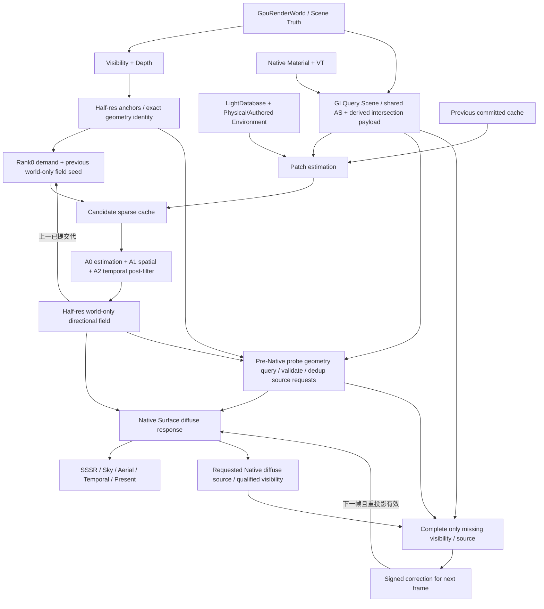

# EEngine Surface Cache GI：完整算法与生产接入设计

本设计与[执行文档](../next-execution/eengine-surface-cache-gi-execution-2026-10.md)构成当前模块唯一施工依据。用户选定的[母稿](../reviews/EEngine_Surface_Cache_GI_WebGPU_Mother_Design_2026-10-17.md)保留为需求与研究输入；本文明确修正的内容以本文为准。总体位置见[路线](eengine-feature-expansion-roadmap-2026-10.md)。目标与实施事实分开：已完成/未完成项只读执行文档，不由设计采纳推断生产切换、来源采用或性能资格。

初始设计源码基线：`3000de2ab7caee2f5a20d86ded367ff3ba2e32c5`（2026-10-17）；本轮执行架构重构基线：`2f276576`（2026-10-18）。以下分开写“源码事实”“目标决定”和“待实测参数”。源码核对覆盖本模块 producer→直接 consumer 及生命周期，不声称逐行审计整个引擎。外部固定 revision、许可证、入口与移植范围见 [source map](../porting/next-renderer.md#surface-cache-gi-2026-10-17)。

**本轮重构决定。** 保留完整 SCGI 算法，替换失控的物理工作组织：共享求交 arena 与场景 TLAS、estimator 样本批处理、先需求后 Native 源复用。执行计划只增加 SCGI-R1/R2/R3 三个完整单元，随后回到 SCGI-10。当前示例与本轮最高验收尺寸为 **1920×1080、internalScale=1**；不能降低分辨率、方向数、几何覆盖或材质范围来证明本次重构有效。旧实现的局部功能闭合不代表成本可接受，下面修订的是目标架构，不宣称已经实现。

## 1. 选择、范围与必须纠正的母稿问题

选定 **camera-follow cascaded sparse surface cache + 世界三角形查询 + RGB L1 irradiance + 信号内时空复用 + internal half-res directional field + Native Surface 消费**。它是动态间接漫反射 owner；SSSR 继续拥有镜面信号，VSM 继续拥有主表面太阳阴影，Native Temporal/FSR3 继续拥有最终重建。没有通用 GI manager、第二套 Renderer、第二份 Material Truth 或通用 Ray OS。

交付的是完整 SCGI 闭包，不能以 opaque-only、sky-only、无动态、无 alpha、单 bounce、无 history seed、scalar RGB cache 或只做屏幕 GI 收口。执行单元是施工顺序，不是可交付的缩水版本。Screen Radiance Gather 也在本设计和执行范围内，作为 world cache 闭合后的近场增强，不能留成一句“以后研究 V2”。硬件 RT、ReSTIR、神经网络与 frame generation 不在本模块实现范围；它们无需成为当前工作的前置。

| 母稿问题 | 本次裁决 | 原因与影响 |
|---|---|---|
| 母稿§5已经区分 Unity 与 RadeonRays 许可，上一版审查误称母稿允许直接复制 Unity | 确认并落实母稿原有区分；Unity 为行为/数学参考，原始 RadeonRays 为 MIT 代码移植 donor | Unity Graphics 固定 revision 根许可证为 Unity Companion License；完整保留机制不等于逐行翻译受限 shader |
| L1 压缩描述为 oct direction+magnitude | 改为正交 SH 的逐颜色 `L1/L0` 线性归一化，见 §11 | 已核 `IrradianceCompression.hlsl`；oct 用在 surface normal 分桶，不是该压缩函数 |
| 命中 Lo 又整体乘 albedo/π 的表述不严谨 | `Lo = Le + fd·(E_direct + E_cache)`；发射 Le 不再乘 albedo | 避免发光体能量错误；材质响应不重复 |
| 局部光只是 bounded candidates | 完整保留 light-origin surface samples、patch reconnection、PDF/Jacobian 和可见性 | 固定 Unity 源码确有 `SamplePunctualLights` 和重连接路径，不以直接光循环取代它 |
| prepare/commit/abort 只有方法名 | 定义 GPU 双状态、同帧可读与提交后的不可回滚边界，见 §12 | CPU 指针交换不能撤销已经执行的 GPU 写入；submit 返回也不证明异步验证成功 |
| GI 预算 80–160 MiB、不含 Query BVH | 改为包括双状态、query geometry 增量、scratch、retiring 的峰值模型 | 4GB 是实测设备类别，不承诺复杂大场景；不从旧预留数推导“肯定放得下” |
| 旧 BVH 一起退役 | 只删无消费者 owner；`DynamicBvh` 仍服务 `geometry/niMeshlets.ts` | 禁止为清理 GI 破坏 cooker |
| 任意 geometry proxy 都能保 coverage | query cut 必须覆盖 active GI domain，并有误差/薄墙/alpha 合同 | 低频 irradiance 不意味着可以删掉门、薄墙、栅栏；查询超域也不等于天空 |
| 第一版/第二版拆范围 | 完整目标一次确定；按依赖实施并集中验收 | 未完成机制仍是未完成，不能用阶段名称改写范围 |
| 上一版只写“temporal→spatial”，遗漏源码中的 temporal post-filter | 三个不同角色：估计累计 A0、空间结果 A1、独立时域后滤波 A2；§9明确开关/初始化/迁移 | 不丢上游阶段，也不把两个时域层的计数和历史混为一谈 |
| 上一版把未完成 alpha 查询跨帧延后，按完成样本重归一化 | 同提交同 snapshot 完整完成 cohort；opaque 完整遍历，MASK 按实际 coverage 子树/bin 内联求交，§5.4 | 不截 alpha，不保留按 shard×bin×quantum 预编码最坏尾巴作为常规路径 |
| 上一版残差可通过 previous field seed 间接回灌世界缓存 | world-only seed field 与 residual 独立；使用半球 Gram 矩阵构造配对预测，§7/13 | 修正隐藏反馈环与直接逆卷积后角度预测不一致 |
| 上一版满绑定 route 最终仍需新增 sampled binding | 复用现有 lighting directory 的原生 u32 数据段；有限分块 route 保持原有合法材质闭包，§10 | sampled/SSBO/group 均可零增量；容量、帧槽倍数与带宽显式计入 |

## 2. 源码事实与具体修改位置

| 当前入口/真实行为 | 复用与目标修改 |
|---|---|
| `render/program/FrameProgram.ts` 的有限 `FrameProduct`、`FrameProductFact`、`FrameProgramStage`；当前没有 GI stage | 增加 `surface-cache-gi`、`indirect-diffuse-field`；field 是多资源 publication，不能伪称一张 rgba16float。对 product fact 增加有限 compound 表示并在 lowering 验证 constituent 格式/域 |
| `FrameProgramLowering.ts` 用 binding slots 导入资源并声明图读写；`FrameProgramBindings.ts` 传每帧 binding | GI 私有内部阶段可以在一个宏 stage 中有多个物理 pass；跨 stage 的 query/material/field/history 读写必须真实声明，不能只加一条虚假的 ready token |
| `RendererCore.frameProgramOwners()` 组装，`render` 的提交、catch 和退休分散到各 owner | 加一个 GI owner 和同一 command 的事务登记；不由 GI finish/submit；缓存图每次绑定当前 generation，不能捕获首帧对象 |
| `ShadeGPUCommandContext.finish()` 在 submit 后触发 `onFinished`；`FrameCoordinator` 对提交后 callback 抛错仍保留 fence | `onFinished` 是 CPU 提交后通知，不是 GPU 完成；GI commit 必须幂等、无分配、不可抛错；异常依 `wasSubmitted` 分类 |
| `GpuScene` 的 instance table 有 current/previous transform、deformation revision；`GpuRenderWorld` 发布 Product/native material/实例集合 | 直接派生 query instance view；revision 不证明已有 skinning producer；用户本轮确认共享 skin/morph 随后续动画模块建设，不作为 SCGI-2 前置 |
| `GeometryProductV1` schema=1，page descriptor、bootstrap/activation、完整性与流送身份，没有 query section | 增加同一 Product 家族版本化 query section及 cook/read/validate 接线，不建新资产数据库；现有字节不能被重新解释 |
| `VirtualGeometryResidency` 管紧凑物理区间、page generation、candidate publication、回收 | query 引用相同 payload，补 query lease/refcount 与 pin reason；raster eviction 不得释放仍被 AS 引用的区间 |
| `GpuVisibilityKeyAbi` ABI=4：24-bit work slot + 8-bit local primitive、外部 queue generation | 只用于本帧 anchor 解码；稳定身份必须解到 Product revision/asset/primitive/instance generation。禁止把 32-bit visibility key 存成跨帧真值 |
| `SurfaceV4` 明言没有 Surface history/cache；native shader 内算材质、environment diffuse×AO/material occlusion 与 coat | GI history 留 GI；改 `native_environment` 的 diffuse incident 选择，材质/coat 响应只施加一次；不恢复宽 GBuffer |
| `AppearanceGraphCompiler`、`NativeMaterialBindings` 已有 native graph、coverage 独立子图、physical banks 与 VT callbacks | 扩出 diffuse-hit/coverage projection，同 graph 参数与纹理身份；不写手工 GI 材质表或解释器 |
| `LocalLightWorkGenerator.localLightPublication` 引 LightDatabase buffer/revision；工作列表使用 view/depth | 复用 DB 槽/单位/衰减，新增 GI 私有 world light sampling；不把屏幕 tile 当离屏灯光全集 |
| `SssrRuntime` 有 prepare/attach/commit/abort 与专属 history；当前 shader 接 base/coat receiver | 只借鉴组织；GI field 先进入 Surface，SSSR 可看到新 surface-radiance，不读取/复用 SSSR history |
| `NativeTemporalV2`、FSR3 分 internal/output、history 与 exposure | GI 自管低频世界历史和 seed history；cut/resize 通知共享事实，独立决定是否清 world cache |
| HZB 为几何保守层级，XeGTAO weighted depth 为效果私有 | 基础 SCGI 世界 query 不需要把 HZB 冒充 triangle traversal；near-field screen gather 按实际精度决定复用/补层 |
| 旧 `GeometryBlasPool`、`TopLevelAccelerationStructure` 无主图调用；`GPULightProbeVolume` 经 `GPUSceneEnvironmentContext` 惰性暴露 | 新 query 不接旧长期 ownership；清理包括 accessor/export/fixture，而不仅删 shader；`DynamicBvh` 的 cooker consumer 保留 |

上表保留设计建立时的源码基线，不能当作后续实现状态表。SCGI-8的实际生产切换、旧probe/BVH退休与验证边界见执行§7.14；`docs/domains/`随真实切换更新。

## 3. 总体关系、owner 和图依赖



`SurfaceCacheGIRuntime` owns cascades、allocator、patch histories、screen field、statistics、scratch 与事务。`SurfaceCacheGIQueryScene` owns 从 Scene Truth 派生的 AS 和 query work；它是同 owner 之下的实现部件，不独立提交。`SurfaceCacheGIMaterialView` 是编译与 binding view，不拥有第二份 material/texture 数据。RendererCore 仅组装。FrameGraph 管真实依赖、import 生命周期与编码，不调度 shader lane。

对外 publication 的必需字段：deviceEpoch、viewId、candidate/committed generation、sourceSceneRevision、geometry/material/light/environment revision、internal/half extent、origin/cascade transform、validity、field 表示与资源 view、guide/depth/identity、settings buffer、lease。所有 revision 都有明确语义，不用一个全局 hash 同时充当身份、地址和数值有效性。

主依赖为 `visibility/depth + scene publications → GI → Surface`。GI 不依赖本帧 Surface motion、不依赖本帧最终 HDR、不强制依赖 AO 或 VSM。内部 query build 可在 visibility 前编码，anchor 在 visibility 后，estimate 可与无依赖逻辑并列；一个 command queue 中按资源依赖串接即可，不虚构 async compute 并行收益。

开启 near-field 时，在既有 pre-Surface GI 阶段增加 probe 几何查询、screen 身份/plane 验证及 sourcePixel 请求去重；全部请求在 Native 开始前可用。Native 只为被请求的 exact anchor 共享本次已求值材质和有资格的可见性。可选 `surface-cache-gi-gather` 宏 stage 在 Surface 后补齐缺失 visibility/source，产生下一帧 residual history。pre-Surface 只消费 previous residual，post 写另一 candidate role，不形成当前帧回边。FrameProgram/Lowering 声明 requests、source-preparation、缺失工作及 history 的真实资源/ranges；不把每个内部 dispatch 提升成主 stage，也不只传 ready token。GI world cache 不依赖本帧 Surface，只有可选残差完成依赖 Surface。

GI disabled 时不创建 cache/query/field，也不多绑定一套全屏产品；从 enabled→off 的旧资源仍计入 retiring，fence 前不得声称内存为零。空场景、Unlit-only、debug-only 路由显式决定需求；无 diffuse consumer 不运行估计。

## 4. GeometryProduct、query coverage 与 residency

### 4.1 Product 的版本化扩展

目标 `GeometryProductQuerySectionV2` 是 Product descriptor 的扩展 section 名称，不是独立长期库。顶层版本变更需同时更新 offline/web cook、序列化、provider、validator、runtime admission、测试资产与重建缓存 key；不向 V1 数据尾部偷塞字段。旧资产通过既有 cook 流程重生成或明确拒绝，不能在渲染 hot path 临时偷偷重建第二套 mesh。

Query section 必须含：section version/recipe hash；asset→query cluster root；cluster bounds/error/child ranges；leaf 的 page/group/meshlet/local triangle references；material/primitive remap；decode format；最低覆盖 cut/page list；topology/deformation revision；coverage-critical 标记与误差类别。使用 Product ID+revision 和完整 page identity 校验，不截断为 material hash。

GeometryProduct 继续拥有完整 position/index/UV/normal/material truth；query 从已发布 cut 派生最小 object-space f32 求交数据，初始模型为 `p0/e1/e2 + source reference`、48B/triangle。它是加速数据，不是第二份完整 Vertex/Index/UV/Material 库；不得再为每种 ray 重复构造。opaque triangle test 直接读该 payload，只有 accepted-hit 属性或 MASK coverage 才回原 Product。初始不引入未经误差验证的 fp16/有损量化。若当前 decimated hierarchy 无法提供薄墙/coverage 合格的 coarse cut，仍在同 Product cook 专用 query proxy，完整保留 primitive/material remap、UV/alpha 拓扑并计真实增量；封闭 hull 不是门洞/叶片的等价表示。

### 4.2 Active domain 与 LOD

GI active domain = 所有 cascade receivers 加 finite query-distance guard。全局所有无限远资产永久常驻不现实；domain 内每个可影响查询的已发布实例必须有完整 traceable cut，不随主相机可见性消失。domain 外/加载中/不完整的结果标 `unknown`，不是 `miss/environment`；使用已知 coarse 覆盖或降低 signal confidence/拒绝本次更新。

只在已覆盖的 ray interval 中证明没有 hit 才允许环境 miss。若 ray 达到 domain 边界而尚未证明 sky，返回 unknown；可用全局保守 coarse occluder coverage 延伸查询，不能直接把有限 ray tMax 当天空。场景 activation 在 query coarse 与 coverage 依赖齐备时一起发布，禁止当前 raster 看见新遮挡物、GI 仍信任旧无遮挡场景。

Query cut 由 cascade voxel scale、hit distance、资产几何误差与 coverage-critical 条件选择；不等于 raster LOD。每个 cut 覆盖同一表面域，避免父子重叠导致双 hit。对薄墙、开门边、foliage alpha、近接触资产可强制细 cut；没有足够保真的 coarse 表示就需要其真实 residency 成本，不能删几何换预算。

**当前 Product 的具体落地。** OGQ2 v3 的现有 producer 将 raster coarse 标为 approximate + coverage-critical，只有原始叶节点具有精确覆盖；因此当前合法 cut 必须精化这些 critical 节点，不能仅因误差预算增大就把 coarse 宣称为有效遮挡。这里保留源三角形质量，不承诺当前内容能获得有损 coarse 的几何减量。工作集收缩通过独立于 raster visibility 的世界域选择实际需要的 clusters/pages 完成，不再为传入 Product 永久 pin 所有 exact leaf。若目标内容的域内 exact 工作集仍不能满足 admission，拒绝该 profile 或由内容 cook 提供经过保真验证的专用代理；通用有损代理生成不被伪称为本轮已实现。

`GeometryQueryWorkingSet` 在 GPU 上归并同一 asset 的所有相关实例，产生 object-space 域包络及保守误差预算。世界域包含所有 cascade receivers 与 guard；实例八角 world bounds 不相关则不产生需求。局部域使用规范化逆变换、角点包围及舍入外扩，病态/非有限逆变换退为完整 asset。负/非均匀缩放保持同一数学。局部允许误差取 `max(voxelSize, lowerDistance × angularFootprint) × errorFraction / FrobeniusScale`，多个实例取最严格值；critical 标记优先于此预算。

反馈分窗、三槽延迟读取，每窗最多4096 assets；只合并同一 frame 的全部窗口。它只服务后续帧的页 IO 和冷 publication，不用本帧 query/ray count readback 决定 dispatch。`GeometryQueryCut` 在不可变 Product DAG 上计算 replacement cohort 与 ancestor closure，再去重访问子 group、选择与局部域相交的 cluster；不能将同一个 refine group 的多个父 meshlet 分别展开为重复几何。selection 只生成 cluster/page 索引，不生成第二份 vertex/index/UV 库。

`GeometryQueryCoverage` 必须重新使用**当前**共享实例和本次世界域，检查每个相关 asset 的需求包络是否包含在所选 cut 的覆盖包络中。缺 asset、遗漏已变动域、未支持形变、材质缺失均写 GPU unknown；CPU 的旧需求结果不能自行成为 coverage 证明。ray segment 的世界域检查仍独立存在。全空 cut 有显式的零 shard consumer，完整写出 miss/unknown；不保留上一批 ray result，不为它分配无 consumer 的 BLAS/TLAS build scratch。

GPU 派生 query directory 为 v2：32B header、112B/cluster、4B prefix/cluster + terminal，外加4B/所选三角形的 source primitive remap。按**实际** cluster/triangle 数计算分段大小；一个 cluster 与其 remap 不能容纳时明确拒绝，不截断。record +60 是 Product cluster，+64 是 cut-local traversal prefix，+72 是 segment-local source remap word。`QueryTriangle.source_primitive` 用于稳定源身份；result 中的 traversal address 仍只用于本次 cut 的求交/coverage/shading，不用于跨 cut history。

### 4.3 生命周期

静态 cluster BLAS 按 `(Product revision, cluster, cut, deformation revision)` 复用；TLAS 引实例 slot+generation、mask、变换、BLAS directory。相同 mesh 多实例共享 BLAS。刚体改变只改 instance view/TLAS；拓扑不变变形重算 leaf bounds/refit，质量恶化触发局部 rebuild/restructure；拓扑变更重建相关 BLAS。

当前静态/刚体实现落点为 `ScgiQueryBlas`，按 Product/cut/目录分段共享；R1 将其物理存储迁到 shared AS/intersection arena。新复用键为完整 Product 内容/topology revision、cut 序列、decode recipe 与 payload generation，不用物理页地址或碰撞短 hash。纯物理搬页且内容/cut 未变可复用求交 payload/BLAS，source directory 与属性页 lease 更新；内容或拓扑变化则发布新 payload+BLAS。cut 键每 lease 只构造一次。未提交/失败候选不进入共享索引，最后一个 consumer fence 后释放，无消费者不留 GPU cache。

`GeometryQueryTransforms` 每 captured scene 只派生一份 128B/slot affine 与 32B/slot world bounds；源 176B instance+16B lineage 快照同样共享。R1 在共享 arena 域内 GPU classify→prefix→稳定 scatter 实例并构建真正的 scene TLAS，leaf 保留原始 GpuScene slot/generation 与 BLAS descriptor，不能把 compact index 当身份。source-slot windows 仅用于有界准备，不再为每 asset/shard 重复整个 ray batch。所有高槽位实例完整参与，CPU 只组织冷 publication/有限 arena，不读当前 count 或逐对象决定工作。

候选可显式传入上一 submitted scene。BLAS/capacity/window 完整对应时，先把旧 TLAS 拷到独立候选，GPU 比较 compact membership、count、leaf bounds 与旧故障，选择 unchanged/refit/restructure/rebuild；不同对应关系完整重建。refit 后 normalized node-area cost 相对 baseline 超过1.2触发 treelet，超过2.0写下一候选 rebuild request，32次 refit 后也强制重建。这些是可调整的质量调度参数，不是画质容差或已测性能阈值。旧 scene 作为 topology copy consumer 登记 fence，历史资源存活与是否仍能服务新 transport 分开；abort 不写 active。

细页请求是 GPU demand→延迟流送，沿现有 IO/上传/背压，不允许本帧 query count readback 控制工作。fine 未齐继续完整 coarse cut；精化与 payload/AS/source directory 同事务发布。源属性/coverage 页仍须被相应 publication lease 保护；derived payload 只免去 opaque 求交逐次解页，不免去 accepted material 的源驻留。搬页先发布新目录再退旧区间；payload、BLAS、TLAS、source leases 分别记录实际最后 consumer，abort 不释放 active、提交后失败 poison generation，不能读复用地址。

`ScgiQueryScenePublication` 只持一个 committed active 和一个同 command candidate。完整新 cut 的全部 page leases、directory、material、instance snapshot 与 AS 准备完成后才能 stage；缺页的准备失败保留 active。candidate 在其 build command 内 frame-readable，submit 后一次交换，abort 只撤 candidate；被替换 scene 的退休等待新提交 fence 和其自己登记的全部旧 consumer。失败 fence 保持隔离与退休计数，不释放共享页。旧 cut 只有其世界域、当前 source/material 及 GPU coverage 检查仍满足时才可服务新 transport，不能为了保持更新而使用 stale active。Renderer 默认接入和 geometry/raster/query/cache 联合 activation 仍在 SCGI-8 原子完成。

**当前范围调整（用户2026-10-17本轮确认）。** 当前 `scene/SkinnedMesh.ts` 是标记子类，其他生产路径也尚无共享 skin/morph geometry producer，因此不在 SCGI-2 中提前建设动画系统，不以它阻塞本模块验收。当前支持静态 Product、刚体 current/previous transform、负/非均匀缩放与拓扑 Product replacement；`dynamic_revision` 非零但没有已绑定共享位置流时，coverage 返回 unknown，anchor 不伪造有效的 deformation history。这是未支持输入的显式语义，不能据此声称已支持 skin/morph。

**后续共享动画扩展合同。** 等动画模块实现真实形变时，由 Product cook 保存 joint indices/weights、morph streams 与 source remap；动画 owner 批量发布 palette/weights；geometry owner 输出 current/previous position、normal/tangent 和 meshlet/cluster bounds，raster、VSM、query、anchor 一致消费。dirty work 由 GPU compact，dispatch 随 geometry program/batch 增长，不由 GI 遍历对象驱动。不能建立 GI 私有 skinning；previous 缺失只拒绝 history，current geometry 仍须正确；非法输入/非有限结果明确失败，morph weights 不擅自限在 [0,1]。此段保留连接点，不属于当前 SCGI-2 的交付范围。

大世界采用 origin epoch + camera-relative f32 query 坐标；整数 cascade origin 保持逻辑地址。纯 world-origin 平移可同步重基几何与 cache；真实 moving assembly 必须更新 geometry/dirty region，不能把世界 GI 整体随物体移动冒充正确照明。

## 5. RadeonRays 到 WebGPU：完整 query backend

### 5.1 移植边界与算法阶段

固定 RadeonRays `c8890b96b1f976bedd2cd280cc170dff5d655e0a`。研究 DX 原始 HLSL、C++ 调度与 Vulkan对应实现，不引入其 context/device/descriptor/queue 封装。完整所选 compute profile：

1. leaf bounds 与 global bounds reduction；空/单 primitive 特殊输入。
2. centroid quantization / Morton；退化轴与重复 Morton 用 primitive index 作确定 tie-break。
3. GPU histogram、exclusive scan、stable radix scatter；所有 digit/prefix 阶段完整。
4. EmitTopology 的范围、split、parent/child、leaf 标志。
5. bottom-up bounds/refit；dirty leaf 更新。
6. treelet roots、SAH cost 与 restructure/rebuild；不能只移植 Morton tree 后自称完整 HLBVH profile。
7. TLAS instances bounds、transform/inverse、mask、BLAS directory、更新与发布。
8. ray-box、triangle、near-first traversal、closest、any-accepted-hit、hit barycentric/primitive/instance、深栈完整替代路径。
9. query output compaction、material/coverage 分桶、reject后完整继续搜索、indirect args 与所有 overflow 路径；不限定为旧wavefront/quantum调度。

保留现有 HLBVH/radix/refit/treelet 机制与 binary node 起点；先移除工作乘法，不以 BVH4/8 重写作为前置。新 shared AS arena 存 node/links、BLAS descriptor、最小求交 payload 与 source reference，多个 Product 的 BLAS 可同域；真正的 scene TLAS 从 instance 路由到 BLAS root/offset。Product 原四 bank 不再决定 opaque traversal 的 shard 边界。超过 buffer/binding limit 才增加有限 arena，由 GPU 空间路由和完整 closest merge 处理；原属性 banks 只在 coverage/material 阶段按实际 source 绑定。§19给出布局约束；不假定 BDA/bindless 或任意 WGSL buffer handle。

### 5.2 WGSL 同步，不能照抄 HLSL 原子发布

已读 donor `build_hlbvh_fallback.hlsl::Refit`：通过节点 update flag/Interlocked 组织父节点合并。WGSL atomic 是 relaxed，workgroup/storage barrier 不能给不同 workgroup 建立全局执行屏障。不能把普通 AABB 写+atomic flag 看作跨组 release/acquire，更不能 busy-wait 等其他组。

选择无跨组等待的分阶段 refit：先完整写叶 bounds；构建/持有 level lists；每个 level 单独 dispatch，从上一 dispatch 完成的 child bounds 读，写本 level；静态拓扑的 level lists 复用。动态 topology 可用 bounded pointer-jumping depth 与 scan/scatter 建 levels。CPU 编码静态上界（按 admitted key/depth 上界），GPU indirect count=0 消掉无工作 level；不回读实际树深。treelet restructure 在 workgroup 内处理互不重叠的 treelet，下一 dispatch 传播上层 bounds。层数/最大深度必须验证；超过上界拒绝发布并走完整 rebuild，不静默裁树。

Scan/radix 的 portable path 为 workgroup scan→block sums→分层扫描→add/scatter；subgroup path 只替换局部 reduction/scan，支持运行时实际 lane 范围。保留全部排序/构建语义，不以某种 CUDA 单 dispatch 技巧作为正确性前提。

### 5.3 Query work / result / payload

不建按 shadow/reflection/GI 各一份 scene。当前只有 GI consumer，但 query 数据合同不含 irradiance 专属算法：

| 产品 | 内容/目标成本 | consumer |
|---|---|---|
| RayWork | origin+tMin、direction+tMax、rayId/mask/mode/epoch；建议 48B/ray | traversal |
| RayResult | t、barycentrics、instance/primitive、frontFace/status、generation；建议 32B/ray | coverage/material/hit lighting |
| Payload | patch slot+generation、sampleId、PDF、path class、light-sample index；建议 32B/ray | estimator；不塞进 BVH node |
| Traversal state | invocation 内 parent/escape 或小栈；完整 parent 回退，不固定深度截断 | 完整 traversal；不按 ray×shard 常驻清空 continuation |
| QueryScenePublication | directory、AS generations、page leases、covered domain、origin epoch | 全 query stages |

world ray 归一化后，变到 object space **不再次归一化方向**，使 t 仍可在 world interval 比较；非均匀/负缩放、normal inverse transpose、front-face parity 分别处理。ray-box 对零方向、平行面、NaN/Inf、degenerate bounds 有明确结果；自相交 offset 按尺度/几何误差，不能固定巨大 epsilon 漏薄墙。

结果分三种明确合同，共享同一 scene/traversal：**occlusion** 只输出 accepted 遮挡/status；**geometry closest** 输出 t、bary、稳定身份、position/flat normal/error，不执行 diffuse material；**material closest** 在最终 accepted geometry 上按实际 Native bin 求值完整材质/VT。geometry-only 仍传播材质资格、缺页、unsupported、numeric unknown/fault，不把省略 diffuse 等同于省略 coverage。

普通 opaque ray 在一次 kernel invocation 中完成相关 TLAS→BLAS 搜索，使用 parent/escape 安全基线，或小 local stack 加完整 parent 回退；不按 quantum 对全容量 continuation 清零/compact，不预编码全树最坏续跑尾巴。`ScgiQueryBatchInput.count` 是 GPU 实际 dense-prefix count；工作组 prefix 后批量预留队列，仅初始化有效记录和少量 header。超容量使整个 admitted batch/cohort fault，不 clamp 丢 ray。arena 路由队列按有界窗口消费，不分配 ray×asset 笛卡尔积；全部相关 arena 合并完才能宣布 miss，equal-t 按完整 instance/primitive 身份确定。GPU indirect 只控制已编码命令尺寸，不会动态创建 command 或 bind group。

### 5.4 Alpha 与 native material dispatch

WebGPU 无任意 shader function pointer。选定 shared scene 内的 opaque 子树及按实际 unique coverage Program/physical binding 分组的 MASK 子树/ranges；它们共享求交 payload、实例、source identity 和事务，不各自维护 scene truth。GPU 保守 bounds 路由 ray 到相关 ranges；MASK kernel 编译该 bin 的完整 Native coverage 子图，遍历到候选时 inline coverage，拒绝后在同 invocation 继续完整搜索。opaque 与各相关 coverage ranges 的 accepted t 严格取最小，shadow 可在任一合法 accepted hit 后终止；不接受跨过共面候选的大 epsilon。额外 coverage 索引/节点与重复实例 bytes 显式入账。

不保留 K 轮候选加 `bin×shard×worst quantum` 尾巴作为正常调度。单 ray 在各相关有限范围内完整结束，不固定 alpha 层数、不跨帧 pending、不按完成方向重归一化。CPU 只编码有限 arena/coverage bins 的静态命令，GPU bounds/有效 count 缩减工作；不为每 asset 编码所有 bins 的笛卡尔积，不假装 indirect 能生成任意命令。若某 bin 只有少量几何，其 traversal 只访问该范围及必要路由节点，不重扫整场景。

parent/escape 路径及结构可达性检查保证深度不截断；有限 node 访问上界须计实例重复访问 BLAS，非法 cycle/越界是 cohort fault，不 busy-wait 到 watchdog。长 ray/深 alpha 仍可能有长 invocation，必须单独测长尾和浏览器稳定性；“理论可终止”不等于实时可用。若真实输入不满足设备执行边界，须在 R1 内调整有界空间划分/队列组织并保持同 snapshot 完整完成，不能恢复全容量量子尾巴或偷偷剪 alpha。

coverage shader 只绑定求交/geometry/coverage 必需输入，不引主 Surface lighting/temporal/SSSR，完整 custom/MASK/VT 与 sampled 上限继续成立。最终 material closest 在 accepted hit 后按实际 Program/bin 分桶求值，geometry closest 和 shadow 不跑 diffuse graph。当前 `shade_hit` 是 accepted-hit 属性恢复，**不是第二次 BVH 遍历**；要删除的是 shard×bin 调度和重复解码，不虚构一遍可消除的 BVH。所有 source/instance/material/VT generation 在提交内固定。

**估计提交单位是cohort，而非先完成的一部分ray。** 每个patch更新预先固定`(patch generation, sample serial, Nhemi, Nconnect, scene snapshot)`；所有样本获得唯一index，正常物理零（遮挡、灯光ray无hit、反射率零、几何cosine≤0）占分母N并贡献0。unknown coverage、数值fault、资源缺失不属于物理零：该分量cohort不发布，保留旧对应信号并衰减confidence；不得删除这些方向后重归一化。独立的hemi/local分量可分别有固定N，但混合版本必须在header标明，世界总输出不能把旧local与新环境伪称全新全量收敛。实现基线采用整patch cohort原子发布，减少混合版本状态。

本设计不保留跨帧pending ray，因此不会保留两帧后被覆写的world bank引用，也不会因移动物体每帧revision变化而永远取消长alpha查询。scene publication的页、instance、材质常量/coverage纹理与灯光版本在本提交内保持immutable lease；后续帧变更按queue顺序。随机序列对每次**尝试**推进（包括物理零、rejected/unknown），pre-submit abort则不提交序号；不能照搬上游`continue`跳过`rng.NextSample()`造成反复采同一失败方向。unknown cohort重试使用下一组序号并请求缺失coverage，记录失效比例；持续缺域不谎称有完整GI。

backface 命中与 geometry double-sided 分开：合法双面材质朝query接收方向定normal，单面语义不自行改成双面；不可信inside patch失效的是该cohort，不是删掉方向后除以更小N。测试必须把合法零、inside-invalid、unknown、fault与environment miss分别计数。PBRT-v4的wavefront工作分类和alpha继续相交只作交叉参考，以上WebGPU同提交收尾是本地方案，不宣称PBRT已有此实现。

## 6. Sparse cache：地址、allocator、rank、维护

逻辑地址为 `(originEpoch, cascade, worldCellXYZ, octNormalBin)`，A=4，即16 bins，cell边长 `s_c=s_0·2^c`。各 cascade 按整数格移动，storage address 用正确 signed modulo；R=24 不能用 `R-1` 位掩码取模。每格必须验证当前 toroidal origin/epoch，不能把 scroll 前的旧 patch 当新位置。

cell→patch map 保留稀疏物理分配；每 cell 两 u32 的母稿 8B只是 map+claim 起点。稳定身份/owner reference 放 patch metadata，计入新增成本。position+flat normal、cell backreference、slot generation、rank、last access、sample count、short mean/variance、A0/A2 RGB L1、当前estimate与空间临时结果全部有独立写域。约200B donor logical patch不是最终WGSL stride；本设计采用§19的304B/patch/bank，A1另有48B/patch scratch。

**单 writer 分配**：anchor/bounce request 先写 bounded request list；GPU 对 cell atomic claim 只选 request index，不在同 dispatch 轮询“是否初始化好”。下一 dispatch 每个 cell winner 分配一次 ring slot并完整初始化，再发布 valid map。多个请求同格的代表位置按确定优先级（visible优先、平面相容、轮转公平）选择；不能多个 invocation 同时覆盖一个 patch geometry。已存在 patch 的 touch/rank 先 atomic 汇总，下一阶段统一写 statistics。

**rank0/1**：当前 visible 为0，bounce discovered为1；再次可见从1升0。只有有预算的rank0产生新bounce requests，防指数增长。rank是需求优先级，不表示“rank1能量更小”。估计 update list 按visible、dirty、age、variance与公平轮转选择，长期低优先 patch 不能永远不更新；所有 deferred 数量可观测。

保留上游eviction的两段年龄机制：启用bounce allocation时，超龄rank0先降为rank1并重置该淘汰阶段的age，之后仍未被访问才释放；rank1再次可见可以升0。关闭bounce allocation才允许超龄直接evict。访问age与照明update age分开，不能因为被screen不断touch就永不重估旧光。

**scroll/evict**：只取消退出 cascade 的 slab；camera jump超过一整 cascade才全清该 cascade，重叠层保留。先计算 invalid/touched，再分配；ring满时先淘汰超龄/非visible，必要时拒绝新cache request并用显式fallback，而不是越界覆盖正在读的patch。

**defrag**：有界 move list，source snapshot→scratch→destination 两阶段，repair cell↔patch和请求 remap，slot generation更新；不能并行原地 swap 互相覆盖。每帧 move budget可调，allocator不能依赖“本帧一定完全压紧”。稀疏环绕、start=end时empty/full依count区分；u32 counter wrap在安全epoch边界重置，不让 ABA 别名污染请求。

SCGI-3落地的物理执行补充：ring是active slot索引的逻辑环，不隐含物理pool连续；header start/end/count只索引该环，物理live由独立16B cacheState判定。每帧GPU prefix重建free slots和active ring，因此部分defrag、任意holes和wrap均不要求搬迁完成才能分配。defrag只把高位live搬到低位free，源/目标集合严格不相交，天然排除swap cycle；先snapshot全部源，再apply/remap。保留搬迁和完整元数据，不移植donor原地wave压紧。world/cell/slot生命周期仍受两bank事务保护。

claim阶段只读已完成bank copy中的patch，先过滤与已有合法patch不相容的需求，避免薄层竞争压掉合法touch。claim结束后统一maintain，下一dispatch分配/完整初始化，后续dispatch才读取已发布map；不用跨workgroup自旋。request保存cell语义地址，defrag后统一验证identity/plane并经最新map解引用，不存失效的slot指针。不相容/无capacity/out-of-domain请求解析为invalid，后续consumer按confidence使用既定fallback；不是把旧patch当成功。

更新列表分new-rank0、dirty/aged/variance-rank0、其余rank0、rank1四类，每类先预留可轮转配额，空类捐出预算；U=1也轮换首类，各类内部cursor随提交推进。选择工作只更新selectionFrame；真实sample count/update age由SCGI-6完整cohort写入。静态需求有界时轮转可达；持续新增超过U不承诺固定更新deadline。当前portable scan为128 lanes、分层block-sum/add，无subgroup依赖；尚未实现的subgroup加速不得在capability中报告已启用。

同格同方向可包含相距很近的平行面，这是表面cache表示的真实限制。lookup增加plane-distance/normal/material/geometry valid检查；无法分辨时降confidence并请求细cascade，不无条件平均。质量验收必须包含双层薄板与室内外相邻墙，不宣称16方向自动消除所有漏光。

## 7. Screen Anchor、稳定身份与 history seed

内部尺寸 `Wi×Hi`，anchor尺寸 `ceil(Wi/2)×ceil(Hi/2)`。2×2区域选择实际有效 winner（轮转phase覆盖细物体）；记录选中的full pixel，而不是假设永远左上角。background、奇数边界、无有效winner完整写invalid。

共享 `PrimarySurfaceIdentity` helper 从 VisibilityKey→本帧work→primitive/barycentric→instance current/previous→camera current/previous，重建 current/previous world position、flat geometric normal、previous clip、positive view depth与validity。与 Native Seed 的 jitter/UV符号一致；不消费Surface尚未产生的temporal textures。geometry/material变化、deformation previous无效、实例slot重用均拒绝seed。

Anchor guide/history保存source pixel、depth、flat normal及§19的完整identity。选定64B identity，明确保留instance set/slot generation、Product/geometry、asset-local meshlet与local primitive、material/value revision及deformation事实。48B缺少独立local primitive，不能截断或hash后称精确身份。world patch不是跟着物体移动的lightmap，新位置重新求值；身份比较不等于位置未动，仍需previous position与plane test。

新patch seed只读上一 **已提交且未失效的world-only** half-res L1 field；screen residual始终独立，主画面合成结果永不成为seed。重投影在bounds内、scene/origin相容、完整identity匹配、法线相容、**绝对**plane distance与depth误差在voxel尺度阈值内才接受。母稿引用的上游单边plane比较不能直接移植为双向正确判据。motion history不可信时可用静态世界重投影，但必须证明该实例静态。seed同时初始化A0/A2及统计validity，real query count保持0，空间临时A1不凭空增加样本数。

resize/renderScale改变重建screen history，保留相容world cache；camera cut拒绝screen seed并scroll世界体积，不能一律清所有world lighting。曝光变化不清未曝光cache；实际environment/灯光变化进入dirty与drift。

SCGI-4物理合同：GpuScene同一instantiate/append/replacement事务批量写16B/physical-instance lineage side table，扩容copy、abort及最后fence退休与instance一致。当前没有local slot独立回收，slot lifetime等于set generation；将来独立回收须推进该lane。Native material精确binding publication变化也推进valueRevision，不能让纹理替换保留旧身份。Native最终重建仍使用已有压缩identity ABI，GI用完整tuple；两者共享primary position/motion数学，不能把最终重建hash当GI严格身份。

场景接线使用`ScgiAnchors.encodeSceneAnchors`：从`GpuScene.queryBindings(command)`获取同command可读的实例/lineage publication，借用`FrameInstanceTransforms`已在本command编码且source/work一致的records，以及真实`NativeSceneQueryLease.publication.data`。编码时捕获buffer身份、high-water、contentRevision、mutationSerial、material current资格与Product binding epoch；提交前再次检查，晚到同buffer修改、扩容、实例替换或material/Product publication替换均拒绝提交，由原command abort/retry。不得仅因旧buffer仍被租用就当作当前场景。GPU同时验证Visibility generation、lineage、work与instance的geometry/material引用、Product generation/table slot及asset group范围；无Product decoder的profile不能把virtual geometry按普通几何解码。裸buffer的`encodeAnchors`保留为内部不可变输入编码及数值隔离入口，不作为场景composition的绕过路径；真实geometry/material资源的fence租约仍由原owner与调用方持有，本入口不另建query AS或场景副本。

当前anchor为128B/H单scratch：position/valid16、flat normal12+sourcePixel u32、previous position/valid16、motion/expected depth/current depth16、identity64，不新增full-res normal GBuffer。完整写所有H，rank0需求使用提交序号驱动的全局循环窗口，Q独立有界，避免前面分片长期抢满queue；abort不推进窗口和2×2 phase。seed按新physical patch唯一writer，source引用随defrag迁移；上一field必须用原guide及scale。previous half坐标为`floor(previousUV*fullExtent)/2`，奇数尺寸不能用`previousUV*halfExtent`。完整identity、双向绝对plane、normal、depth、world/tangent位移及device/scene/numeric/origin/voxel资格全部成立才初始化A0/A2和seed/post validity；真实sample/cohort count仍0，A1当帧重建。

当前没有共享deformation producer，dynamic_revision不能证明previous position，实现因此明确拒绝该分支seed；按用户本轮范围调整，skin/morph有效路径随共享动画模块验收，不作为SCGI-2/4关单前置。当前静态/刚体、负/非均匀缩放、previous transform与slot/generation历史语义仍需真实验收。SCGI-7尚未产出真实world-only field，隔离fixture只证明seed数学与事务，不能证明估计器、完整GI或query接通。

## 8. 材质、VT 与完整灯光估计

### 8.1 Native diffuse-hit projection

从同 AppearanceGraph 编译需要的 base diffuse reflectance、metallic、emission、coverage、UV transforms、vertex attributes、normal与双面语义。普通非金属 `fd=baseColor·(1-metallic)/π`，coat下层衰减与现行native规则相容；特殊custom graph必须完整编译其依赖，不用默认灰色材质代替。

复用 NativeMaterialBindings 的decode、sampler、texture bank、Product与VT路由。hit footprint由ray cone/patch voxel size、距离、UV metric和query LOD构造显式texture LOD/梯度；compute不使用隐式屏幕导数。coverage采用现行resident完整依赖与匹配采样语义，不能擅自“低mip alpha”改变栅栏拓扑。shading纹理可用coarse mip tail；GI feedback单独标低优先级、去重/限额/age公平，超过容量保留可用coarse并统计，不能把alpha缺页当opaque或透明。

查询 VT 使用现有 residency owner 的独立三槽 feedback channel，保留原 atlas、page table、IO、上传与 frame command；query/primary demand 作并集，互不清除另一通道。物理 admission 默认7/8主视图、1/8查询，未用份额可借，coarse dependency 优先，query-only 同 mip grant 每8帧按 age 轮转。mapping generation 随普通上传提交推进，同 command 可读取候选 token，abort 撤销候选；batch 暴露 token 与 viewDependent，SCGI-6/7 必须将其纳入 cohort/history 接受。双通道 GPU/readback/ring bytes 都计入 VT owner，不能把它藏在“复用现有 VT”里。单面背向 accepted hit 对 diffuse 为不可信 inside，不能当天空；any-hit visibility 仍把真实 accepted backface 当遮挡，双面材质则朝接收方向构造物理响应。两种 query 共享 coverage，visibility 不额外执行 diffuse shading。

使用 owner 内置 feedback 的 batch 在准备后持有 query demand，最终成功 consumer fence 后销毁 batch 才释放；abort/preparation failure 回收相同持有。最后一个 batch 释放时撤销 query-only demand、保留 primary 引用，并拒绝不晚于退休帧的迟到 feedback，不能靠未来恰好产生一次空查询才释放工作集。约2.625MiB的独立feedback ring留在原VT owner供绑定复用，直到该owner teardown；不是每batch重复分配，也不延长无消费者细页的需求。显式外部feedback由调用者维持其生命周期。

算法域固定为 **linear Rec.709、未曝光**，与当前`native_surface.ts`求和前相同；source texture按现行decode转入此域，最终Native一次`oengine_linear_rec709_to_rec2020`并乘preExposure。field、world cache、light sample池和screen diffuse源都不得存pre-exposed Rec.2020后冒称同域。source transform写入publication合同，oracle含彩色发光体/超白HDR；若将来改working domain，必须整generation迁移而不能混历史。

Native图输入保留现行 authored 语义：uv0/1/2、vertexColor、position/worldPosition、normal/tangent、view-space量和`cameraPosition`都由共享completion与真实view事实提供。现行`viewDirection`明确是朝实际camera，因此默认query projection也保持这一含义；另外的`transportDirection`是算法内部量，用于diffuse/coat出射响应，不能偷偷覆盖用户的camera输入。camera/view-dependent的baseColor/emission/coverage属于view-dependent authored appearance，按依赖标记在view变化时使相关cache/sample失效并重估，不宣称物理view-independent GI；用户将来可显式提供GI projection输出，但本模块不要求所有旧材质重写。

ray cone footprint在命中处构造切平面的C/X/Y三点，使用triangle UV Jacobian计算各UV域差分，再交原有native graph传播/textureGrad显式采样路径；非线性UV变换、normal map、VT双mip过滤保留。coverage与diffuse可以使用不同质量footprint，但coverage必须与已发布MASK规则相符，不能以lower mip省查询改洞形。ray cone本身是过滤近似，验收比较同footprint参考，不声称任意ray方向与屏幕导数逐值一致。diffuse-only projection裁剪不消费的specular分支，不能裁剪其依赖的normal、coat下层衰减或custom输出。

### 8.2 环境、太阳、发射与多跳

uniform hemisphere基础采样PDF `1/(2π)`；样本投影 `L_lm = (1/N)Σ Lo(ω)·Y_lm(ω)/p(ω)`，N是计划样本数而非非零/已完成子集数。它投影的是patch正半球、背半球取零的入射场；L1的方向重建有截断误差，但恒定半球场的irradiance积分可以精确，见§11。miss只在§4覆盖证明成立时读取当前环境。

当前`physical_sky_ibl.ts`调用`atmosphere_sky`只生成散射天空，`runtime.ts`没有在该函数加入太阳盘直视项，因此该路径由sky负责散射、physical sun负责直射。命中处太阳复用`atmosphere_sun_irradiance(hitPosition, parameters)`、已有solar LUT publication、world scale/altitude/photometry/horizon事实；不新建大气owner、不用相机位置的恒定sunColor替代。authored HDR若自带太阳且另配方向灯，必须由环境publication明确“包含盘/分离盘”设置，默认保留资产本身，不自动扣除未知亮点；双计属于内容组合必须可诊断。

hit radiance：`Lo(y→x)=Le(y)+fd(y)·[E_sun(y)+E_indirect_prev(y)]`，punctual bounce由下节独立估计。太阳visibility通过同query backend和alpha检查，不采主相机VSM缺页结果；VSM对最终Native直接光继续有效。

多跳读上一提交cache `C[t-1]`，写当前candidate estimate；本帧新patch可接受history seed但不递归读正在写的估计。无patch时发rank1 request；下一帧消费。这样是明确的Jacobi更新，消除同dispatch随机读写顺序。物理吸收/reflectance约束、零反射、封闭室、连续开关灯必须检验能量收敛。禁止靠反复clamp隐藏重复计能量。

### 8.3 Punctual light-origin samples 与重连接

保留donor完整路径：从LightDatabase的当前点/聚光集合按已知`p(light)`抽样；在点灯球面/spot cone按`p(dir|light)`发射ray；世界closest accepted hit后存position、normal、albedo、lightId、primitive/instance generation、distance、direction、reciprocal PDF。没有灯时完整写零计数，不计算`count-1`下溢。

patch从包含no-hit槽的完整固定Nlight池抽样，再追patch→sample重连接ray；按同instance/primitive和目标t/误差判endpoint可见。不能compact成功槽后仍按原PDF抽样。设灯l位置z，命中y，接收patch x，`p_l`选灯、`p_ω`发射方向概率；`p_A(y|l)=p_ω·|n_y·(z-y)^|/|z-y|²`。目标辐亮度SH积分贡献为 `fd(y)·E_l(y)·V(x,y)·|n_y·(x-y)^|/|x-y|² ·Y_lm((y-x)^)/(p_l·p_A)`，并乘patch正半球指示函数。均匀抽pool槽时用这些已除原PDF的贡献的均值，不再额外乘Nlight；非均匀槽概率q_j则补`1/(Nlight·q_j)`。

`E_l(y)`包含light intensity、distance/range/spot与`|n_y·(z-y)^|`；后者与面积Jacobian可解析抵消，先化简再计算避免grazing下0/0。无hit、被遮挡、合法零cosine保留零贡献与N。重连接近零距离用ray/geometry误差区间判断self-hit；非有限、未知覆盖使cohort失败，不以删掉该槽重归一化。测试用有限面积/离线积分参考验证此点灯VPL估计，不能把近距离任意clamp当无偏数学。

不能同时在普通hit路径全量采punctual又加完整reconnection而不做MIS。选定路径按光源类别分区：环境+太阳+emissive+cache continuation走hemisphere，punctual single-bounce走重连接；多跳cache已含上一轮所有类别，属于更高阶transport，不重复当前单跳。全灯uniform选样为有完整support的reference，生产可GPU power-CDF/alias改善variance；所有非零灯都有正概率，PDF与light revision一致，禁用只采前N灯。

sample pool不是ReSTIR reservoir，不需要本模块引入RTXDI。动态灯修改/删除使旧sample revision失效；geometry/material改变使相关sample无效。light池、reconnection、alpha continuation、bounce request的预算都计入总query数。

### 8.4 SCGI-6物理产品、工作窗口与接受合同

`ScgiEstimator`捕获现有`ScgiQueryScene`、Native material publication、全局`GPULightCollection`与可选`PhysicalEnvironmentRuntime`；创建及每次encode/提交前检查light/source/material/environment generation和resource identity。它不拥有另一份geometry、material或light truth，不执行独立submit。view/camera复制为不可变输入；view-dependent、VT mapping generation写入cohort资格。authored环境显式记录`authoredSolarDisk=absent/embedded`，保留资产，不自动删盘；physical散射环境与太阳直射分开。

LightDatabase的point/spot page occupancy完整枚举为16B/light表。uniform reference和带5% uniform support的power-CDF使用同一全灯集合；超过`maximumLights`、非法功率或f32 CDF丢区间都使整publication失败，不截前N灯。directional按完整发布槽枚举，physical sun独立消费现有LUT。没有灯也完整保留固定no-hit池与预定分母。

物理布局由`ScgiEstimatorLayout.ts`拥有：control128B、light16B、固定pool192B/slot、path224B/有限batch lane、cohort96B/selected update，各段按storage offset alignment对齐。ray/result合计80B/lane，Native hit扩展为可选96B，前64B保持既有消费者；后32B给出asset/asset-local meshlet/local primitive/source primitive、world flat normal与误差。几何settings扩为64B以携带Product groupBegin。实例/primitive/generation、64B语义identity、目标t及误差全部一致才接受重连接，不能以primitive相同代替实例相同。query resolve拒绝扩展几何非有限/退化值。

上述布局是 SCGI-6 实现基线，R2 将物理样本循环扁平化为 `(patch generation, sample serial, path class, light sample)` 工作队列，在有界 scratch 窗口内批量 closest→accepted material bins→实际非零贡献的 compact shadow→确定性逐 patch reduce。不再在 TypeScript 中对每个 sample/directional 调用一次完整 query 调度。窗口容量只影响 scratch 和窗口数，不改变固定 N、样本身份或随机序列；压紧次序不能成为 RNG seed。全部相关 arena/MASK/material 完成后才能覆写窗口，pool 每帧重建。参数仍用 command transient 不可变切片，不用 queue.writeBuffer 覆盖前序参数；不用非确定 float atomic accumulation 替代 reduce。

whole-world coverage允许无限ray miss读取环境；有限域query出域为unknown，有限ray cutoff miss也不是世界miss。light-origin只有灯光有限range已包含全部支持域时，range-end miss才是物理零；任意budget cutoff不可这样处理。source几何cosine与面积PDF解析抵消；有normal map时保留shading/geometric cosine比，不用grazing clamp改变积分。

每个raw64B为12个RGB L1浮点与`Nhemi/Nconnect/valid/fault`四word，先验证全部系数再由单lane发布；`publication.estimateComplete`只证明完整encode，不是GPU完成或field有效。patch的`countSerialFlags`明确为real count/sequence low/sequence high/flags；SCGI-6仅推进后两者，不增加real count、不写A0/A2。序列溢出进入高word，高word耗尽置world fault；失败尝试也推进，pre-submit abort丢弃candidate所以不推进。`rankPostCohortStatus`依次为rank/post validity/last cohort fault/missing A0 lookups。SCGI-7必须按missing降低置信，不能把缺失的continuation当高置信物理零。

previous A0 lookup检查world及逐patch numericEpochs、scene/device、slot generation、完整identity、orientation、双边plane/normal与距离；只读上一committed bank。SCGI-7只有成功的数值writer才更新patch numericEpochs，SCGI-6更新world header不能令旧patch自动获得新epoch资格。rank0缺失发有界rank1 demand，rank1不继续递归扩需求。submitted失败隔离estimator/query/cache publication并保留fence资源，不回滚已执行GPU；成功fence或pre-submit abort才可正常释放，device loss统一销毁。

成本上界令L=pool槽、H=hemisphere samples、C=reconnect samples、U=updates、B=batch lanes、D=authored directional+physical sun：新ray≤`L+U(H+C)+UHD`；cache lookup≤`UH`，alpha/node visits另由query报告。**旧SCGI-6物理基线**为arena约`128+16·maximumLights+192L+224B+96U`加对齐，额外176B/lane及query私有内存、12B indirect、64B disabled参数和8B disabled纹理，command transient另计。其窗口`W=ceil(U/B)`、`P=ceil(L/B)`，local dispatch上界`5+3P+W[1+H(2+2D)+2C]`，再加`[P+W(H+C)]·queryDispatch+WHD·shadowDispatch`；这些是要替换的调度成本，不能继续作为R2目标公式。R2改按扁平active样本窗口和实际shadow计数编排，R1同步去掉强制176B旧continuation布局，具体queue/reduce存储及dispatch由新实现入账。数学ray上界/固定pool/cohort保留，不能为降dispatch删除alpha或样本。

几何query mask分`surface-transport`与`shadow-visibility`：可见表面不能因`CastsShadow=false`从hemisphere hit中消失；shadow类尊重现有casts/receives语义与明确GI设置。MASK完整支持；BLEND、折射/体积transmission仍由未来透明/介质模块定义，当前不会假装拥有这些transport，也不能无声将BLEND当opaque。admission/report明确透明内容限制；本模块“完整”指母稿的opaque+MASK动态漫反射闭包，而非无限扩展到尚不存在的透射renderer。

## 9. 时域、空间滤波和动态失效

每patch维护short mean、short relative variance、A0累计L1、A2后滤波L1和real update count。SCGI-7存无量纲`Var(L0)/meanScale²`，先除有限magnitude再平方，meanScale取`max(abs(mean),magnitude·1e-10)`，最小normal尺度为f32最小normal；避免HDR平方溢出。adaptive比较归一化short/long drift与相对stddev，零variance用无量纲1e-4分母下限。启动权重不大于`1-1/count`且允许drift加速，饱和后采用长期权重。没有完整cohort时保旧并降低有效性，物理零cohort则必须正常更新到零；filter参数运行时调，不为数值编译PSO。

temporal hysteresis与spatial归一化权必须有限、在[0,1]且构成凸组合；无相容邻居使用自身有效A0/显式invalid，不除零。age/sampleSerial计数饱和或换epoch有独立策略，不能让u32回绕把老patch误作新生。signed residual允许负信号值，但其滤波权仍不引入负权外插。

统计源用未曝光radiance/L0；只有完成且合法的估计进入moments。不要把space-filtered邻居当新的独立蒙特卡洛样本增加count。large drift、query topology/normal改变与material emissive改变有reset/fast update区别；每次VT physical tile搬家不能全局重置GI，内容revision改变才有数值影响。

完整保留`SurfaceCache.cs::RecordFiltering`的三角色，不能把末层省略：

| 角色 | producer / 输入 | 生命周期与消费 |
|---|---|---|
| A0：estimate-integrated | raw cohort→short moments/drift-guided temporal accumulation；读active A0 | world bank持久，只有真实完整cohort增加count；multi-bounce读上一代A0，避免每bounce额外空间扩散 |
| A1：spatial | 本帧immutable A0→tangent-plane jitter/normal/plane/cascade筛选 | 48K临时scratch；开关开启时对全部live目标写完整结果，未更新patch也有定义；不是新MC样本 |
| A2：temporal post-filter | A1（spatial on）或A0（off）+active A2+同patch统计→adaptive temporal | world bank持久；独立输出历史，不再次更新short moments/count；screen lookup选择A2（on），否则A1或A0 |

新分配/seed/defrag/slot重用必须同时处理A0、A2和stats；A1是当帧重建，不需存入两bank。首次开启post-filter将当前selected input复制到A2并记录valid，不能混入关闭期间陈旧A2；切换spatial、滤波表示或大radius改变使post history reset，原始A0无需全清。独立支持spatial/post的四种组合；完整功能不等于强制两层同时开。后滤波对有效但暂未更新patch可平滑空间结果，不增长真实sample count，不把过时A0变成高confidence。

空间滤波在tangent plane、voxel scale与jitter neighborhood上查cache，输入immutable A0，输出独立A1。cascade边界可寻找更粗相容patch并连续权重过渡；thin wall不因距离近而混入反面光。初次seed L1与正常sample具有不同confidence，两个temporal层的step response必须单独观测，不能用过大hysteresis把动态错误掩盖成平滑。

动态几何dirty = old/new bounds并集加query influence guard；局部material/light变化按影响域提高刷新/降confidence。太阳/环境全局变化通过lighting epoch分批重估并迅速降低旧confidence。遮挡变化可能影响远处接收面，局部dirty不是充分证明；需要有界全域age refresh与全局revision衰减，door opening测试验证不会永久保留旧光。

大规模移动、teleport、场景替换只使受影响域失效；不能靠全缓存每帧清空解决动态正确性。dirty队列overflow升级为该域/全域invalidation标记，不能漏dirty region。

### 9.1 SCGI-7具体实现与调用合同

`ScgiInvalidation.encode → ScgiCache.encode → ScgiAnchors.encodeSeeds → ScgiEstimator.encode → ScgiFilter.encode`借同一frame transaction；anchor producer在cache之前。invalidation从同一immutable GeometryQueryInstanceSnapshot读取GpuScene source/lineage，比较identity、geometry/material/global material epoch、bounds与完整affine；移动、移除、AABB不变的旋转均产生old/new并集+guard。私有两份128B/source derived facts不复制顶点或材质truth；32个32B region加16B header，overflow/nonfinite升级全域dirty。changed标记使局部域外接收面也降低confidence并置dirty，没有本帧GPU回读。source超过capacity必须replacement，拒绝截断；新owner首帧保守重建dirty、旧owner按fence退休，SCGI-8负责composition。

filter物理顺序为qualify→integrate→spatial→post→publish→各segment lookup→touch。qualify检查旧数值、epoch、age、geometry revision与GPU changed；成功cohort才写A0/moments/count/逐patch epochs，missing previous-A0比例降低置信。失败保旧，非法SH置sticky fault，不伪装有效黑场。dirty持续到真实更新；原cache配额轮转保证有界工作集可达，不声称U预算内当帧刷新全部dirty。

A2 post状态word69为0=无history、1=seed、2=post history；spatial/post/radius/taps/normal/plane配置变化或owner重建显式reset，host配置只在submitted推进。stale/new cohort在清dirty前记录reset-this-frame位。seed置信为原field置信×0.25，count0，首真实cohort替换seed；A2随304B patch一起defrag，A1每帧重建。

空间与lookup使用双边plane、normal、距离、map generation及同instance/Product前8word身份；允许跨普通primitive/material边界，保守拒绝不同实例，跨对象连续面的接缝仍需画质验收。cascade在外侧两cell用smoothstep向相容粗层过渡，缺粗层保持细层。screen保留中心权重0.1、tangent位置jitter与独立维度cosSpread=0.9均匀cone方向jitter；中心缺失仍可用rank0邻域。实际使用slot在4K control scratch中原子归并，再由touch统一写lastAccess，避免并发世界读写。

filter要求`estimateComplete && cacheComplete`，完整encode后标`filteredComplete/fieldComplete`，不是GPU成功证书。fault使整field invalid。无私有submit/readback/full-res irradiance texture，Native正式consumer仍在SCGI-8接通。

## 10. Screen lookup、Native integration 与绑定压力

lookup读已完成candidate filtered cache，保留中心小权重、tangent jitter与orientation jitter；邻居rank0限制按donor机制保留，避免bounce-only位置污染screen插值。输出RGB L1、confidence、guide。未覆盖/无相容patch是validity=0，不输出未初始化texel。

### 10.1 源码绑定清单与选定物理接线

`nativeSurfaceBindingGroups`最满Product+compact+VT+SSSR route为：geometry组4基础read+5 Product+1 reflection=10 SSBO；lighting组3 SSBO；material组publication+compact+feedback=3，合计16。已有sampled texture为visibility1+lighting5=6，再加material/VT纹理；4个group全部在用；HDR/reactive/seed/identity最多4 storage textures。`GpuNativeMaterialScene.snapshot`按剩余sampled数分bank，某个单材质自身也可能占满；再分更多bin不能让单材质少用必需纹理。

因此默认GI接入 **不增加任何Native sampled/storage/group binding**：在现有`FinalPixelLightingPublication`同一个buffer后追加只读GI segment，Native从`lighting_directory`原有group1/binding2读packed half SH与u32 guide；§19固定112B/half-pixel。field由GI私有writer生成，再由同command的copy拼入目录；local/VSM/solar/noise的写域仍互不重叠。这个publication只管物理拼装，GI仍拥有算法和history，不把VSM/Local owner并进GI。

world-only双history始终为GI私有分片，当前field直接生成到candidate history role，再向Native目录copy（完整域112H B，窗口额外含halo）。全目录与分块采用同一writer，避免跨绑定上限时改变生成/历史ownership；不再采用“目录先生成再复制回history”的旧物理计划。残差启用时另有32H的directory段，base保留原值。directory最多3个未完成frame allocations，故全量segment按最多3份计入峰值，不能以双world bank队列复用推导它也只有两份；只按需求实际创建槽。

`FinalPixelLightingRanges`固定96B、六个vec4u：local lookup offset/count与VSM descriptor offset/count；solar/noise/GI word offset及GI word length；全half extent/窗口half起始行/有效标记；窗口x/width/height/y；完整internal extent/debug/lighting response；remap标记/half origin xy/局部field宽。所有offset按u32 word计。逐窗口通过encoder-ordered write更新，不能使用queue.writeBuffer覆盖同command前一个窗口的参数。普通VSM publication与Native窗口分别显式提供自身noise offset，共享滤波算法。

### 10.2 单binding容量不足时的完整分块route

如果`oldDirectoryBytes + 112H (+32H residual)`超过实际`maxStorageBufferBindingSize`，不拒绝原来合法的材质、不改为默认灰色：field先写GI私有分片buffer，按horizontal stripe复制含所有upsample tap halo的局部field到现有directory的固定GI窗口；该stripe所有material bins完成后，再覆盖窗口并执行下个stripe。同一queue、同command、pass边界保证先读后写，无CPU回读。shader保留全局pixel/half坐标并减窗口origin，非法halo是错误，不依赖OOB零。

窗口的预留空间来自既有directory容量计划：不能直接缩VSM容量挪空间。若旧directory本身几乎满，按stripe需求同样对local lookup和VSM descriptor建立**GPU gather到窗口的局部索引**；solar/noise保持固定，descriptor不截断、页ID经映射访问。全局原目录作为GPU producer输入保留，Native绑定局部完整窗口。单位stripe按实际可容纳页描述符/lookup选择上界，极端一stripe缩至一个work tile；索引重映射和所有consumer都在SCGI-8原子切换。此路径是有限的容量实现，不是广义deferred renderer。

Stripe数量由extent/capacity计算，bin count来自已有publication，CPU编码`Nstripe×Nbin`固定范围。GPU work在单次partition中生成stripe+bin ranges，禁止每个stripe重扫全屏/每个material实例派发。extra copies、window bytes、partition队列及CPU编码成本均单列；不是零成本fallback。完整shared frame graph声明base field、window、Native输出与次序。

可选texture物理route只在已证实**整材质**有余量时使用：4层RGBA16F array+GI integer guide需要明确额外槽；array storage写入是一个`texture_storage_2d_array`binding，4个layer坐标合法，格式/访问在真实runtime验证。该可选route与packed目录同数值，不是基础正确性的前置。不再把“先resolve成一张full RGBA16F、再增加一binding”当满绑定方案。

fused resolve：从邻近低分辨率样本按source pixel重建位置；先bounds/identity/plane/normal拒绝，再逐tap解压成世界坐标正交L1，线性加权后用当前shaded normal评价§11的E。禁止直接混合归一化压缩系数；法线不同的tap是否相容由guide约束，不能把混合结果宣称精确半球函数。无相容tap时confidence=0。packed-buffer/texture routes都使用实际half extent检查边界，不依赖越界读零。

这里空间identity检查验证实例/几何/材质仍有效及相容性；严格same primitive用于跨帧seed，不能强加给空间邻tap而让所有三角形边缘失效。当前Native通过tap source pixel的同帧Visibility/work恢复精确instance slot，再核对field中的实例集/几何/材质revision；不新增lineage绑定。双向plane与normal拒绝当前采用保守depth-scaled阈值，可能在极端几何尺度过度拒绝；后续依据图像验证调整，不将其宣称为几何误差证明，不任意放宽跨墙混合。

生产设置为`surfaceCacheGi`，默认关闭、显式启用后只有本SCGI owner；balanced/quality preset与irradiance/confidence调试共用真实生产publication。`ScgiRenderer`组合既有cache/query/anchor/estimator/filter，借用Renderer已打开command异步准备；camera/settings/resize变化在提交前取消旧准备。query revision独立于GpuScene revision，用于cut变化的filter epoch和temporal response；光照数值变化刷新同物理资源的estimator输入。device recovery重放设置和共享Product恢复源，未提交abort不推进active/history，已提交observer异常隔离资源至device loss。此设置不包含尚未实施的SCGI-9 residual。

唯一合成公式：

```text
E = (1-c) * E_environment * AO_XeGTAO + c * E_SCGI
L_indirect_diffuse = NativeDiffuseResponse(E, material)
```

材质occlusion在Native响应内施加一次，SCGI不预乘主receiver的albedo/occlusion；coat底层衰减仍由Native计算。direct sun/local light、specular IBL、SSSR与emissive不乘此GI confidence。Unlit不读GI。confidence包括coverage、filter权重、age和真实完成样本，不把fallback黑色标成高置信。

GI更新使material identity未变但照明变化：向现有temporal response发布有界reactivity/lighting-change事实，NativeTemporal/FSR3各自处理；不要每次GI sample变化都强制整帧history reset。SSSR采当前Surface结果，GI不依赖同帧SSSR结果。

## 11. SH、压缩与数值合同

采用标准orthonormal real SH，固定顺序`[Y00,Yx,Yy,Yz]`、`Y00=1/sqrt(4π)`、`Yi=sqrt(3/4π)·ωi`；不同donor的y/z/x存储必须显式重排。radiance投影后cosine卷积`A0=π,A1=2π/3`得到irradiance coefficients，`E(n)=max(0,Σ c_lmY_lm(n))`。负L1合法，不逐系数clamp。

**解析基准。** 令入射radiance在几何法线ng正半球为常量L、背面为0，则`l0=2πL·Y00`、`lxyz=πL·sqrt(3/4π)·ng`。卷积后`E_L1(n)=πL·(1+dot(n,ng))/2`，这也等于该恒定半球场的精确cosine积分；n=ng时L0/L1各贡献πL/2，总计πL。不能误算成5πL/4，也不应据错误推导更换donor能量核。全球常量同样得到πL，但与半球常量是两个不同fixture。

**真实误差。** 标准L1等效积分核为`1/4 + dot(n,ω)/2`，近似`max(0,dot(n,ω))`；窄亮源、normal map大幅偏转存在角向截断偏差/负lobe，最终RGB非负处理也是近似的一部分。对n=ng，半球内核非负且积分π，非负有界入射不会产生上述虚构的1.25倍增益。任意法线、空间混合与多跳仍要用高spp参考验证，不能把常量fixture推广成任意照明都精确。

选定继续使用标准SH投影、cosine卷积与12系数方向性，不引入未经来源和画面验证的自定义lobe。A0/多跳、A1/A2与screen评价使用同一数学；A1在世界basis混合相容邻居，法线差过大拒绝，不伪称精确旋转了不同可见性半球。signed residual在相加前不作单独非负clamp；base-only和base+residual最终负值量需可观测。若custom材质反射率>1，本身可能不收敛，诊断并尊重内容，不偷偷改材质。高albedo封闭房间、方向亮源和法线图列为必需画质/稳定性测试。

对每个颜色通道，Unity参考数学为：`q1 = 0.5 + sqrt(3)/4 * c1/c0`，`c1 = (q1-0.5)*4/sqrt(3)*c0`；c0=0时显式零；invalid由独立valid bit表达，不把-1辐射混入压缩。非负radiance样本与凸权滤波满足`|c1/c0|≤2/sqrt(3)`，故q1理论在[0,1]，高噪声本身不是违反该界的理由；越界须区分浮点误差、错误滤波权与signed信号。baseline保留float16而不另引UNORM量化。oct只用于normal orientation bins。负c0/非有限world值为错误诊断；不能把NaN清零当验证通过。

patch accumulation/moments/geometry/bounds维持f32；world screen采用packed half，encoding scale由GPU最大有限L0 reduction按2的幂确定，不随相机曝光改变；scale写GPU world header58，同一exponent存该role每个有效field flags，0场用1。seed读对应field exponent，禁止用CPU coefficientScale诊断值1代替GPU值。极小L0的比值求值需有f32下溢/denormal策略与误差oracle，不用任意epsilon把暗彩色光抹黑。signed residual固定采用未归一化scaled half，scale由全部系数最大绝对值确定，不能拿可能为零/负的L0作分母。两种编码有不同语义字段，不能误解码。误差oracle分全球常量与半球常量、单方向、旋转、L0=0、小L0、大HDR和两颜色混合，容差从表示/量化/采样三类误差分别推导。

## 12. 提交、中止、重试和资源退休：完整事务

### 12.1 四个概念与GPU实际数据

`activeGeneration`是下一帧可依赖的已提交状态，不表示GPU已经完成；`candidateGeneration`是本帧构建状态；`frameReadableGeneration`是同command中GI完成后Surface可读的candidate；`retiringGeneration`是已脱离逻辑owner但仍有GPU消费者的资源。`completedFence`只用于回收/诊断，不作为每帧lighting决策。

基线选 **两个完整world state banks**，包含map、allocator、patch geometry/statistics、long irradiance、bounce requests和epoch。每帧command先copy active→candidate，再只写candidate。estimate读取active，temporal/spatial按内部独立scratch完成，screen field写candidate role；query静态BLAS共享只读，动态AS/directory按candidate构建。这个实现有额外copy成本，§15明确计账；后续可用chunk COW/dirty-copy优化，但必须维持同一事务与数学合同，不能把优化作为缺省正确性前提。

两banks能支持现有2/3 frames-in-flight，因为一个queue按提交顺序先完成旧读再执行后来覆盖；**允许队列排序的GPU复用，不允许CPU提前writeBuffer覆盖pending使用的数据**。每帧uniform/staging使用现有frame slot或编码copy；任何公共bank写入都在本帧command内。replacement额外资源仍按fence退休，不能用“只有两bank”漏算重建峰值。

### 12.2 状态与动作

```text
Prepared → Encoded → Submitted → Published → Retiring → Reusable
    └────────┘          │
     PreSubmitAbort     └→ Poisoned epoch / recovery（不是rollback）
```

| 边界/事件 | 必须行为 |
|---|---|
| prepare | 校验capability/容量和依赖revision，拿candidate资源；不改active map/counters/history role |
| encode | copy、build、update、field与Surface同一command；所有counter/reset也是command写；frame binding可指candidate |
| pre-submit abort / encoder.finish失败且未submit | 丢弃command，active不变，candidate暂存可重置复用；已queue.writeBuffer的staging不能假装撤销，但它不得是active数据 |
| queue submit已发生 | candidate进入提交序列；commit只登记CPU角色/lease/fence，幂等不可抛错；下一帧可以queue-order读它 |
| submit后publication callback异常 | 根据`wasSubmitted`保留该提交的leases与fence；禁止走pre-submit rollback。隔离GI generation并触发恢复，不能重新用旧frameIndex把同一代再计数 |
| 异步GPU validation error / OOM / gpuDone拒绝 | submit调用返回不构成成功证明；标device/submission依赖链poisoned，停止把其后续代当有效history，按现有恢复路径重建/清cache。不能宣称恢复了GPU旧字节 |
| retry | 未提交重试沿同一committed源、同一随机sample序号；提交后失败是新的恢复epoch，不能重播已提交transaction delta |
| disable / scene replace / device loss | 关闭新需求，解绑未来consumer；保留最后submitted fence的资源。device loss隔离整个epoch，迟到IO/PSO/readback按epoch丢弃；拒绝fence不等于成功完成 |
| resize / renderScale | 新建screen field/history并拒绝旧seed，世界bank可保留；old/new screen sets并存峰值计账 |

CPU commit不逐patch遍历，也不等待GPU读回“所有patch成功”。GPU publication header记录valid generation/status，消费者按同帧依赖只读已完整写域。queue顺序不能替代shader dispatch内部同步；§5的跨组错误仍需分dispatch。

资源复用规则：同queue后续command覆盖可依赖队列顺序；CPU allocator把区间给不相关owner、destroy、跨queue或host map复用必须等最后consumer fence/确认device teardown。未提交的candidate只有在确认无外部queue写或staging依赖后才能立即回收。query pages、materials、VT banks、light/environment publication都需要此lease，不仅GI自己的buffer。

### 12.3 为什么不选“单状态+CPU abort回滚”

单状态encoded写若command未submit确实不会执行；但它不足以同时解决active读/candidate多跳写、submit后错误、外部queue写、resize/replacement和多帧引用。完整双状态提供清晰依赖，代价是copy与内存。以后按dirty chunk优化时，必须同时保留map/allocator/slot generation一致性，不能只COW irradiance而原地改active map。

## 13. Screen Radiance Gather：本模块完整近场增强

选择**稀疏screen probes + 可见性验证 + 相同方向的world预测残差**，参考FidelityFX Brixelizer GI的spawn/reproject/fill/project/interpolate阶段。保留其screen probe调度/重投影/方向积分思路，**不移植其SDF world scene、brick radiance cache或specular GI**；世界visibility依本模块query scene。源代码采用范围明确列在source map，不称整套Brixelizer移植。Horizon/visibility-bitmask方案保留为比较：更适合接触高频，但容易与AO重复，故本次不另建第二套horizon GI。

采用 **先查询需求→Native 共享求值→补缺→残差**。pre-Native 对本帧 probe 方向发 geometry-closest query，完成 world closest 后进行 screen identity、双 plane、距离/法线与 epoch 验证，将合法 hit 映射到 half-anchor 的 exact `sourcePixel`。GPU bitset 去重并产生唯一 source request；不先给整片 half-screen 求材质和阴影，再发现大多数源无人消费。所有请求在主 Native 前已知，不能为本帧 GPU count 增加 readback/submit。

Native 在精确 sourcePixel invocation 为被请求 anchor 共享本次真实 evaluated material、camera/derivatives/VT inputs，生成 diffuse-source preparation；只请求 2×2 中 anchor 选择的那个 pixel，不平均 2×2、不将任意 ray hit world position 当成同一源。源为 **Le + transport diffuse × (shadowed direct + material occlusion × world-only E)**，线性未曝光 Rec.709，排除 specular、sky、aerial、bloom、previous/current residual 和 environment fallback 冒充 world field。world-only E 必须读该 half anchor 的 base field，不取主 Native 已合 residual 的 `scgi_native` 返回值。保持 §8 的 normal/coat/metallic 数学；主直接光 clearcoat BRDF 衰减与 `native_diffuse_hit` 的 transport 响应并非可无条件替换，不能直接复制 `ReflectedLight.diffuse` 总和或从最终 HDR 减 specular。

源选RGBA32F（16H B），保持未曝光HDR不受half最大值限制，按显式textureLoad访问，不额外要求float32-filterable。SCGI-9实际物理布局选择32B/方向的f32 delta/mask+direction/PDF，在有界probe batch中复用，避免全屏方向数组和无必要half量化；不需要源最大值reduction。signed residual仍有独立power-of-two scale，不能拿相机preExposure当缓存编码。

**visibility 只按资格共享。** 当前 `native_local_lighting` 的 point/spot 和普通 directional 没有 shadow，不能复用为已遮挡 direct；Physical Sun 才使用 VSM。`vsm_sampling` 缺合法页/深度会返回 1，该值不是“已证明可见”。将 VSM helper 的当前 epoch、exact receiver、合法 fine/coarse page coverage、bias/filter 语义作为 invocation-local 资格一并返回，不建立通用 proof registry。仅同一 receiver/light 且资格完整时复用太阳结果；PCF/bias 是 VSM 近似，须用薄墙/门边的 exact triangle oracle 评估，不宣称与世界三角逐位等价。缺页/不合格太阳、local/普通 directional 等，只对唯一 requested source 的真实非零贡献生成 shadow 队列，post-Native 完成并 finalise source；unknown 不当无遮挡。

源灯光采样/PDF 仍与选定 reference 一致；可以共享材质和合格 visibility，不能把主 Surface 全灯确定性求和直接当一个随机 light sample 的值。新增 shadow 数为 `Σrequested source 的实际待验证 light contributions`，不承诺所有主光都已可复用。未请求源显式 invalid，debug 不能把未写区域解释成黑色有效辐亮度。

执行：pre-Native tile/disocclusion spawn、oct 方向/geometry closest、合法源请求；Native 共享求值；post-Native 补缺、source fill，再按已保留的方向映射构造 world prediction 和 `δL=Lscreen-Lprediction`，以相同 PDF 投影 L1，缺 coverage 方向 δ=0；signal-local temporal rejection/variance→project/interpolate。t+1 的 Native 对 base field 与 residual 分别评价再合成；**base field、world seed、multi-bounce 输入字节不被残差覆写**。world prediction 使用相容 transport 阶数/scene epoch；无法配对只拒绝修正。

残差只进入最终 screen 消费，不回灌 world bank 或 seed。运动/光照变化拒绝 previous residual，world GI 独立；gather on/off 验证能量，不能持续增亮。Native finalPixel 当前已有 **4 storage textures**，不得增加第五张或拒绝原本合法材质。首选把 request/source-preparation 的明确不相交 ranges 放进现有 lighting directory/window buffer，复用既有 binding，按 phase 声明 read_write；输入/输出字节、buffer usage、binding range、唯一 writer 和 pass 边界全部可核对，不能把当前只读 declaration 偷当可写。若具体设备/route 的 usage 规则要求分 range 或独立 source phase，该 phase 只能消费本次 Native 已求值的最小产品，按请求紧凑执行，不重算整屏 graph。R3 必须完成 full/stripe/remap 的具体 descriptor inventory 与合法路径，不能以“以后可能可行”关单。每窗口 source preparation 在目录复用前排空/复制到 GI owner 资源，不能保留会被下一窗口覆盖的引用；源与 HDR 不共享可写 view。

旧稿“直接逆cosine卷积后评价标准SH就保证恒定场零残差”不成立：投影支持域是半球，basis不再正交。选定半球最小二乘预测：取四维`Y(ω)`、patch support normal ng，`G(ng)=∫hemisphere Y Yᵀ dω`。在ng=z局部系，G对角均1/2，只有`G03=G30=√3/4`非零（顺序0/x/y/z）；旋转到世界即可。用`l=c/A`恢复radiance moments，解`a=G⁻¹l`，`Lhat(ω)=a·Y(ω)`。矩阵固定、正定、解析inverse，shader不作通用求逆。它是低阶模型，不把E直接当Lo，也不是在同hit重算完全相同Lo制造恒零残差。

`δl=(1/N)Σ m(ω) w(distance) [Lscreen(ω)-Lhat(ω)]Y(ω)/p(ω)`，m是配对coverage且两项共享，w为有界近场window；N固定，mask=0是零修正。存`δc=Aδl`，按§11标准SH线性评价求signed δE；signed residual不能独自clamp成正数。最终`E=max(0,Eworld_raw+cδE)`，先合系数/线性结果再非负处理，负值量须计数/解释，不能掩盖模型不相容。同一ng、恒定半球辐亮度时Gram拟合精确常量，故配对样本δ=0；normal/support不同的邻居混合只是近似，必须测误差，不能套用该零残差证明。

令`u=dot(ng,lxyz)`，解析inverse为`a0=8l0-4√3u`、`axyz=2lxyz+(6u-4√3l0)ng`。G条件数约13.928，可能放大估计噪声；prediction使用有足够confidence的world估计，temporal/variance拒绝和有界残差权重是实质需求。不能把source与prediction强行设为同一个采样来制造恒零，亦不能将负预测删去后仍宣称上述线性数学成立。

screen probe历史只保存投影后的signed L1、guide/identity、variance与confidence，方向radiance数组仅当帧临时使用，省去无consumer的双份方向history。每个screen residual texel严格对应同代world field的anchor/sourcePixel，因此其history复用那一代world guide/identity，只另存32B signed coefficients；两者roles、epoch和validity联动，world history退休/resize时residual同时失效。t+1在GI stage先按这些guide重投影到当前anchor，写Native当前directory的残差段；禁止Native拿旧screen坐标直接采样。spawn/reproject/disocclusion/fill/visibility/project/interpolate机制全部保留，但history表示是本地适配，不自称逐阶段bit-exact AMD port。near-field配对、半球Gram和标准SH卷积各有独立oracle，不把本地残差数学归到donor名下。

gather budget按screen probe数×方向样本与query budget独立计；不能默认full输出像素每个64ray。probe/history/SH/radiance source全计入附加内存，不包含在基础cache的“小几十MiB”里。该单元完成后才关闭完整执行计划；它的runtime开关是合法质量选项。

## 14. WebGPU能力、物理routes与可替换性

规范核对采用 [GPUWeb](https://gpuweb.github.io/gpuweb/) 与 [WGSL](https://gpuweb.github.io/gpuweb/wgsl/)，日期2026-10-17；规范包含不等于浏览器/当前types已支持。生产协商在创建资源前完成，capability profile固定到deviceEpoch。

| 能力 | 用处 | 缺失时同算法路径 |
|---|---|---|
| core compute/storage/indirect | cache、query、scan、dispatchIndirect | 不满足必要limits则明确不启用本效果，保持现有renderer |
| `subgroups` | scan/reduction/compaction，减少局部同步 | workgroup+多dispatch完整scan；不固定32/64lane |
| `subgroup-size-control` | 可选固定已支持尺寸的专用kernel | 通用subgroup或portable kernel |
| `shader-f16` | 可选局部算术/带宽，需数值验证 | f32算术；half纹理存储不要求shader f16 |
| immediate data | 小型per-dispatch参数，须API+maxImmediateSize+WGSL language feature完整探测 | 现有frame uniform/staging；不是新的feature字符串 |
| `buffer_view` 等WGSL language features | 若toolchain/runtime均有，用于arena视图组织 | typed buffer/u32 pack，不能作为算法完整性的依赖 |
| timestamp-query | 各宏阶段实测 | CPU/whole frame观测如实标记，不能冒充GPU ms |
| native hardware RT | 将来替换build/traverse执行；query/material/identity合同继续 | 当前WebGPU software query完整实现 |

不依赖WebGPU未核实的hardware ray query、64-bit atomics、BDA、自由bindless、persistent跨组等待。`TRANSIENT_ATTACHMENT`不能用于跨pass sampled GI field；不因它是新特性就误用。limits核对包括maxBufferSize/maxStorageBufferBindingSize、每stage bindings、workgroup storage/invocations、dispatch维度、texture维度/layers；CPU编码按arena/bins/capacity增长，不按可见对象遍历决定工作。

显存类别与capability正交：4GB也可能支持subgroup，12GB也可能binding受限。软件query高性能是待验证目标，不能用“支持最新WebGPU”代替cost与真实GPU结果。

## 15. 可复核性能与内存模型

以下都是理论字节/工作量，不是benchmark。`P=Wi·Hi`，`H=ceil(Wi/2)·ceil(Hi/2)`；output renderScale为s时近似`P=Po·s²`。昂贵query按updated patches而非output pixels增长。

### 15.1 基础screen资源与目录帧槽

§19选定112B/H/role：L1 32B、guide16B、完整identity64B。GI双world-only history是224H B；当前field生成在既有lighting directory的112H段中，该publication最多持有3个fence-held allocations，所以新增目录段峰值为336H B。两者是不同资源，不能只算其中一个；也不能把GI双history再次机械乘3。

| internal尺寸 | P / H | 双history 224H MiB | 三目录增量336H MiB | screen合计560H MiB |
|---|---:|---:|---:|---:|
| 1920×1080 | 2,073,600 / 518,400 | 110.74 | 166.11 | 276.86 |

当前 128H anchor scratch 还须另计：1080p 63.28MiB，上表加 anchor 为 340.14MiB，尚非完整 GI 预算。anchor 为单 scratch，不机械双 bank。本轮不要求 1440p/4K 验收；extent/capacity 仍必须按公式检查，不以固定 1080p 掩盖越界。

一份目录+双 history 在用量为336H，表列三份目录的保守峰值。母稿72H只算双 SH+depth，不是本地全量 screen 成本；上一稿128H没有完整身份，撤销。§10分块 route 用于实际 binding limit、目录组合或受控容量输入，不以超出当前目标的输出分辨率作为前置。

分块route直接在candidate history分片生成world field，再GPU copy stripe+halo到directory window；不同时分配完整112H directory segment。其screen模型是`224H + 128H(anchor) + NframeSlots·Wdirectory + Bpartition + Bhalo`，Wdirectory包含窗口完整light/VSM/GI数据，已有全局目录保留另计。source与destination为不同GPUBuffer，不在同buffer重叠copy。resize旧screen roles、旧目录槽与新set的并存按真实fence计，不用“最终两份”解释峰值。

### 15.2 世界cache、AS、queues与near-field

`Ncell=R³·16·C`；两个map banks为`16Ncell B`；两个304B patch banks为`608K B`。A1为48K scratch，raw cohort为64U，allocator/header/requests/defrag另算。

SCGI-3另增双bank cacheState共32K B，不复用patch的postValid/lastCohort/status；全cell claim为4Ncell单scratch。令T=Q+B，cache scratch另含4T request-cell、4K active、16K四类priority、384K move snapshot + 4K seed-source、1024B dirty bounds、256B settings、256B control，以及free/live/winner/visible-winner/四priority的flags+prefix层级，每层每元素8B；分层n依次取ceil(n/128)直到≤128。batch另增64B indirect range，各range对齐仍另计。完整分配示例见执行§7.5，以上基础表故意未把这些新增项混入旧的小计。

| 示例profile | 单map MiB | 双map MiB | 双patch MiB | 加1080p双screen history的小计 MiB |
|---|---:|---:|---:|---:|
| R24/C3/K32768 | 5.06 | 10.13 | 19.00 | 139.87 |
| R32/C4/K65536 | 16.00 | 32.00 | 38.00 | 180.74 |
| R48/C4/K131072 | 54.00 | 108.00 | 76.00 | 294.74 |

小计**不含**目录帧槽、anchor、AS、query新增payload、queues/scratch、VT/VSM/SSSR、gather、retiring和renderer已有资源。中间profile加1080p三目录GI段后已约346.86MiB，再加anchor为410.14MiB，仍未加query。80–160MiB不能代表完整GI预算。

- AS 基线：每 node64B+links8B、4B/primitive reference，单 shard 约 `72·(2T−1)+4T+64`，另加对齐；100万三角约141.14MiB，400万约564.58MiB，非完整 scene。R1 新增派生求交 payload 模型48T：实验屋1324三角约62.06KiB，100万45.78MiB，400万183.11MiB；需加 source mapping、coverage 索引、allocator 空洞、old/new/retiring，不用“共享”隐去新增量。每源 slot 的176B instance+16B lineage、128B affine+32B bounds共352B；TLAS 约148B/实际 leaf，10万 slot 加一份 TLAS 约47.68MiB。新模型按真实 arena/coverage 范围的 leaf 数计，不继续默认每 asset 重复 TLAS。directory 基线每段 `align16(36+116C+4T)`；源页 lease 延长的驻留仍计原 residency owner。
- 静态AS不双份copy；动态candidate/rebuild计旧+新node/ref/links与scratch。排序key+index双buffer可按16T估计，parent jumping双ancestor/distance约16Nnode，depth/level lists约8Nnode，histogram/prefix/treelet scratch另列。只有寿命不交叠才alias；多组BLAS build可复用scratch，不永久保留所有资产各自的最大临时量。page lease延长的共享geometry驻留同样计工作集。
- ray batch 旧布局 work48+result32+payload32+continuation64=176B/ray，65536条11MiB。R1 opaque 完整 invocation 不再要求64B continuation；48/32/32B为112B/ray、65536条7MiB的基础模型，具体 query kind 可少写 result，geometry/material extension、routing、bin scan 和 scratch 另计。此差值是理论 REMOVE，不是实测 VRAM/带宽收益；只有实际删除旧分配才能入账。B 控制临时量，Qtotal 控制工作量。
- bounce requests112B/项，双bank若各K=65536则14MiB；visible demand临时若逐H存项则1080p为55.37MiB。anchor完整写H，rank0需求先按commit-only全局窗口轮转，再cell去重；存完整112B request，队列cap显式给出。defer新cache需求是cache miss，不可丢已计划query/cohort。claim索引若每cell4B，R32/C4另8MiB；如复用map sentinel须证明完整恢复才能抵扣。defrag scratch按真实搬迁record计。

near-field 采用紧凑 SH history，不保存双份方向历史。旧 engine allocation defaults 为 tile8/directions64/batch4096；**本轮实验屋等工作量对照固定 tile12/directions16/batch65536**，1080p `Np=14400`、`Q=230400`，不能把切换默认参数记成架构提速。probe 每 role160B，双 history320Np；f32 方向 scratch32B/有效 batch lane。源16H，signed residual双history64H，当前重投影32H，最多三目录96H，均独立计账。R3 source preparation 按请求紧凑化是否替代 dense source 以实际 consumer/lifetime 决定，不能提前扣除16H。

| internal | probe双history MiB | 方向scratch MiB | diffuse源 MiB | residual双history MiB | 当前重投影 MiB | 三目录残差 MiB | 附加小计 MiB |
|---|---:|---:|---:|---:|---:|---:|---:|
| 1080p，实验屋 tile12/16方向/B65536 | 4.39 | 2.00 | 7.91 | 31.64 | 15.82 | 47.46 | 109.23 |

probe列表/scan/validation与query scratch另计；目录分块时以window真实量替换三份full残差段。方向scratch可分probe batch复用，但须保留必要邻域/投影寿命。表是给定布局的理论量，不是质量推荐或GPU实测。

R3 反转依赖的附加模型：source bitset 为 `4·ceil(H/32)`，1080p 64800B（0.0618MiB）；唯一 source ID 队列至多 `4·min(H,Qvalid)`，当前上限921600B（0.8789MiB）；跨 pre/post 保留的最小方向映射按16Q估算3686400B（3.5156MiB），合计约4.456MiB，counter/alignment、必要 material preparation 另计。方向 mapping 的具体字段须保完整身份验证结果与 generation，16B 不是允许截断身份的硬上限；可在 pre 阶段完成资格校验后保存受 publication lease 保护的索引。不要为改变顺序永久保存全帧96B/hit。若分窗口流转需保留所有请求直到 Native，则显式计映射与 drain，不得把 batch scratch 当跨阶段仍有效的数据。

### 15.3 工作、带宽与dispatch

分别记录 admitted capacity、GPU active rays、实际 routed entries、node/triangle visits、coverage evaluations 和 material evaluations，不能把 lane×shard 上界称为物理 ray。令 L 为 light-origin 池、U 为更新 patch、Hsample/Csample 为 hemi/reconnect 数、D 为需要 shadow 的 directional 数，estimator 原始上界 `L+U(Hsample+Csample)+U·Hsample·D`，物理零与已有 visibility 可减少实际 shadow。R2 不改变样本总数，只使窗口数随总 active work/B 增长，不再每 sample 重复 scene scheduling。Gather 几何 rays 上界 Q；R3 源 shadow 从全 H 灯光阶段改为 unique requested sources 的实际缺失贡献数。实验屋 Q230400、H518400，unique source≤230400；真正减少比例必须读取计数，不预设去重命中率。

R32/C4/K65536的map+patch单bank为35MiB，copy读+写70MiB/frame，60Hz约4.10GiB/s理想流量，尚未含bounce队列copy。A1 3MiB、raw64U、全map维护扫描另计。world field生成到目录后copy到history又读写224H B，1080p约110.74MiB/frame；分块route生成到history再copy窗口总体同量级，halo另加。后续dirty copy/COW优化必须维持§12事务，不提前声称这些开销已经消除。

SCGI-3独立cacheState使上述单bank再加1MiB（读写再加2MiB/frame）。当前clear claims为Ncell、维护/分类/scan为K/T上界，claim与更新消费者使用GPU indirect实际count；这是完整但尚未优化的物理调度。GPU粗成本与52/69 dispatch实例见执行§7.5，不宣称实时性能资格。后续可合并分类/多输出、复用scan scratch、按slab维护或按budget缩move scratch，但不能破坏claim→init→consumer、snapshot→apply的全局同步边界。

Native融合省去单独full RGBA16F写+读：1080p31.64MiB/frame。它不是总净收益；4 tap保守每tap112B时逻辑读取448P B，1080p约885.94MiB/frame（60Hz约51.91GiB/s）。先读guide再SH、相邻pixel cache复用可降低实际流量，但须GPU实测。packed/texture/window路线比较bytes、ALU、cache与binding，不凭省一张texture宣布更快。

逻辑stage不等于physical dispatch。build保留radix/scan/topology/refit/restructure真实同步；query按 active batch、有限 AS arena 和实际 coverage ranges 编码，删除 asset×全batch×quantum 尾巴；material 只按最终 accepted-hit 实际 bins；screen source 按请求而非 H×灯阶段。cache/filter原有同步仍保留。CPU 编码成本、零 indirect 命令、clear/copy 声明范围与 GPU 有效工作分别报告。PSO只含capability、物理layout、Native Program/有限route，spp/quality保持runtime。

本轮 Cost Card 同时列 ADD（48T payload、coverage 索引、request/mapping/preparation）和 REMOVE（旧续跑 arena/clear、空命令、重复解码与 source graph），区分冷 build、静态复用、全动态重建与退休峰值。0/50/100% source 请求和 visibility 复用分别建模：无有效请求仍付 probe 查询、bitset/header 和 source-request 判断；零复用仍付全部必要 shadow，不能宣称总成本为零。reuse 的 break-even 为 `被省 graph/visibility 成本 > request去重+映射+Native额外分支/写入+缺失队列成本`，payload 为 `节省的重复 decode/traversal 调度 > 派生build+48T驻留/读取`；不从1324三角小场景外推百万三角。长 alpha、很多 Program、多 arena、动态 replacement 单列 worst case。**理论模型不等于 benchmark，不承诺具体 FPS/ms 倍数。**

### 15.4 4GB/8GB/12GB+ 的真实admission

`Peak = RendererExistingLive + GIStable + QueryIncrement + BuildScratch + InFlightTransient + ReplacementRetiring + UploadStaging + DriverUntrackedMargin`。先从ResourceAccounting取已有live/retiring，不能用显卡标称显存直接当可分配总量；WebGPU没有可靠通用“剩余VRAM”接口，OOM仍须正确处理。

| 设备/工作集档 | 初始实验方向（非保证） | 超预算时行为 |
|---|---|---|
| 4GB受限 | 有限场景；R24/C3、32K patch、完整coarse coverage、batch较小，gather可独立配置；不保证所有内容启用 | 按实际工作集调cache/update/域与内容profile；可另选低成本质量档，但不能用降低实验屋1080p scale来验收此次重构。完整闭包装不下则明确不能启用 |
| 8GB常规 | R32/C4、64K起；spatial/full灯光/multibounce，按场景开gather；query节点往往比cache大 | 独立控制geometry cut/build峰值和screen history，避免同时替换多份大AS |
| 12GB+ | 优先增加near geometry质量、patch更新与sample质量、gather，不直接R64爆炸 | 仍执行capacity/峰值检查；更多内存不能解决随机访问/alpha worst case |

质量profile可以减sample/update率而不删算法；性能数字必须记录actual adapter、浏览器/backend、internal/output、scene、patch/triangle/instance实际数量与功能组合。功能验收不要求相对GI off净提速，也不要求预先赢得全Renderer性能资格。

## 16. 旧架构清理与切换

文档立即撤下独立SSGI→SDF/AtlasDDGI/probe作为未来默认主线；Local Reflection Probes重定位为未来Local Specular Cache，不能冒充diffuse owner。母稿保留原文用于追溯，不作为与本文竞争的第二authority。

代码实施先完整构建query/cache/material/field/consumer闭包，最后一个集成单元原子切全部production routes。旧 `long_range_diffuse_provider.ts`、`screen_space_diffuse_resolve.ts`、无consumer的旧BLAS/TLAS、旧probe GPU accessor及专用资源/fixture在切换单元删除；旧数学若有真实consumer留原owner或提取，不能整类误删DynamicBvh。未来镜面cache不以保留旧diffuse probe owner为前置。

新SCGI disabled时现有environment fallback是合法同renderer无效果路径；不是旧GI fallback。禁止旧新GI selector、旧material VM、重复world/material数据库。纯数学oracle可保留参考实现，但不能作为生产fallback。

## 17. 母稿逐机制追踪与完整性判据

| 母稿章节 | 本设计落点 | 执行单元 / 验证责任 |
|---|---|---|
| 0–3、6–9、33、38–40：主路线/owner/Native融合 | §1–3、10、16 | SCGI-1/8，唯一owner/无宽GBuffer/全route |
| 4.1–4.6：cascade、16方向、稀疏pool、ring/scroll/evict/defrag、visible/bounce | §6–7 | SCGI-3/4；环绕、竞争、薄层、promotion、饥饿与overflow |
| 4.7–4.8、18–20、30：估计、multi-bounce、光源/材质/SH能量 | §8、11 | SCGI-5/6；sky/sun/local/emissive分项与联合 |
| 4.9–4.10：variance temporal/spatial | §9 | SCGI-7；完整A0/A1/A2、开关/seed、drift、零variance、dirty、薄墙 |
| 4.11–4.12：half-res、L1 compression/upsample | §10–11 | SCGI-7/8；正常与limit route等价 |
| 5、13：许可/完整compute donor | §1、5、14与source map | SCGI-1/5；stage、分支、oracle、真实consumer三层 |
| 10–11：anchor、motion/history无环 | §7 | SCGI-4；奇数边界、cut、deform、disocclusion |
| 12、14：世界query/virtual geometry/LOD/coverage | §4–5 | SCGI-2/5；offscreen、page eviction、coarse切换 |
| 15–17：material/alpha/VT | §5.4、8.1 | SCGI-2/5/8；custom graph、深alpha、VT压力 |
| 21：AO去重 | §10 | SCGI-8；AO×GI×IBL交叉组合与corner能量 |
| 22–23：阶段与GPU驱动 | §3、5–6、12 | 全单元；无额外submit/本帧readback |
| 24–28、36–37：内存/预算/成本/风险 | §14–15、执行成本卡 | SCGI-10；峰值/异步失败/真实场景，不虚构帧时 |
| 29、34 Phase I：near-field screen gather | §13 | SCGI-9，完整机制纳入本模块，不再称V2缺省延期 |
| 31：动态/变形/large assembly | §4.3、9、12 | SCGI-2/7/10；真实position producer与origin |
| 32、35：debug/场景 | 执行§4–5 | SCGI-10，计数器与固定场景矩阵 |
| 34 Phase A–H：实施 | 执行SCGI-1～8/10 | 保留全部能力，原子切换推迟到完整闭包可验证时 |
| 41：来源与最终状态 | source map与本节 | 研究不是adoption；母稿勘误显式保留 |

## 18. 尚需实施验证的风险与解决路径

最大风险不是“有没有GI shader”，而是query residency闭包、native材质分桶导致的alpha续跑成本、HLBVH跨组同步、screen绑定上限、动态失效与双状态峰值。每项已给具体实现路线和执行测试；仍未实测的阈值（voxel尺度、plane tolerance、update公平窗口、refit退化阈值、gather采样数）必须在独立reference场景按数值/误差冻结，不能凭预算反向放宽正确性。

若某来源算法不适合WebGPU，记录实际失败、寻找另一成熟实现/论文代码，并在本对文档替换物理执行方案；不以砍alpha、multi-bounce或动态范围结束。Unity参考本身有边界/数值风险，采用机制不等于照搬bug。没有实际GPU结果前，只能称“设计与来源核对完成”，不能称完整port完成、AAA效果达到或4GB资格通过。

## 19. 可实施的ABI、分片和资源清单

以下是选定的本地布局合同，已有实现的ABI以ScgiAbi及独立CPU/GPU验证为事实；query等尚未完成部分不因列出布局而成立。u32索引先检查容量，f32均有限。按结构实际alignment验证，host pack和WGSL解码独立比对；调整布局必须同步§15与执行成本卡。

### 19.1 身份：不拿hash或物理地址冒充稳定身份

`SurfaceIdentity`为16×u32=64B，offset顺序为0 instanceSetId、4 setGeneration、8 localInstanceSlot、12 slotGeneration、16 productTableSlot、20 productGeneration、24 assetRecordIndex、28 geometryGeneration、32 assetLocalMeshletId、36 materialHandle、40 materialValueRevision、44 deformationRevision、48 localPrimitive、52–63 reserved=0。primitive是(meshlet,localPrimitive)元组，不hash或截断。ordinary geometry的product两字段为0，meshlet用physical slot减geometry.meshlet_begin，Product meshlet引用保持asset-local；物理page搬迁不变，topology更换generation。material handle若重用，revision必须随重用改变；不能只改texture pointer而保留旧身份。

当前ABI9的instance_set_generation、geometry_generation、dynamic_revision只是可复用输入，**没有声称现有176B record已经包含上述全部字段**。缺少的slot lifetime generation由既有GpuScene实例分配/释放owner维护side table，经现有批量upload发布；history只保留精确值，不扩展成GI独立scene。generation将wrap时先换scene/device identity epoch并失效所有相关历史，不能等待32-bit碰撞后用hash补救。whole-scene epoch存publication header，per-pixel不重复存；旧header租约未退不复用其ID。

Product/table物理迁移不改变语义identity；topology/primitive remap改变必须换generation。deformationRevision变化但有真实previous geometry时可做motion reprojection，seed仍需几何误差与内容revision资格；不是一见revision变就彻底禁止所有动画时域。patch自身`slotGeneration`另属allocator，用于cell和request ABA，不等于SurfaceIdentity.slotGeneration。

### 19.2 cache与screen布局

| 产品 | offset/stride | 完整字段/生命周期 |
|---|---|---|
| Cell map | 8B/cell/bank | patchIndex、patchSlotGeneration；EMPTY/CLAIM状态用专门不与合法index冲突的sentinel，claim后下一dispatch才读patch |
| Patch state | 304B/patch/bank | 0 position.xyz/radius；16 normal.xyz/planeError；32 identity前48B；80 cell/cascade/orientation/patchGeneration；96 updateCount/sampleSerialLo/Hi/flags；112 access/update/birth/dirtyAge；128 shortMean.xyz/confidence；144 relativeVariance.xyz/seedConfidence；160 A0 RGBL1 48；208 A2 RGBL1 48；256 geometry/material/light/environment数值epochs；272 rank/postState(0/1/2)/lastCohort/status；288 identity尾16B |
| Cache state | 16B/patch/bank | 0 demotionFrame、4 dirty、8 selectionFrame、12 live；仅allocator/scheduler拥有，不能占用304B patch中的post/cohort状态；随world copy/abort/defrag一起迁移 |
| Spatial A1 | 48B/patch，单scratch | 4×vec3f按紧凑u32 pack（每色f32），不能用WGSL `array<vec3f>`误变64B；所有live目标完整写 |
| Allocation/bounce request | 112B/request | position/radius16+normal/source16+identity前48+cell/rank/sourcePixel/status16+identity尾16；队列上界独立，不能只按K假设全部请求都可容纳 |
| Half field/guide | 112B/H/role | 0–31四个packed RGBA16F向量（RGB系数，空lane为0）；32 depth f32；36 oct normal u32；40 sourcePixel u32；44 confidence/flags；48–111 SurfaceIdentity。scale/extent/origin/epoch在header |
| Primary anchor | 128B/H单scratch | 0 current position/valid；16 flat normal.xyz；28 sourcePixel u32；32 previous position/valid；48 motion.xy/expectedDepth/currentDepth；64 identity64B |
| Raw estimate | 64B/updated patch | 48B RGBL1+cohortId/plannedN/completion/fault16；单scratch，完整cohort完成后A0消费 |
| World bank header | 固定256B/bank | generation/epochs/origin/cascade offsets/ring counters/capacity/validity；C有已协商上限，超限扩明确header布局，不越界写 |

SCGI-7固定confidenceFlags：bit0 valid、bit1 normalized world irradiance、bits2…9 power-of-two exponent+126（合法0…239）、bits10…25 confidence UNORM16，其余保留。逐颜色L0除GPU scale存half，方向比值q不除scale；signed residual独立编码，禁止旧world decoder兼容分支。depth/position不用f16，身份保持完整。sourcePixel用线性u32 index前验证Wi×Hi范围；odd extent与inactive padding完全写invalid。raw/patch中的RGBL1按12连续f32存；读helper明确stride，不能混用vec4 padding。

双world banks包括map、304K patch、allocator与**上一代bounce request队列**；更新列表、claim scratch、A1、raw cohort为同command transient，可按不重叠寿命复用。candidate内的历史A2和allocator必须copy，A1不copy。screen双history独立于world bank、由提交role推进；同queue有序GPU覆写可复用，但当前FinalPixel目录仍有最多3个fence-held frame槽。

SCGI-1固定world header为256B、最多4 cascades：0 generation/device/scene/view；16 numeric epochs；32 origin/scale；48 patch/cell/bounce capacity/validity；64 allocator start/end/count/serial；80 bounce count/overflow/status；96四组cascade origin/scale；160四组cascade offset/ring；224 addressGeneration/sampleSerialLo/sampleSerialHi/reserved；240 reserved。将来超过4 cascades须显式版本化，不复用reserved偷扩ABI。allocator free-slot数组另按4K B/bank计入完整world arena。

SCGI-7明确word22（88B）为filter geometry revision，word58（232B）为GPU f32 field scale、word59（236B）为提交filter配置序号；prepare只写56/57，不覆盖58/59。scratch增加filterValidity4K与filterControl(64+4K)B（含touch），各range独立按设备alignment对齐。

SCGI-3明确header已有字段的使用：60B为sticky cache fault（非零禁止更新/有效lookup）；64B start/end/count为逻辑active ring；76B为提交frame；80B/84B为candidate bounce count/overflow；160B每cascade为signed integer origin.xyz+originEpoch；240B reserved四word明确分配为四类update cursor，仍保持256B stride和4 cascade上限。frame只接受1…0xfffffffd；序号重启需fresh world，slotGeneration接近sentinel时GPU置fault并停止有效更新，不能wrap重用。纯origin重基当前保守失效world patch；scale变化也失效，即使存储cell数字偶然相同。

half field/history是**逻辑完整、物理可分片**的112H产品：按线性half-pixel连续区间分配，每段不拆112B记录，完整binding range满足实际maxBufferSize/maxStorageBufferBindingSize。publication携带有序segments及half extent，各段起点由前段count累加，完整写域校验所有段无遗漏。两history roles具有相同分片布局、各自scale；是否分片取决于真实大小/设备limit，不新增更高分辨率验收目标。Native仍走§10目录窗口，不能把私有分片误当新增Native binding。compound fact同时约束field/guide/64B identity的stride、extent、generation、颜色域与完整写域。

### 19.3 query布局与没有bindless时的访问

| 产品 | stride / 字段 | 说明 |
|---|---|---|
| Binary node | 64B 起点 | 两个32B child项；arena-relative ref 与 BLAS descriptor 区分，admission检查编码范围，不截身份 |
| Node links | 8B/node 起点 | parent/escape，完整 invocation 的安全遍历；restructure后重建 |
| Hierarchy primitive reference | 4B/primitive 起点 | TLAS→原 GpuScene slot/BLAS descriptor，BLAS→derived triangle；不能把 compact slot 当稳定身份 |
| Derived intersection payload | 48B/triangle 模型 | f32 p0/e1/e2 + source reference；原 Product/cluster/primitive/generation经不可变映射解析，覆盖所需属性仍读原页 |
| Query geometry/source directory | 基线每段32B header +112B/cluster +4B/cluster prefix +4B terminal +4B/triangle remap | coverage/material使用原四bank；普通 triangle test 不再二分prefix和解页。新source map/BLAS descriptor具体字节在R1实现时入账 |
| Query instance | 128B | object→world3×vec4=48、world→object48、instance slot/set/lifetime/BLAS root16、shard/BLAS generation/mask/flags16 |
| RayWork | 48B | origin+tMin16、direction+tMax16、rayId/mask/queryKind/snapshotGeneration16 |
| Result | 32B | t/bary.x/bary.y/status16、instanceViewId/primitiveId/geometryGeneration/frontFaceFlags16 |
| Payload | 32B | patch slot/generation/cohort/sampleId16、PDF bits/pathClass/lightSample/flags16 |
| Routing/control | GPU count、prefix、finite arena/coverage work、fault | 按有效记录写入/消费，少量header重置；不再强制64B/ray continuation或每shard全容量clear |

每 arena 的整个 binding range 满足 limit，多个 Product 的 payload/BLAS 放入同域，以 scene TLAS 的 descriptor 定位 root/offset/source。超大单 mesh 可在 Product cluster 边界切 BLAS。GPU 保守空间路由到有限 arenas/coverage ranges，false positive只加工作，false negative禁止；source 属性 banks 不再迫使 opaque rays 逐 Product 重扫。跨 arena 保持 rayId/cohort、world t 与稳定 tie-break，全部相关域结束才允许 miss。routing 用有界窗口/队列，完整处理全部相关 pair；不持久分配 rays×assets，也不拿 screen visibility 裁离屏实例。

基线 Product query 四组为 query、native constants/source、output/work/continuation、native textures，最满 diffuse/VT route为16 SSBO。该数是旧实现事实，不能直接当新layout已验证。R1 必须分别列 occlusion、geometry closest、coverage、material closest 的完整 descriptor inventory：普通 traversal 只读 AS/payload/instance/资格及 work/result；MASK 与 material 阶段再绑定原 Product banks、Native constants、完整 textures/samplers、必要 VT feedback。没有新增 sampled 槽承诺须以真实 pipeline 验证，满绑定材质不能减输入。共享 affine/source/lineage 不复制；SH/lighting/SSSR/主Surface outputs 不进入 query pipeline。非Product/未支持形变继续 unknown。

AS arena 是唯一加速节点表示，intersection payload 是显式派生数据；batch arena 仅物理 pack 临时队列。各 offset/count/access mode、整个 buffer 与 binding range 均检查，不能每子段合法就声称整体合法。低 limit 按完整 phase/finite arena 处理或明确能力不支持；不能用容量 admission 掩盖未完成的 custom/MASK/VT 分支。R1 全 consumer 一次切换后删除旧 asset-shard/continuation 调度、绑定和无消费者 scratch，不保留生产 A/B bridge。

### 19.4 refit / restructure 的有限调度

先写leaf bounds→topology parent；depth由每node parent pointer-jumping求出：ping-pong ancestor和distance，最多`ceil(log2(Nnode))`次，单次只读上一轮。所有parent检查在range内、root终止、无cycle；否则fault不发布。按depth histogram→scan→scatter建立level list，反向逐层refit，每层一次dispatch；静态topology复用这些list。Morton+primitive index排序键的radix trie上界可证明，treelet重排后重新计算depth，不能默认原level仍可用。

treelet采用不相交root集合：先计算subtree primitive count/cost，再选择互不包含的roots，每组在workgroup内构造；root外parent不同时改写。完成后重新links/levels/refit上层。若重构造成深度超过admitted schedule，执行固定深度可证的balanced-range重建（同排序primitive完整二分），不是反复运行同一失败LBVH；质量触发仍保留treelet SAH，不把救援重建当默认删算法。所有容量/最大dispatch维度按三角数推导，可分二维dispatch，实际深度不用GPU回读。

### 19.5 目录分块和资源使用合法性

packed field写入的producer binding只覆盖GI子range，与VSM/local不同段；consumer绑定整个directory只读发生在后续pass，禁止同pass同bytes同时storage写读。按256B或实际minStorageBufferOffsetAlignment对齐subrange，完整buffer大小与binding range分别检查。copy大小/offset按4B，纹理可选route另守bytesPerRow；不能用struct padding当可写字段。

stripe/window route若需重映射VSM，先由共享几何helper求receiver与原`vsm_sample_directional`相同的geometric normal、bias、projection、tap和fallback页集合，再GPU gather这些descriptor并发布每receiver的局部索引。固定solar/noise、local tile offset/count保持语义；不会截断VSM级数/taps、重算shaded normal替代原几何法线或裁灯数。窗口与halo最小容量由一个work tile的完整页需求决定；实现前独立枚举所有读取证明覆盖。

near-field source 遵循§13的请求驱动 Native sharing，不再独立重跑全 half-screen diffuse graph。lighting directory 从只读到源准备可写时，更新 WGSL、bind layout、range、usage、Lowering 和 writer 生命周期；任何输入仍须先由其 producer 完成。source/window 与主 HDR storage views 不重叠，每窗排空再复用。额外 phase 只读真实已求值 preparation，不能以“binding 不够”恢复重复全图求值。gather signed field、world-only field、seed 和 source request/preparation 在 FrameProgram facts 中区分。

## 20. 完整帧调度、容量、失效与验证决定

### 20.1 实际编码顺序

| 次序 | producer→产品→consumer | 全局同步/工作上界 |
|---|---|---|
| 0 | prepare publications/leases/settings→本帧事务 | CPU做资源协商与已有结构上传；没有逐对象本帧visibility决策 |
| 1 | shared deformation→current geometry/bounds；query cut/AS update | geometry→BLAS→TLAS按真实buffer依赖；build/refit均在同command |
| 2 | active→candidate copy、scroll/evict/defrag→一致map/patch | defrag gather/scatter及map repair分dispatch |
| 3 | visibility/depth→half anchor→rank0+prev rank1 demand | claim→allocate→initialize A0/A2/stats→publish，最后才估计 |
| 4 | age/dirty/rank→bounded update list、light samples | 本帧GPU count/indirect；请求少于预算不复制虚假工作 |
| 5 | 扁平sample队列→批量closest→accepted material→compact shadow→reduce | 有界窗口、完整scene traversal/coverage；固定N整cohort完成才积分 |
| 6 | raw cohort→A0/stats→可选A1→可选A2→world-only field | 各不可变输入/单writer；统计只更新一次 |
| 7a | world field+anchor→probe geometry queries→screen validation→dedup source requests | 全部本帧请求在Native前已知；保留最小方向映射 |
| 7b | world field+previous residual→Native diffuse；requested sourcePixel→source preparation | 全量目录或striped窗口；共享真实材质/合格visibility，不额外加storage texture |
| 8 | compact missing visibility→source finalise→signed residual候选；field→world-only history | 同command，不消费HDR/specular，不返回本帧7b；world历史仍独立 |
| 9 | 原SSSR/sky/aerial/Temporal/FSR/Present；同一finish/submit | CPU commit仅登记角色与leases；后提交异步错误按epoch失效 |

步骤8可在与其独立的SSSR等阶段之间调度，必须真实声明依赖，不假造async queue收益。Native主照明local阴影仍是另一个未来模块；本模块hit/gather的shadow query不借此延期。

### 20.2 预算参数与公平

K、cascade R/C、query cut/covered domain、batch capacity、light pool、gather probe cap是**allocation profile**；改变时candidate replacement+peak admission。U、hemi/connect spp、max dirty quota、rank0/rank1比例、age deadline、filter半径/开关、gather更新率是**runtime quality**；不以每个整数编译pipeline。material Program、coverage投影、capability、物理layout/route才进入有限PSO key。

update scheduler先保障dirty/新可见patch，再为old rank0和rank1保留配额；age超过deadline获得优先级。预算长期小于新增需求时只能如实降低coverage/confidence，不能声称所有patch按固定deadline更新。deadline由K/U和负载给出有条件上界；camera静止后必须展示收敛与无饥饿。多view按viewId管理各自screen/cache或明确共享world owner，当前选每view独立SCGI实例，预算乘实际view数，不能在多相机间互相推进同一history。

缓存未覆盖时Native读environment fallback是定义行为；query中的unknown绝不变sky。低端profile可以关闭gather、减域/分辨率/更新率，但默认实现仍包含全算法；某scene不满足coarse资源闭包须明确禁用效果和诊断。既有合法材质不因GI新binding被拒绝，§10路径必须先做完；不以profile admission掩盖未实现shader功能。

### 20.3 失效矩阵

| 变化 | world/map | A0/A2与query | screen seed/residual |
|---|---|---|---|
| 仅曝光 | 保留 | 未曝光值不变 | 保留；输出转换处响应 |
| camera小移动 | scroll退出slab，重叠保留 | camera-dependent材质按依赖dirty | 正确reproject；support/identity不符拒绝 |
| camera cut/teleport | scroll/必要cascade重置 | query新域coarse未齐标unknown | seed/residual reset，不能旧屏拉伸 |
| resize/renderScale | world保留 | query/patch无需全清 | 新extent双history，old retiring计peak |
| material/emissive内容 | 相关region dirty | sampled texture内容revision失效；旧sample池不用 | identity/revision拒绝；reactivity事实 |
| VT/geometry物理搬家，内容未变 | 数值可保留 | 地址directory/AS generation更新并pin旧地址 | identity不因物理slot改变而误失效 |
| instance transform/deform | old/new影响域dirty | current shared positions、BLAS/TLAS更新 | previous有效才reproject；快速变化降confidence |
| 灯光/环境改变 | map可保留 | light sample重建，A0快速响应，A2相应reset/衰减 | residual与预测epoch配对；禁止旧池slot复用 |
| device/scene epoch换代 | 全失效 | old leases/fences隔离，不跨device复用 | 清history/迟到回调；新提交重新seed |
| filter/profile切换 | 只对表示/容量变化replacement | post启用初始化A2；spatial变化reset A2 | field格式/scale解释一致；旧role不能误解码 |

global light revision不是要求每帧全扫全清；确实持续改变的天空用temporal响应跟踪，geometry snapshot在**本帧**固定即足够，不因下一帧即将变化取消本帧已完成cohort。

### 20.4 数学、实现与画质的独立验收

三条reference分离：①固定donor行为（含原始invalid分支）；②独立brute-force visibility/高spp积分/解析SH moment；③本地Gram残差预测、WGSL布局与调度。①不证明②正确，③不能与自身重复代码做唯一oracle。参考fixture必须含物理零/unknown、深alpha、black emissive、薄墙、max-bind材质、负缩放、多instance同primitive、页搬迁、high-albedo封闭房间、large HDR和三帧in-flight。

§11标准卷积与§13Gram的解析式在本设计轮用临时CPU数学程序验证积分/条件数，结果记执行文，不构成shader或画质通过。实现阶段还要比较reference/original与本地结果：窄光源角响应、normal-map方向性、是否过度模糊、开门响应、multi-bounce能量、近场高频收益。若局部适配破坏选定画质目标，需要同一单元中研究成熟重建替代并更新算法；不能宣称“数学有界”即可交付。

性能卡至少独立列build/refit/payload准备、maintenance/copy、traversal/coverage、material/VT、light reconnect、A0/A1/A2、field/目录copy、Native增量、source请求/补缺、gather和retiring峰值。固定1080p实验屋、相同灯/几何/样本与成熟度记录冷/暖、static/moving，再比较架构重构前后；GPU ms、CPU编码、dispatch/clear/copy和实际有效工作分别报告，不把CPU+GPU直接相加。R1/R2/R3先做各自必要编译与少量直接oracle，SCGI-10集中整链画面和成本。原316ms失败保留，不能靠降scale/方向/coverage改写为通过。

**不作为此次重构前置的候选。** 自适应4/8方向、交错更新需要新的PDF/age/rejection数学；本轮保持16方向同条件对照。HZB/screen hit不能未经保守证明代替world closest，只可辅助候选/tMax或作为另行验证的近似质量档。更粗query LOD须有薄墙/MASK/source remap保真合同，不能绕过当前critical cut；BVH4/8、subgroup专用遍历与排序可在工作乘法移除后单独测收益。不用NRC/硬件RT换掉当前完整软件query，也不引入新渲染器。
