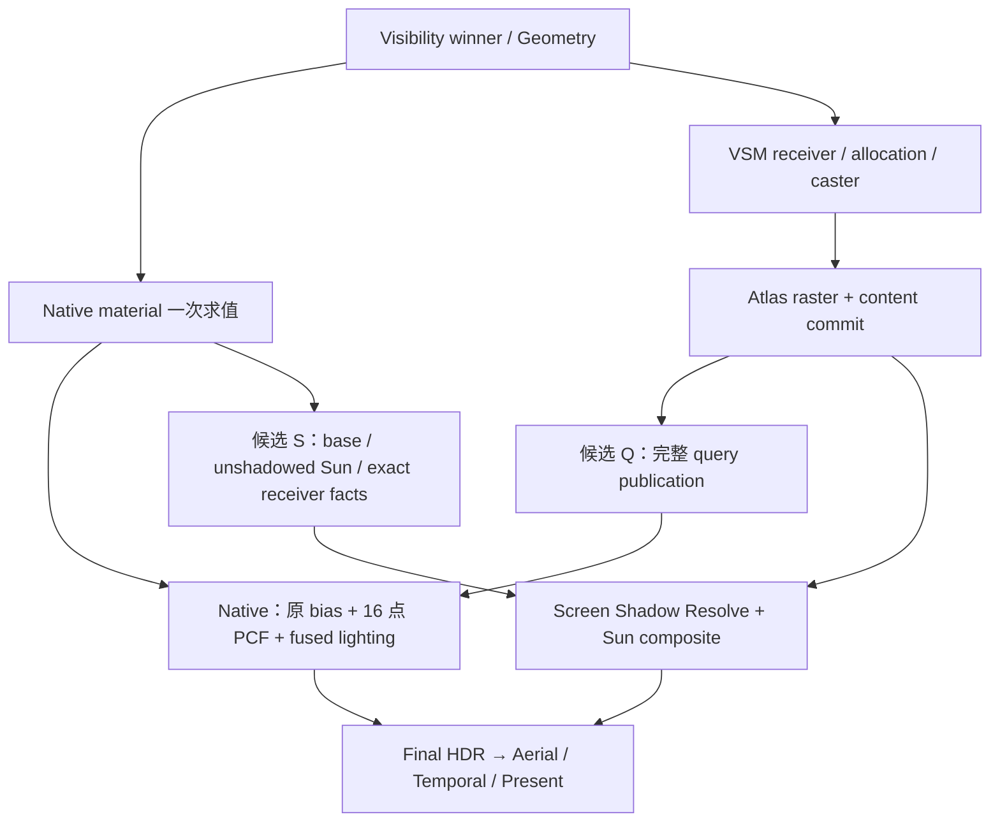

# EEngine V4：最终像素阶段与资源预算性能重构

> 历史 authority（2026-10-11 退休）：下一阶段目标由 [V5 Final Pixel Design](eengine-v5-final-pixel-performance-2026-10.md) 与其 Execution 唯一约束。本文保留当时设计/数据/失败，不作为新重构限制，也不追认性能通过。

本设计是当前性能模块的唯一设计依据；单元状态、实施顺序、真实代码切换及After结果只在[执行计划](../next-execution/eengine-v4-performance-optimization-execution-2026-10.md)。全局不变量继承[V4 Native Shading 母稿](./eengine-v4-native-shading-2026-10.md)，导航由 [workstream](../../project/workstreams/active/eengine-next-clean-rebuild.yaml) 持有。设计目标本身不证明实现或性能已经达标。

**决定：停止扩展高级效果，主攻 VSM consumer 的物理执行结构与 WebGPU 原生 Temporal；保留 GPU Scene→Virtual Geometry→Visibility→Native Material 主干。** 不把这一阶段缩成若干 ALU 小补丁，也不先承诺拆 pass 一定更快。完整重构必须能说明删除哪些生产工作、额外付出什么，以及如何证伪。

这是此前分析与用户提供的大胆方案的择优合并：VSM/Temporal提升为主攻架构单元；此前的IBL硬件采样、稳定depth域/局部失效和4GB预算保留为完整备选单元。不是逐项照抄附件，也不是把方案退回只有几个load/ALU的小修。方案选择优先消除百万pixel重复的管理工作、过大的shader live set和不必要的跨pass产品；支持“数毫秒量级热点值得完整重设”，不支持“新架构必定省几毫秒”的未测承诺。

初始源码审查锚点为 `f495f04bca30f6238fdb595f73bd83748534ba65`，原始方案中的“当前”指该版本；后续实现前必须复查源码。后续P1–P4采用/拒绝的设计修正明确标在对应章节，实际代码与验证出口以执行计划为准；其它新产品、shader、policy不因本文件 `state: current` 而视为已实现。

## 1. 目标、证据与成本边界

目标 GTX 1650 Ti 4GB，1920×1080、DPR=1、internal=output、renderScale=1、Dungeon 模型自身覆盖≥80%，固定视角约90.7%。不降低必需工作、画质或 feature 来证明性能。60FPS GPU budget 为16.67ms；稳定性还依赖 CPU、admission、浏览器与 presentation，GPU budget 通过不等于 Presented FPS=60。

Before 使用[原总报告](../performance/2026-10-10-dungeon-warkarma-performance-report.md)及后续[Native slicing](../performance/2026-10-11-dungeon-native-vsm-cost-unit.md)、[receiver aggregation After](../performance/2026-10-11-vsm-receiver-word-aggregation.md)。**不重跑完整旧 baseline。** 旧总报告full timing GPU P50约20.97ms，可比默认重复轮Native P50为9.157ms；它们是各自窗口指标。较新的受热/驻留影响窗口更重，不能混成同一条件的精准回退比例。

【实测事实】已有 `.local/validation/vsm-word-aggregation-2026-10-11/after-repeat/full-2.json` 的代表窗口：240 CPU 帧、60 GPU samples，GPU command span mean26.500/P50 26.456/P95 27.422ms，pass sum mean26.030ms，CPU host render P50/P95 2.440/4.235ms，Submitted FPS37.789，Presented FPS unavailable。GPU约90°C、thermal slowdown Active 100%、graphics clock P50 900MHz；queue completion P50 50.260ms不是单帧 GPU 时长。

下表是该窗口同帧、互斥类别的**均值**，不是各 pass P50 相加。分类只用于当前工作排名，不代表可分别全部消除。

| 成本桶 | mean ms | command span占比 | 判断 |
|---|---:|---:|---|
| Native winner shading，含 VSM sampling | 13.010 | 49.09% | 首要最终像素成本 |
| FSR3，不含 Native Temporal Facts | 6.331 | 23.89% | 第二主攻架构单元 |
| Geometry / Visibility / HZB 等准备 | 2.711 | 10.23% | 保留；不能声称全部亚毫秒或免费 |
| VSM receiver | 1.178 | 4.45% | 聚合已完成，暂不重做 |
| Environment，主要 Aerial | 0.818 | 3.09% | 保留现有功能，非本轮主攻 |
| Native Temporal Facts | 0.782 | 2.95% | 完整 identity / motion 合同不能删 |
| Execution bins | 0.540 | 2.04% | 保留 tile/indirect 执行 |
| Present radiance | 0.403 | 1.52% | 不混入 Presented FPS |
| 其它 VSM 与 bounds | 0.258 | 0.97% | 这是此稳态窗口，不代表运动场景 |
| timestamp spans 之外 | 0.470 | 1.77% | 不擅自归因 GPU idle 或 CPU |

Native+完整 Temporal 约占76%。26.50−16.67≈9.83ms 是该均值窗口的预算差，不是保证可获得的优化量。现有候选即使成功，也未证明足以一次达到60FPS。

【实测事实】Native 三轮累计 slice P50（ms）：

| slice | 真实边界 | 三轮 |
|---|---|---|
| A | winner/reconstruction，含防 DCE anchor | 2.224 / 2.319 / 2.474 |
| B0 | A + center material inputs | 2.397 / 2.401 / 2.556 |
| B | 三套 center/x/y inputs 与 derivative anchor | 2.812 / 3.159 / 3.044 |
| C | B + material evaluation / sampling | 3.508 / 3.932 / 4.232 |
| D | C + unit-incident BRDF 与 local direct | 3.995 / 4.355 / 4.528 |
| E | D + IBL | 5.989 / 6.795 / 7.129 |
| F | 完整 material/IBL/实际 atmosphere Sun，不执行 VSM | 6.222 / 6.582 / 6.805 |
| G | 完整 Native | 10.345 / 10.897 / 11.974 |

这是**差分定位数据，不可直接求和**。D→E约1.99–2.60ms支持 IBL 为重要候选；F→G约4.12–5.17ms支持整个 VSM consumer 分支重要，不能解释成 PCF 独占5ms或拆出后可全部收回。F−E两轮为负，原结果保留；D/E unit incident 与 F/G实际 Sun不是严格递增的可加阶段。没有 register/spill/occupancy/cache/DRAM 硬件计数，不能宣判 ALU bound、spill 或带宽 bound。

用户观察“关 VSM 增约10FPS”支持 VSM 值得主攻，尚不是 controlled After。帧率差要换成各自帧时间比较，例如50→60FPS对应20→16.67ms；未提供实际起止 FPS/热状态，不能倒推出本场景恰好节省多少毫秒。

## 2. 当前实现：问题属于哪里

| 调用链 / 源码事实 | 定性 | 设计含义 |
|---|---|---|
| `native_surface.ts::nativeSurfaceWgsl/nativeSurfaceBindingGroups`→geometry completion→三套 inputs→material evaluate→lighting | 已有正确 native 编译架构；存在执行成本 | 不恢复 VM、每材质全屏扫或 Universal SurfaceRecord。源码表达式重复不证明驱动未 CSE |
| `native_execution_bins.ts::classify/publish_tile` 与 `SurfaceV4` route dispatch | 已按8×8 tile、精确64-bit coverage mask组织 | 附件“材质路由破坏所有 screen coherence”过强；新 resolve 的优势需证明跨 bin 公共查询和更小 live set，而非声称当前完全不连续 |
| `native_surface_lighting.ts::nativeSurfacePhysicalSunWgsl`→`vsm_sample_directional(position, geometry.shading_normal, incident)`→query→PCF | 候选架构问题：复杂 VSM query 与 material/IBL live state 共存 | 融合本身不是已证明错误；分离后仍需承担 projection/PCF，且 material normal 依赖必须闭合 |
| `vsm_sampling.ts::vsm_lookup/vsm_query_directional/vsm_sample_page` | 当前 fine→coarse fallback、完整身份校验、16 point compare box filter | 页表 entry 12u32/48B是 ABI 容量，不代表每 pixel48B实际 DRAM；失败 PCF 去重不能凭“更少 load”复活 |
| `VsmReceiverDemandPass.addToGraph`→8×8精确 word聚合→完整 coarse | 已优化实现 | raw2,073,600→global36,154–36,168；组内 word重复≈98.256%，global fine323–324pages/39words，coarse114。不能把每组同word解释为同page、更不能当 resolved fallback分布 |
| `VsmGeneration.prepare`→caster/source revision变化→fullInvalidate/rebuildDepth | 动态架构风险：保守全域失效 | 普通页内 camera movement不导致每帧全失效；window滚动是pageQuantumChanged。geometry发布/retire可能改变sourceRevision，需要事件关联证据 |
| `Fsr3UpscalerRuntime.addToGraph`→Prepare→SPD→reactivity→instability→Accumulate→RCAS | 1:1仍支付通用时域算法与移植执行成本；值得替换物理图/算法 | FSR Native AA有真实作用，不能断言1:1所有pass无用。新算法必须重新证明 temporal质量与输入语义 |
| `Fsr3AccumulateShader.ts`同时写current_history与upscaled_output；RCAS只读RGB | 确定的重复产品 | RGB相同、alpha不同；可让RCAS读本帧写出的history版本，保留lock alpha，不需增加history |
| Dungeon `geometryMiB`默认1536、metadata128MiB | 配置与长期资源策略问题 | API能创建≠4GB平台预算合理；独立容量单元，不与 shader性能改动混测 |
| `negotiateVsmCapabilities`能满足limits就high4096²/6clips/4×4 | 当前是能力选择，不是性能选择 | 显式 quality 与performance policy应分离；默认high降低属于质量选项，不算同质量优化 |

CPU交互/Geometry canonical decode/数字 operation map 和receiver聚合已经有独立提交与报告，作为保留基础，不重复列为待优化收益。加载/Range/hash/LZ4/首帧编译不混入本模块；`fullQuality`不保证 geometry与VSM整个采样窗口已settled。

【实测事实】必须修正“raster近乎零所以无需关注”的概括：已有 `after-repeat/full-1.json` 60个样本中37个 raster>5ms，P50≈17.787ms，frame220约17.832ms、224约17.038ms，末段才降到≈0.01–0.015ms。full-2/full-3没有同类突发。额外 invalidate/depth-bounds dispatch与高值同现，仅是关联；终点dirty=0不能证明整窗没有工作。下一轮要记录逐帧invalidation reason、dirty、pairs、commit拒绝、source revision，保留突发和transition。

## 3. VSM Sampling / Projection V2：主攻架构单元

### 3.0 Shadow Projection 独立产品（2026-10-11 新授权）

**当前实施合同：S3生产源码已切入独立Projection→packed visibility→Native Sun，Native不再执行query/PCF；净性能验收仍未通过。** 用户已明确选择“架构剥离优先：保留生产重构，标明性能验收未通过”。S2首次搬移16点PCF的拒绝出口仍保留在执行§3.7/Git `7b6e6db1`，不能追认为性能成功；S3的Depth receiver/geometry-face bias、exact point重数/raw gather、Cost Card与数值门见下文，真实结果见执行§3.8。无人使用的v2 prototype fixtures退休，冻结旧sampling只作数值oracle，常规生产唯一owner，无运行时A/B。

以下先保留 S2 初版历史合同：用户新任务覆盖原 S 的「先完成材质再 resolve」限制，从 Visibility winner 精确重建世界位置与几何插值法线，VSM post-commit descriptors/atlas → 独立 8×8 Resolve → Directional Shadow Visibility → Native Sun。不是 GBuffer，没有 material graph、tangent、UV 或历史。S2 的 shadow bias 候选为几何插值法线；当前 S3 改为下文的 camera-facing geometry-face，BRDF/coat 继续使用材质法线。必须独立检查 normal-map 极端斜面 acne/peter-panning，不能称与旧 mapped-normal bias 逐 bit 相同。

第一版保留 clip、fine/coarse fallback、reverse-Z、gutter、4×4 PCF 和 radius。采用 core `r32uint` 四个水平像素/texel：每 byte 的低 5 bit 保存可见 tap 数，高 2 bit 保存 `tapsPerAxis-1`，消费为 `count/taps²`。物理宽度 `ceil(internalWidth/4)`，逻辑域仍是 internal-full。默认 4×4 的 k/16 **无量化误差**；1/2/3 taps 同样保留原计数/除法。R8Unorm 的 k/16 不能精确表示且 storage capability 不应凭格式名假设；本版不引入该混杂变量。debug 在同一产品编码类别，16B mode uniform 决定 palette，关闭诊断时不建额外 full-screen 产品。

共享范围只覆盖 fine descriptor：每 tile 的 lane 0 发布完整 `(selected clip, worldPageX, worldPageY)` 和 descriptor。其它 lane 完整 key 相等才复用，异 key/无效 leader 直接 lookup；fine 失败则每 lane 沿原坐标 coarse fallback。**不共享最终 coarse result**，同 fine page 不保证浮点计算后的 coarse window/page 相同。无 hash、atomics、容量溢出或跨帧 cache；边界/背景 lane 仍到达 barrier。若当前 query entropy 或成本不支持，拒绝该候选而不是增加第二套生产 renderer。

来源：WickedEngine MIT `7f776d02094571dd2c8166c7e5879d5e93d2b642` 的 `screenspaceshadowCS.hlsl` → `wiRenderer.cpp::Postprocess_ScreenSpaceShadow` → `lightingHF.hlsli` shadow-mask consumer，作为产品分离的架构参考。其 half-resolution、upsample、多光源打包、WaveActiveBitOr/RT API 不适合本任务，不移植；本地 precise geometry、descriptor broadcast、PCF 与 byte packing 为自主实现。该来源不证明 GTX/WebGPU 净收益。

S2 实施前历史 Cost Card（144B settings 属于 S2；当前 S3 为64B settings+16B mode，见下文）：

| 项目 | Before → After |
|---|---|
| Native 工作 | 每 receiver query/fallback/bias、16 depth taps、对应 live values → 一个 mask uint load、byte unpack、count/taps²；Sun irradiance/BRDF 不变 |
| Resolve 工作 | 新增 winner decode、3-corner position/normal + perspective interpolation、world→light、同样 query/bias/16 depth taps；几何读取/ALU是重复成本，不隐藏 |
| Descriptor 逻辑读取 | full fine tile 最好 64×16B → 16B；异 key 最坏仍64×16B；coarse不承诺减少；GPU cache 实际DRAM收益未知 |
| 产品 / 带宽 | 1080p 单产品2,073,600B（1.98MiB），每帧写同量、Native最坏每 pixel 4B load（7.91MiB逻辑，邻域cache未知）；无RGBA16F/法线附件 |
| 同步/调度 | +1 compute pass/dispatch，+2 workgroup barriers（广播/packing），约288B shared；0 atomics、0 history、0新frame submit |
| CPU / 常驻 | 新增两种几何 capability PSO按需缓存、144B settings+16B debug mode；bind-group资源缓存；FG瞬态跟随现有在途池，resize/abort不swap history |
| 最好 / 通常 / 最坏 | uniform fine tile减少63个descriptor lookup，Native分离减少live state；通常需真实测量；最坏高entropy仍付全query+重复重建+屏幕写读/同步税，可能变慢 |
| break-even | `embedded Native time - mask Native time > Resolve time +新增其它GPU税`，必须比较同帧Total P50/P95；寄存器/occupancy收益未实测不可预承诺 |

质量门在 After 前固定：query/status/slot/fallback 与旧采样 oracle 完全相同（同 geometry normal）；tap count/PCF visibility 和 mask roundtrip exact；旧 mapped-normal bias 差异另列 intentional semantic delta。HDR/material/LOD/motion/preExposure不得改；固定近景覆盖≥80%、相机/分辨率/功能不改。测试 fine/coarse、negative depth、gutter、clip/page边界、无receiver、partial tile、完整 generation/epoch、dirty/stale/missing、resize/abort/retry/loss/释放。真实整帧A/B保留失败/outliers和热频，不能以 Native 桶下降证明净改善。

S2 同单元重建税修订（实施前，2026-10-11）：实际 K 产品记录完整 visibility key，不拿 page coherence 代替 geometry coherence。2,073,600 receivers 中 1,680,257（81.03%）与 tile leader 的完整 winner key 相同，32,400 tile 中共 57,526 unique keys。首版 fine broadcast 的 Native+Resolve 差分未证明净收益；允许只在同一 Resolve 内广播 leader 的精确三角形 corners，不改 Geometry owner/产品/PCF。每 lane 仍验证完整 queue/instance generation、receives/bin/primitive；同 key 才复用 position/normal/coefficients/world-plane/flags，异 key 自己重建。不共享像素插值、bias、最终 PCF，也不建跨帧 cache。

该局部修订 Cost Card：新增176B workgroup triangle、一次 workgroup barrier和完整 key 比较；总 shared464B、3 barriers、无atomics/新pass/新产品/history。新增 leader→shared stores及匹配lane的shared loads；删除匹配非leader的3-corner geometry读取、object→world/normal transform、winner coefficients及world plane重建。默认非virtual属性读取逻辑至少3×(position12B+normal16B)，仍保留每lane winner/instance校验和插值，实际cache/DRAM省量未知。0%匹配时全重建加同步税；50%/100%时最多减少31/63次重建每64-lane tile；当前81.03%含leader，对应可删除约79.47%的lane重建而不是整个Resolve时间。best同triangle tile，expected依driver/shared live range未知，worst高entropy及低occupancy更慢。break-even是重复重建省时超过shared/barrier/register税；Resolve当前约3.5ms仅给局部收益上界，不能预报净收益。

静态 A/B 额外固定 geometry settled：pending/inflight/verified/retiring为0，resident/upload/evict/reload签名持续3秒且≥60 submitted frames不变。fullQuality不等于geometry settled。full profiler的120-sampled-frame预算在settled后重新开始，严格验证240-frame窗口60个full samples；早期混合full/coarse窗口保留为测量失败，不能选择性当稳态Before/After。

S2 历史出口：上述 triangle broadcast 数值通过但成本不支持采用，已从候选移除：该轮 Resolve P50 4.706ms、Native+Resolve同帧P50 10.019ms，新增shared/barrier/liveness未因81.03%匹配而自动赚钱；热频未配对，不能宣称精确退步百分比。S2最终候选只有 fine descriptor broadcast，288B shared/2 barriers，16点PCF保留。两轮 settled 整帧 A/B 同样未证明净收益，S2当时恢复embedded生产。当前S3按再次授权保留独立生产，不能把该历史出口当作当前ownership。新单元必须说明实际删除的主工作，而非仅搬桶；S3仅重排等价point-PCF执行，不授权history、resolution或Temporal改动。

### 3.1 先明确可分离的数学

2026-10-11 再授权单元 S3（实施前冻结）：S2 已证实单纯搬移16次读取不足，不重跑该方案。独立 Resolve 保留原三角形精确位置/插值几何法线、全域 packed mask、fine broadcast 和全部生命周期；本次允许调整 **PCF物理执行方式**，不调整PCF数学。默认4×4/radius0.75的每轴offset为 `[-.375,-.125,.125,.375]*radius`，原 `floor(localUV*pageSize+offset+.5)` 再按gutter clamp，仅有至多两个不同整数坐标。由原四个坐标逐项计算低/高坐标出现次数，二维权重为两轴次数乘积；读取至多四个不同深度后按原 `stored>0 && stored>reference+bias` 比较并加权，仍得到原16次point比较的精确k/16。不得以线性comparison过滤/新Gaussian/近似权重替代。其它合法taps/radius仍在同一个sampler内执行完整原支持域，并对默认路径检查实际端点跨度，不靠范围假设丢样本。

S3 Cost Card：删除默认receiver重复的12次逻辑depth reads（16→4）、重复地址生成与相同值比较；新增8个精确轴floor/clamp、低坐标计数、四个整数乘积权重。64B→16B逻辑depth载荷不等于DRAM节省，cache原可能已命中。Resolve仍付重复geometry重建、1.98MiB产品写/Native mask读、1dispatch、288B shared/2barriers，无新sampler/资源/history/atomics/submit。best为重复取样/texture instruction主导；expected未知；worst为原cache/编译器已去重，新增计数与register live范围亏损。0%采样节省仍承担S2的整套新增税；50/100%只对可删除texture指令成本做敏感性，不承诺整帧比例。break-even仍是旧embedded Native减新mask Native大于Resolve和全部新增税，必须全帧A/B证明。上一版Resolve4.2–4.8ms仅作这一完整pass上界，不把12/16当速度比例。

S3 receiver重构（第一轮后、下一轮实施前冻结）：精确PCF压缩本身的近景同帧Native+Resolve P50仍约9.63ms，不能关闭单元。接下来用已完成的reverse-depth和当前inverse-VP重建receiver position；水平/垂直各选择一个**完整VisibilityKey与center一致**的邻居，用同三角形的三个反投影点计算几何面法线并朝向相机。不同winner/背景/屏幕边界不参与求法线；任一轴无同winner邻居、非有限反投影或退化cross，仍从现有Geometry arena/immutable source精确求当前三角形面法线和位置，不能漏掉细线/单pixel三角形。有效depth0且key有效不被当背景。唯一shadow bias语义定为camera-facing几何面法线，替代旧mapped/interpolated normal；BRDF/coat继续原材质法线，不把新receiver position或bias称为与旧算法逐bit一致。

Receiver Cost Card：可支持像素删除3-corner immutable position/normal loads、解包、object→world/normal变换、winner系数及插值；新增center/最多四邻居key、最多三depth读、三次inverse-VP和cross/normalize。边界完整geometry分支也删除无consumer的vertex normal数据，只读position/几何面。新增camera624B借用uniform和depth借用view，无新全屏产品/history/atomic/pass/barrier，mask/sampling成本沿前述。best大三角形连续覆盖；0%支持时额外key/depth判定+完整geometry净亏，50/100%只代入实际可支持receiver比例；worst细碎几何和斜面depth量化造成数值风险，非有限/退化回完整source，不能近似漏work。break-even为删重建省时超过key/depth/inverse-VP/分支税；不因“用了depth”承诺收益。复核WickedEngine MIT原pin `normalsfromdepthCS.hlsl::main` 的3-point世界面法线和不连续失败经验；本地以相同winner限定邻居，不照搬最近深度猜表面、shared halo或normal压缩。

新增receiver验收：独立analytic平面/斜面、perspective、边界/单pixel及fallback的面法线朝向；normal-map不参与receiver而保留BRDF；双面/负缩放、near clip、细线和遮挡边界不能跨winner构造normal。沿用PCF逐bit合同（同position/normal输入）；depth反投影的量化差异与旧mapped bias属于单独质量比较，不能放宽material/HDR/LOD/motion容差来掩盖。未通过此质量门不能称AAA画质验收完成。

Receiver独立oracle在运行前定义：解析平面、斜面、perspective/mirror与强制geometry-source路径逐component法线误差≤2e-4（f32反投影/相邻差分允许量，不适用于放宽材质numeric）；depth路径只有在两axis长度>1000×world f32 ulp量级且非近平行时可用，否则完整source。该guard是执行条件，不删除receiver。普通与强制source的有效receiver一致，背景保持无效，必须实际出现depth与source两类结果，不能只用全neutral mask通过。量化风险/normal-map改变另留质量记录。

S3 raw-gather候选Cost Card（在最终A/B前冻结）：默认point地址合并后四个depth textureLoad进一步替换为一个raw depth textureGather；WGSL规定返回顺序是左下、右下、右上、左上，本地重排为原四点权重顺序，不用comparison sampler/双线性结果。协商atlas2048/4096均为二幂；`(lowTexel+1)/dimension`是精确f32坐标，位于2×2 footprint中心。非二幂保持四次load，其它radius/taps仍原完整循环，同一sampler函数无第二生产owner。删除3条取样指令不等于减少四个底层texel或DRAM；新增坐标换算、固定nonfiltering nearest/clamp sampler/一个绑定，无新增texture/pass/dispatch/shared/barrier/history。best取样指令吞吐主导；expected未知；worst gather执行更慢或额外零权重邻居消耗cache。0%指令收益承担坐标/绑定税，50/100%仅可删除指令成本的敏感性；break-even必须以Native+Resolve和Total同帧窗口判断。32,053点×24配置与冻结旧WGSL须逐bit一致，不能改比较/容差。

新增numeric门在After前固定：各tap轴1..4、radius0/.75/1/1.5/8、slot/gutter/page边界及相邻f32值、正/零/负reference和clear深度，与冻结原16tap shader逐bit相同；所有query状态、mask完整写域/尾部、abort/retry、generation/loss沿用。几何法线bias是S2已明确的有意语义变化，极端normal-map/掠射场景另验，不称与旧材质法线逐bit相同。来源重读Filament Apache-2.0 `764fe6cac9bdb4ba24d3d852344dfa04a5f70f75` `surface_shadowing.fs::ShadowSample_PCF_Low`：其四次comparison取样是Gaussian，拒绝直接移植；本地整数重数/原point box是自主推导。当前单元不改Temporal、receiver、allocator或resolution。

**以下Q/S是原设计的资格推导，保留作历史对照，不再是当前实施入口。S3方向已按新授权冻结；其质量/净性能限制仍必须如实报告。** 原embedded visibility依赖position、Sun direction、**材质mapped normal**、page完成状态、depth range和PCF；`receiver_cosine=max(dot(mappedNormal,Sun),1e-3)`决定normal/slope bias。附件提出的“Depth/Visibility→shadowMask→Native textureLoad”缺少mapped normal，直接用几何normal会改变阴影，尤其normal-map和grazing angle；S3已明确承认并设计为camera-facing几何面bias，而非声称旧normal数值不变。

【源码事实】`lighting_brdf.ts::re_direct_physical`的Standard/coat表达式对incident.color线性，在正常有限计算域可推导 `L_sun(V*irradiance)=V*L_sun(irradiance)`；这允许研究把**unshadowed Sun radiance**交给专用resolve，而非发布整套材质GBuffer。**但函数还有non-finite contribution提前return，不能把整个f32函数宣称无条件线性**：unshadowed计算溢出时先拒绝、再乘visibility，与原来先遮挡后求BRDF并不等价。S必须证明可支持数值域，或把BRDF系数/incident乘法与finite guard完整搬到正确的resolve阶段并重算成本；不准静默忽略极端输入或改guard来过测。无法闭合则拒绝S。所有现有lobe、色域/pre-exposure/alpha/diagnostic_mode必须验证，不扩展到未存在的transmission。浮点乘加顺序变化仍需既有numeric容差验证；线性实数推导不等于f32 bit-exact。

选择两种实际候选进行资格比较，最终只保留一个生产执行方案；不是添加永久 runtime A/B renderer。

**候选 Q（完整 query 预解析，PCF留在Native）**：VSM management/raster/content commit→sampling descriptor publication→Native读取descriptor→原UV/bias/16点PCF。把fine校验和coarse搜索从200万pixel迁到最多6×128²=98,304个fine-cell。descriptor建议16B/full cell：physical slot/valid status、resolved clip+mip、target failure status等；generation/projectionEpoch/namespace在完整producer校验与frame context保留，不能打包截断。只声明实际consumer字段，布局在实现前定案。

publication必须消费**完成后的pageTable/contentVersion**，不是allocator已占slot就标ready。第一次采用每帧完整写域，包括invalid/missing/dirty；约1.5MiB产品、一个GPU dispatch，不建persistent history。Native仍做原world→light/clip/localUV/bias和PCF，debug必须保留fine失败原因。fine-cell代表点是否可唯一决定coarse结果必须依据当前f32 `vsm_world_page`证明，尤其负坐标、window边界、coarse floor；不能仅凭整数网格比率认为天然等价。不能证明的边界在同一query实现中精确处理，或拒绝该layout。

Q目标是大量删除每pixel的full entry验证/fallback与缩短Native live set，新增便宜lookup；**不删除16PCF samples**。若query-only定位小到不足覆盖publication税，直接否决Q。

**P1定案的Q-exact支持域**：不以fine-cell代表点预选最终coarse结果。每clip分别发布fine和coarse管理记录的完整校验结果，Native保留原f32 clip/world/window与fallback顺序，按原pixel坐标读取这两种compact plane。descriptor为`slot_x/slot_y/status/reserved`四个u32（16B），mip由plane确定、target failure由原query流程保留；generation/epoch/namespace/world/mip/flags在当帧post-commit producer完整验证。high布局为`6×(128²+8²)=98,688`项、1,579,008B；这比原fine-cell布局多384项，同时避免未证明的f32 coarse映射假设。完整身份不是被压缩到descriptor，而是在同帧产品发布时校验；管理页表继续由allocator/caster消费。此版本删除重复管理entry检查，**不声称删除整个fallback计算或证明register下降**。是否采纳与实测净成本见执行计划§3.5。

**候选 S（完整屏幕Shadow Resolve与Sun合成）**：Native material求值一次→输出base radiance（非Sun）、unshadowedSun、receiver facts→VSM已完成atlas + screen-tile resolve→最终HDR→Aerial/Temporal/Present。resolve可合并PCF与最后合成，避免仅为一张无其它consumer的visibility mask多加一次composite。专用shadow visibility只有真实debug或额外consumer需要时才发布。**为了mapped normal正确，resolve在material事实之后；不是附件画的pre-material depth-only resolve。**

最小receiver facts优先是Native按原公式算出的reference、material bias coefficient与lightXY，避免存normal再重算或用depth反投影替代原position。这里coefficient是`filter.y + slope_bias + normal_bias`，**不是已乘depth_per_texel的最终bias**；后者依赖query得到的resolved level/mip，必须由resolve按原公式乘回。完整产品写域由Surface初始化加有效winner写入闭合，不能要求现有稀疏bin invocation凭空覆盖所有背景像素：`SurfaceV4.encode`当前先copy/clear HDR和Aux，Native的mask/invalid winner/interpolation分支可以提前return。新产品需要对应的全域初始化或等价完整writer，且明确unlit/non-receiver的无阴影标记。resolve不得读取上帧残留；不能用SunRGB是否为0推断receive或query状态。identity与receive验证沿winner/frame context；未接线 counter的0不当证明。

基线S布局保守使用f32，不先压half：两个rgba32float容纳baseRGB、unshadowedSunRGB及两个scalar仍不能同时装下lightXY+reference+bias coefficient四scalar，需第三个receiver product或另一个明确布局。三个rgba32float的保守48B/pixel跨pass产品约94.92MiB，native store48B + resolve read48B + final HDR store8B，对原8B store新增**96B/pixel≈189.84MiB/frame逻辑流量**；allocator峰值还含old/in-flight/resize。明确可研究的紧凑布局是`baseRGB+bias coefficient`、`SunRGB+reference`两张rgba32float，加一张rg32float lightXY，40B/pixel、79.10MiB中间容量、新增158.20MiB/frame逻辑流量；3个storage输出加现有reactive共4个，仍须完整limit协商和其他profile检查。40B是尚未闭合valid/receives-shadow/diagnostic字段的数值载荷预算，不是最终ABI；它们可从当前winner/instance产品读取，也可显式携带，但相应loads/字段必须入账，禁止占用正常f32输入或截断identity来凑40B。可进一步为32B/pixel仅当少存的coords由同数学恢复且numeric验证通过；32B版本新增约126.56MiB/frame逻辑流量。以上是full-rate shader store/read的逻辑预算，尚不包含新产品初始化、背景copy/clear、source reads或实际压缩/缓存，不能当实测DRAM流量。没有证明前不能把R8 mask约2MiB当方案全部成本。

可选变体是发布exact mapped normal与position，再重新求Sun BRDF；这会重复material/BRDF或输出更大材质产品，当前不推荐。先写unshadowed whole-HDR半精度再减Sun会有抵消/提前量化，不能当等价快捷路径。

S可更早让base/material shading不等待VSM atlas，但WebGPU不保证异步队列重叠收益；最终resolve仍依赖二者。新pass与依赖必须同一FrameGraph/encoder/submit，Renderer仍仅composition root。全部Native ordinary/Product、reactive/debug、resource-limited Sun continuation、neutral VSM binding都在同一个切换单元闭合；不能遗留部分route使用旧VSM再重复计费。

图中的Q/S是相互排斥的设计候选，不是两个同时生产的渲染器。S对material facts的依赖是本次源码审查对附件的关键修正。Q/S最终采用哪一个由资格与净成本决定；既有完整路径是迁移oracle，不作为永久fallback。

### 3.2 Tile-coherent lookup的正确边界

Q/S都可以研究screen-tile query共享，但先统计**完整query key/result**，不能沿用receiver word重复率。输入必须来自实际Native geometry reconstruction的position/lightXY与同帧VSM constants；receiver由depth反投影得到的位置可能在f32页边界落到另一key，不能拿它替代consumer统计。key至少覆盖selected clip、world page、mip与当前generation/projectionEpoch/namespace；同word有32不同page。不同page最终可能落到同coarse，但必须先完成同数学选择，不能猜测。

8×8组共享完整查询结果只消除相同key的query，不共享每pixelUV、material bias或PCF visibility。遇到超过组内容量/碰撞/partial组仍执行完整原工作；uniform barrier前无divergent return。不依赖subgroups/warp size/跨workgroup同步。是否采用聚合由完整key重复、现有cache与成本决定，不能在S第一版同时混入复杂local hash和新PCF。

### 3.3 Cost Card与资格判断

| 项目 | Q：query publication | S：screen resolve + Sun composite |
|---|---|---|
| 删除 | 每pixel细页完整entry检查/coarse搜索的可预解析部分；最多P次 | Native中的query/16点PCF及相关live state；lightXY/reference/material bias coefficient仍需在Native求值，最终UV/depth_per_texel转到resolve；全帧PCF仍在 |
| 新增bytes/访问 | N×16B写+原management读取，Native额外descriptor读；Q-exact high N=98,688；随机查变紧凑查 | baseline48B产品store/read；≈189.84MiB/frame新增逻辑流量，顺序screen读取；atlas仍随机/局部 |
| ALU/samples | 新producer N次resolve；PCF数量不变；不能按48Bentry推DRAM | Native写receiver facts/unshadowedSun；resolve per-pixel query/PCF/composite。PCF质量与samples不减；position重复重建若有必须入账 |
| atomics/barriers | 全写域无需新增全局atomic；tile共享是后续独立资格项 | 初版无需local aggregation；采用tile共享后另算组内存/barrier税 |
| dispatch/CPU | +1 publication；常态无逐pixelCPU allocation | +1 resolve/composite，另核算初始化pass/copy是否可并入现有步骤；Native route数不因材质实例上涨；+产品绑定/FrameGraph编码/冷编译 |
| working set | 约1.5MiB，含in-flight/resize峰值；无history | 保守94.92MiB中间产品；最终HDR/池alias/in-flight分别记账，不能假定全部瞬态免费 |
| best / expected / worst | fallback多/像素多最好；通常未知；query本已cache好且窗口稀疏最坏 | Native register瓶颈且screen查询一致最好；通常未知；纯texture/cache占主导、带宽紧张/内存驻留变化时更慢 |
| break-even | `P*省下query成本 > N*publication成本 + 新lookup/依赖/容量税` | `Native执行节省 > resolve成本 + 中间读写 + dependency/峰值税`；少了Native时间不等于全帧省了 |

0%收益时Q/S管理税均为净亏，拒绝；50%/100%只是代入“被测可删除query/执行惩罚”的敏感性变量，不是预测。任何局部收益不能超过完整Native成本；F→G 4.12–5.17ms只给定位量级，S新增整个resolve后不能拿它直接当收益上限或承诺减到1.5–2.5ms。即使出现Native显著变快，Native+resolve+其它consumer同帧净成本与Total GPU必须一起验证。

**推荐入口**：先用现有slicing补一项query-only/PCF-only受控定位与完整key统计，完成Q/S容量和numeric资格。按净删除工作的证据、新增税与支持域选择一个：query足够大且publication税小支持Q；能够闭合material/HDR合同、且独立resolve与中间流量仍有净收益空间支持S。**不因为Q改动较小就自动先做Q，也不因S更像大重构就跳过成本判断；收益证据相近时优先低税Q。** S不以取得通常不可用的硬件occupancy计数为准入前提，缺计数时执行惩罚原因保持假设，最终由完整候选净成本决定。Q/S均不具备资格则拒绝VSM拆分，停在Temporal入口，不退回持续PCF微调。

### 3.4 Hardware PCF与动态page系统

Filament四次comparison fetch的Gaussian3×3与当前4×4 point box不同。reverse-depth clear0、负reference、自定义bias、gutter、boundary与comparison sampler过滤支持也要独立证明。**同质量精确路径保持当前box语义；PCF V2算法替换作为条件单元，质量可能变好也可能改变轮廓，不能默认“≥旧质量”。** 允许研究等效权重的硬件compare，但原point-tap重复权重与fractionalbilinear权重不是自动一致。旧失败整数去重记录保留；再次授权的S3是从原四轴point地址计算重复次数的向量实现与raw gather，不追认旧失败，也不采用Gaussian。

`VsmAllocatePagesPass`约10段dispatch与slot扫描是真实实现成本，但代表稳态其它VSM仅≈0.258ms，不能因为图复杂就先persistent free/eviction queues。若运动/压力样本证明management大，才设计free queue、可回收candidate与dirty append；需完整coarse保护、slot唯一owner、ABA/epoch、overflow、取消/重新提交，不新增current-frameCPU控制。

【源码事实，P5】`RendererCore` caster/source及GPU Scene提交revision→`VsmGeneration.rebuildDepth`→完整caster快照/old+new损伤→局部slot dirty→原allocation/pair/raster/commit。内容变化不再推进projection epoch；page→asset CSR将实际upload/retire映射到全部相关asset实例，包含离屏caster，保留完整slot/generation。MASK未知coverage/纹理publication保守损伤全部MASK；material替换、cast flags/removal、affine/shear/负缩放均比较旧新记录。普通运动不reset temporal，Sun/scene/device/extent/reset仍全失效。数量变化重建快照并全内容dirty，不能读取未初始化历史。

Depth归约仍包括全部caster。新padded域被旧域包含时保持reverse-depth编码逐位不变；域扩大只能先撤销全部内容ready再重绘，保持世界projection身份。全部clip/mip/coarse按原pairing gutter交测试；无CPU可见/work控制、无额外frame submit。GPU非法bounds/损伤overflow保守all-dirty并保留failure，原caster failure链拒绝错误ready。实测支持减少流送更新突发，不证明稳态60FPS；Cost Card、source帧数量/热状态差异、正确性与原始结果见执行§6.2。

## 4. Temporal V2：针对1:1重新设计执行与算法

这是第二主攻架构单元，不把目标限制为FSR源代码逐行parity。**按真实服务域选择policy**：internal=output采用Native Temporal Resolve；实际upscale仍由upscaler能力负责。唯一Temporal owner、同一commit/abort事务与FrameGraph；不永久保留“旧FSR benchmark renderer/new production renderer”。迁移期间reference仅oracle/离线fixture，切换后旧Native-AA执行图删除；有真实缩放consumer的FSR保留作为另一服务域，不是测试fallback。

【初始Before，不是最新执行图】1:1原完整链代表full-2 pass P50/P95（ms）：Facts .747/1.090；Prepare .683/.707；Reactivity 1.077/1.358；ShadingSPD .832/.870；LumaSPD .197/.211；ShadingChange .059/.062；LumaInstability .475/.496；Accumulate 2.579/2.955；RCAS .278/.291；preExposure .0084/.0106。不能相加重建stage。clear locks timestamp0不证明无成本；SPD声明多mip也不证明未消费mip都逃过FrameGraph culling而被执行。T3最新生产图与验收边界见执行§4.5。

### 4.1 先做同算法执行闭包，作为V2可退守的成果

`AccumulatePass.addToGraph`返回的**写后currentHistory ResourceId**可直接作为RCAS输入；保留history alpha lock、RCAS输出alpha1，去掉重复upscaled RGBA16F产品与store。删除8B/pixel=15.82MiB/frame逻辑store，一个storage binding/瞬态产品，无新增history、pass或atomic；物理pool峰值减少量需实测alias，不能保证VRAM下降15.82MiB。

Accumulate当前3×3 current-color邻域可在1:1用10×10 f32 tile替代64lane×9=576次逻辑load为100次；1,600B vec4共享内存+uniform barrier+零初始化+halo/index ALU。`top_left`与flip调整后集合仍为[-1,0,1]，保留遍历/加权顺序、clamp与pixel-dependent initial tonemap；不是去掉derivative或换historyfilter。16-tap motion-dependent history不是同一screen邻域，不能一起强行共享。其它比例需要真实坐标footprint方案或同owner泛用kernel，不能假装1:1证明覆盖所有ratio。

这两个改变不是V2全部目标，而是明确可删除的工作和保持当前算法的退守边界。纹理cache可能已经复用大量邻域，100/576不是GPU加速比；不能因ALU搬到shared而增加occupancy税后仍声称赚钱。

### 4.2 Native Temporal目标图与不可融合边界

目标图为：Native Temporal Facts→Temporal Analysis/Scatter→Depth Resolve +局部classification→Temporal Resolve→保留质量所需Sharpen/Output。希望减少重复depth/motion/luma全帧读写与SPD中间产品，不硬性要求“总共2个dispatch”。Facts、radiometry实际consumer仍独立；支持同帧depth scatter时必须存在**全域scatter完成→depth读取**的dispatch边界，workgroupBarrier不能充当device-wide同步。

Analysis tile共享depth/color邻域，按完整validity和identity选motion；Depth Resolve消费当前frame scatter对应prior UV的最近depth，输出disocclusion/confidence；在有真实局部数学依据时合并reactivity/局部luma分析。Resolve重投影HDR history→exposure ratio校正→YCoCg/合理color domain rectification→身份/遮挡/reactive rejection→锁/置信累计→HDR输出。filter/lock/statistics可以重新设计，但每项改变需单独量化质量影响，不把删SPD/luma instability当无功能损失。

最初保留现有rgba32uint identity history的**完整四字段与当前判定语义**。`native_surface_aux.ts`实际写入`[instanceSlot+1, geometrySignature, materialSignature, materialSlot+1]`；两个signature已经是现有u32 hash，其中geometry signature输入instance-set generation、geometry generation和geometry slot，material signature输入handle/flags/slot与publication版本。它不是逐像素存page/generation/primitive全tuple，也不能声称collision-free。**禁止本优化再缩字段、截generation或把已有四字段换成一个hash**；如需提高signature碰撞保证，应另开身份合同单元，不冒充此次Temporal性能重构已解决。当前刻意不以triangle/meshlet/LOD winner切换硬拒绝history，V2不得引入这种reset。重用Facts的motion/validity/hard replacement，避免再次恢复原材质求值。geometry publication普通resident细化与真正replacement的history规则继续由原owner定义，不能统一强reset掩盖不正确运动。

`TemporalFabric.begin/markProduced/commit/abort`与history registry继续拥有提交事务，新的Temporal实现只拥有自己实际color/confidence/depth等GPU资源。defer未提交不交换history；普通camera motion继续重投影，camera cut/policy或支持域改变才按合同reset。新实现接入同一FrameProgram输出与radiometry/pre-exposure产品，不能把算法重构做成第二个独立submit的upscaler插件。

可研究current scatter双缓冲、在Depth Resolve中完整clear下一buffer，删除独立clear；会增加4B/pixel=7.91MiB持久buffer，不能当零内存优化。resize、新建、裁剪domain扩大、pre-submit abort/retry、同批in-flight使用必须完整初始化和事务索引；不能假定上一帧每pixel都执行过clear。保留reverse-device-depth atomicMax与零clear，或完整推导正linear-depth atomicMin与+inf；不混用pmndrs的方向/符号。

Shading-change替换SPD为workgroup-local多尺度block均值有潜力；跨tile footprint需halo/独立归约，不能在block边界丢支持域。平均luma再取ratio与平均per-texelratio不是同算法，8-frame block history也不是免费管理；先用最少真实消费产品，有足够闪烁/响应证据再选择history。当前不默认新增8帧cache。

RCAS维持当前质量入口。若新resolve要代替锐化，需证明同质量/无HDRovershoot，不默认禁用或便宜近似。算法改变允许与当前不同，但须有可接受的质量结论；用户要求大胆设计不等于已接受细线、运动或HDR退化。

### 4.3 Cost Card：Temporal V2

**T3实施后的设计修正（2026-10-11）**：重新设计的完整TAA/局部shading detector在冻结HDR、thin/运动/light-step门失败，拒绝采用；没有为了删除SPD改阈值。当前选择1:1专用执行重构：原Prepare/两种SPD保留质量消费者，Depth Classification→融合instability/thin-lock/当前重建的Native Resolve→原RCAS。删独立new-lock R8/instability R16产品、一个compute与locks clear；persistent history不缩。1:1固定滤波权重每帧计算一次，经96B产品传递；固定9tap静态寻址与16tap历史流式累计避免已实测的dynamic indexing/live-array税。仅精确整数texel中心时删除零支持历史tap，分数位置保留全部16点；浮点与数学等价分开验收。shared confidence和更宽motion intermediate成本候选亦撤回。局部完整链两轮正收益支持这个有界执行候选，但整帧Total/P95净收益和完整动态质量未通过，不能称原定全部算法重构或60FPS完成。以下原表仍为研究候选，不代表全部已采用；实际Cost Card与失败/After见执行§4.5。

| 删除目标 | 新增工作 / 限制 |
|---|---|
| 重复upscaled output store | RCAS改读写后history；无新产品，确定删除15.82MiB/frame逻辑store |
| current-color逐lane重复邻域读取 | f32 shared halo、index、至少一个uniform barrier；576→100仅对8×8/1:1 current邻域 |
| 若质量证明成立：ShadingSPD/resolve和部分luma/lock中间读写 | shared多尺度归约、history reproject与classification；有必要的halo/额外历史全部入账 |
| 若采用ping-pong：reconstructed clear pass | 新增7.91MiB depth buffer和next全域clear写；首次/resize/abort恢复税不能删 |
| 1:1通用upscale逻辑与冗余产品 | 新analysis/resolve kernel、pipeline compile、bindings与policy切换；不增加frame submit |

最好：少全帧产品/重复ALU、tile访问一致、V2质量可用；通常净收益未知；最坏：新history与shared降低occupancy、质量为补救重新加pass、散射/跨tile依赖仍重、policy切换频繁。break-even为删除pass/访存/重复ALU大于新分析/halo/sync/quality补救与驻留税；0%净省则拒绝切换。50%和100%删除某个旧阶段不证明整Temporal等比例变快。完整Temporal约6–7ms量级只给当前工作上界，Facts与不可替代时域工作仍在，**不承诺2–3ms**。

## 5. IBL与容量：完整单元，不能被误当成已解决

### 5.1 IBL硬件友好publication/filtering

Before `native_environment`通常执行diffuse4 load、specular8、DFG4、AO1，共17逻辑loads，coat再加8；oct wrap对每neighbor做integer divide/modulo/parity reflection。`rgba16float`支持filtered采样，但Before layout把IBL5/6/7设为unfilterable-float。初始目标保持GGX128 samples、diffuse256 samples、roughness→LOD映射、DFG(Fc,total visibility)与single scattering；把seam处理移到环境发布，Native用硬件filter。以下为候选设计，实际采用与拒绝以执行结果为准。

推荐每原mip tile有1-texel ring与corner，由现有oct_wrap生成，compact atlas显式记录origin/size；sample坐标 `(origin+1+octUV*N_l)/atlasSize`，硬件texel−0.5与原bilinear对齐；两次LOD0 atlas fetch按原roughness LOD混合，不给atlas自动mip。DFG直接linear/clamp原64²LUT。ring来自完成的原mip，不能同dispatch跨workgroup读尚未完成的邻接output。原filtered scratch只存到conversion完成，随后fenced retirement，不永久保留两套IBL产品。

这里有真实capacity风险：Physical Sky固定128²/8mips容易；authored允许任意合法square/NPOT，device maxDimension及累计256MiB预算约束。constant-resolution array浪费严重：128/8层130²约1.03MiB而原specular约.167MiB；1024/11层约88MiB，不推荐。示例vertical compact128为130×271×8≈275KiB，但它不是覆盖全部支持域的最终packer。N+2可能超过device limit；新atlas、scratch、outgoing/in-flight叠加可把旧合法输入挤出256MiB。

**实施前必须证明支持域不缩水**：逐尺寸/format计算当前 `raw + 2*rgba16floatMipChain + diffuse + DFG + allocatedBytes`，与新布局完整peak比较；不准默默缩源尺寸或新增unsupported。布局无法闭合时，研究原mip storage上“interior hardware bilinear、仅接缝按原wrap”的单helper分段算法（含branch/liveness成本），或拒绝本candidate；不是为了atlas强迫allocator大改。最终只选一种完整publication/sampling方案，不建复杂capability framework。

Cost Card：normal非coat逻辑filter调用由16点loads→diffuse1/spec2/DFG1 filtered fetch，AOload不变；底层过滤仍可能读16个texel，**不是4× DRAM节省**。删除重复地址/wrap/mix ALU，增加sampler、tile metadata/绑定、每环境publication conversion/gutter dispatch与scratch峰值，无每帧额外history/atomic。physical sky `record→pending views→commit(gpuDone)→active/retired`、authored `record/onAborted/onFinished/gpuDone`同时切换；原runtime同frame encoder、不增加submit。camera探针量化/Sun变化导致更新频繁时，新增发布税可能吞掉每pixel收益。best静态环境/pixel多；worst持续重烘焙、大源/预算边界或driver filtered rounding不通过；break-even为累计Native省时大于publication及峰值税。0%拒绝、50/100%是删除手工采样工作的敏感性，不是IBL整体收益。D→E约2–2.6ms仅定位区间。

当前lit consumer由physical/authored供IBL，unlit不采样；`neutralLightingEntries`只覆盖VSM/AO，不存在要迁移的neutral IBL owner。`environment_ibl.ts`未接线的旧background/diffuse常量不是production consumer；prefilter自身helpers不得因Native换sample就一起改数学。

**P3实现后的设计修正（2026-10-11）**：padded atlas不能覆盖原maxDimension/累计峰值域；interior硬件radiance过滤也在合法NPOT HDR亮点上违反原数值容差，拒绝采用，不能把“支持filterable”当同质量证明。最终使用同mip rgba16float产品、Native有界oct neighbor寻址和原四点f32插值，删除通用division/modulo；DFG单独hardware linear/clamp已通过原积分/数值检查。没有gutter/conversion/new texture/new dispatch，原producer采样数学和容量不改。原radiance硬件方案不留生产fallback或诊断分支。实际Cost Card、After、拒绝与生命周期见执行§5，不能据此宣称整个IBL已变为四fetch。

### 5.2 Memory预算V2

原API live≈2348.30MiB、peak下界≈2423.45MiB；Geometry banks1536+metadata128占1664MiB。固定pages1207对应1224个256KiB物理slot≈306MiB，原无eviction实验uploaded payload28.97MiB、约9.47% slot利用；这个累计上传量不是通用resident有效载荷计数。BC7array133.33、VSM76.14（atlas64）、FSR75.15、Facts identity双缓冲63.28、Atmosphere16.16MiB等必须分owner独立记账。

原512MiB banks实验可删除1GiB nominal容量且固定view pages相同，尚不证明运动集足够或FPS收益。Windows专用/共享由约2584/159变为1647–1668/1050–1067MiB，Chrome working set上升，不能从API容量不变断言无驻留问题，也不能从shared上升宣判paging已证实。

路线：先显式platform/scene negotiated budget与完整accounting，再研究**分bank渐增的physical pool**。当前四bank绑定/slot寻址不是天然growable；WebGPU buffer不原地resize，增长可能需要new bank/copy/完整directory原子发布/old fenced退休，短期峰值反而更大。先可独立调安全容量，不先承诺512→640→768免费扩容。预算不能靠adapter型号猜VRAM，浏览器无可靠通用dedicated-budget API；使用显式target profile/device limits/scene需求，未知设备保守透明策略。

Cost边界：budget调小不删除采样/ALU/dispatch，只删unused nominalbytes；一旦超working set新增evict/reload/IO/upload与VSM invalidation、P95可能恶化。growable最好静态小场景省容量，最坏迁移overlap+频繁增长与retire；break-even是容量/驻留收益超过copy、publication与reload税。variable-page/subpage可提高低密度，但涉及格式/地址/全部consumer，另开后续架构任务，本阶段不搭便车。

**P4实施后的设计修正（2026-10-11，承接§5.2）**：先关闭独立容量单元，未实现growable pool。Dungeon应用显式选择`target-4gb`：2GiB诊断API envelope内分配geometry512MiB、metadata128MiB、其余owner/峰值余量1408MiB；不猜adapter型号，不把这份配置称为全局allocator硬限额或Windows驻留保证。raw/cooked/诊断runner使用同一默认；显式容量override标为custom，非法输入拒绝。现有四等大bank/device-limit协商与完整identity、feedback/eviction合同不变。

记账分别报告当前payload、resident/retiring固定slots、bank空余、metadata各区间使用量、全部已观测显式API资源的live与**同时**peak及owner构成；未知format/未显式destroy资源不能当作0。完整API审计仅diagnostic开启，生产`GraphicsContext`统计仍为partial并明确标名。实测当前Dungeon全部1207pages在512MiB内驻留；受控运动加载结束后无evict/reload或source revision增长。该证据只支持这个静态Product集合，不保证更大/可编辑场景；峰值与运动加载前段原始数据不删。实际容量下降1GiB，GPU稳态帧时未证明改善，释放缺项已补齐；详细Cost Card/验证/热状态见执行§6.1。

## 6. 开源执行方式、附件采纳与拒绝

固定来源及本地映射见[Source Map](../porting/next-renderer.md#性能模块研究映射2026-10-11)。均是研究依据，未声称新方案已移植/adopted。

| 来源 | 吸收什么 | 不能照搬或宣称什么 |
|---|---|---|
| Blender EEVEE tilemap finalize/read_depth | management后发布compact最终采样地址，O(1)consumer | GPL源码仅architecture参考，自主WGSL；其layout/mip/native执行不直接适配WebGPU；不证明本项目更快 |
| Filament IBL | hardware textureLod/filtering，DFG/coat语义 | cubemap≠oct atlas；不能换掉本项目single-scatter物理模型 |
| Filament PCF | comparison filtering与优化权重的实际shader | Gaussian≠当前box，质量/反深度需重新证明 |
| AMD FSR3 | sharpen permutation直接RCAS读current history；精确depth/lock/HDR数学 | wave64/fp16/native SPD执行不能盲目搬；WebGPU虽有global buffer atomics，不能据此保证device-wide单dispatch进度/同步 |
| WickedEngine TAA | current color/depth shared tile、barrier后neighborhood reuse | packed half/Gather、较简单history/拒绝合同不等于EEngine FSR同质量 |
| pmndrs/upscaler | WebGPU scatter→depth clip边界、双buffer clear、多尺度shared detector与实测拒绝source graph | ratio2/Apple Metal数字不外推1650/native1:1；重推ratio、vote、8帧blockmemory、historyfilter与HDR conditioning是算法变化 |

pmndrs固定revision `5821d915c4e3a595c913d399e832155d8dade338`、MIT。实际production `Upscaler::_encodeGuides/_encodeLate`仍有多个dispatch；不是已经实现“两kernel全部Temporal”。其PARITY记录source-style +36%/+76%及.044/.231ms来自Apple Metal、1920×1080输出、ratio2旧实验，后续block spread/history修改未重新计时；只能证明重设物理图值得研究。其RCAS曾用8bit画面证明“无差”，HDR读回后来发现约1000×fireflies；其简化cross-frame depth也曾在dolly失效，production恢复了same-frame scatter+独立depthclip。**本设计把这两个失败作为强制数值/动态验收范围。** 不采用其独立commandEncoder/queue.submit或bench overrides进入生产。

采纳附件的大方向：VSM projection独立成本桶、可分离consumer、Native-resolution Temporal policy、预算与capability分开。拒绝附件的过强结论：VSM“放错位置”已证实、98%word重复等于所有query可共享、固定终点dirty=0代表窗口无raster、2–3ms预测、架构/实现/配置50/30/20比例、永久FSRReferencePath、默认降scale/禁RCAS、4fetch Gaussian自动同质量。没有这些前提也可以大胆重构，但必须付账与验收。

## 7. 方案顺序、验收与停止

优先级按“可改变的大成本×证据×新增税/质量风险”确定，而非dispatch数。**主线先VSM consumer资格与一个完整切换单元，再Temporal V2；IBL作为证据强的独立候选，Memory/动态VSM根据结果与驻留压力插入，不并行修改生产变量。** 若VSM候选证伪，直接转Temporal，不为交付优化硬保留S。若新Temporal质量不能闭合，同算法执行优化仍可独立保留，算法替换不切生产。

禁止继续高级VT/GI/SSR/ReSTIR/透明介质/新光照扩展。恢复条件：目标device上的同质量1080p GPU budget/尾帧、交互、动态/压力正确性、内存/overflow/lifecycle证据可审查；性能尚未到目标时明确剩余gap，由用户重新决定预算/质量和新增effects。此前VSM模块R4验收义务仍未完成，性能报告不能代替它；Minimal GPU Work暂停不自动解除。

所有单元保留winner/shaded coverage、material numeric、导数/LOD、normal/coat、HDR/pre-exposure、motion/reactivity/完整identity、caster/fine/coarse/gutter/overflow、publication atomicity与abort/retry/device loss。测量与instrumented统计分开；normal interaction与max-throughput分开。CPU+GPU不相加，各pass分位数不相加。硬件热/驻留不可比则给区间与限制，不输出精确百分比。

缺失证据包括query/PCF独立贡献、full-key每组entropy、Native register/spill/occupancy、驱动cache/DRAM计数、逐资源OSresidency、raster突发因果、运动/太阳/material变化VSM成本、Temporal长期HDR/细线/动态质量、4GB平台峰值与增长生命周期。执行计划以最小足够实验补齐；本设计不把它们包装成已验证事实。
