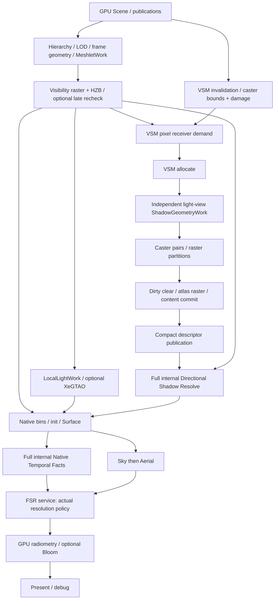
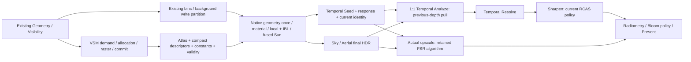

# EEngine V5 Final Pixel Performance Architecture

本文件冻结下一阶段的**目标架构**：Logical VSM Separation + Physical Sun Fusion；Native Surface 单次昂贵重建并生成 Temporal Seed；1:1 Temporal 使用 previous-depth pull 的 Analyze → Resolve → sharpen 图。只选这一主架构。V5 是 Final Pixel 模块版本，继续遵守 [V4 Native Shading 母稿](eengine-v4-native-shading-2026-10.md)的全局不变量，不重建 Geometry Frontend。

迁移与单元出口由[唯一执行 authority](../next-execution/eengine-v5-final-pixel-performance-execution-2026-10.md)管理。旧 V4 performance 两文保留历史证据，不再约束新目标。本文不追加候选实验日志；实验进入 `docs/performance/`，执行文只链接结果。最初架构冻结仅交付文档；后续用户授权Phase1非生产实施，当前范围与完成状态只读执行authority，不自动跨Phase。

## 1. Current source truth

2026-10-11 source gate：`HEAD = 49fcaa300fafcbbe3db142df403baa3487f89956`；起始 `git status --short` 仅 `?? .vscode/`。当时 workstream 为 `performance-optimization-v4`，authority 为 V4 performance design/execution，minimal-GPU-work 与 VSM 功能扩展仍暂停。本文交付时只更新文档 authority；HEAD 的 production 实现仍是下述现状。

最近相关提交：`49fcaa30` Native-resolution 部分 Temporal 替换；`c6e8d31d` S3 独立 Shadow Resolve；`7b6e6db1` 独立投影候选拒绝记录；`9ca9ae1f` local caster invalidation；`6eb77e8d` 4GB 应用容量；`941345ad` IBL 精确寻址/DFG；`b87a991d` shared tile 拒绝；`5850fa31` Accumulate 重复输出删除；`f6f7189f` compact sampling descriptors；`f495f04b` receiver word aggregation。提交名称不证明收益。

事实优先级：production source > 实际测量 > 当前物理执行图 > design intent > execution status > commit message。以下入口按函数正文、绑定、直接 consumer 和生命周期核对，不以 diff 代替源码：

| 范围 | 主要源码入口与核对内容 |
|---|---|
| lowering / graph | `FrameProgramLowering::lowerSceneFrame/lowerVisibility`；`FrameGraph::compile/executeCompiled`，版本边、side-effect 保留、裁剪与 fence 后 pool 回收 |
| Native | `SurfaceV4::prepare/encode`、`NativeExecutionBins`、`native_surface::nativeSurfaceWgsl/nativeSurfacePublicationDescriptors`、geometry completion/reader、material directory 与 Native Sun |
| VSM | receiver、allocate、caster records、atlas raster、content commit、sampling publication、Shadow Resolve；generation、resources、capabilities、projection、page-state；对应 WGSL |
| Temporal | `NativeTemporalFactsPass` / `native_surface_aux`；`TemporalFabric`；`Fsr3UpscalerRuntime` 的两域 graph/history 事务；Prepare、Luma/Shading SPD、Native classification/resolve、RCAS |
| GPU publication | Instance 176B / FrameInstance 288B ABI、`GpuNativeMaterialPublication/Scene`、`GpuShadingPublication`、Geometry Product admission、frame geometry 与虚拟目录/四 bank 消费 |

**两处必须纠正的源码事实**：

1. NativeTemporalFacts 虽绑定 asset metadata / vertex payload，当前 WGSL **没有读取这两个 buffer**，也没有 `geometry_complete_resolved` / 三 corner 重建。它重复的是 winner/instance/material access 和 depth→world→previous clip；不能写成“三个 pass 都完整解码三角形”。
2. 默认 `filterRadiusTexels=.75` 经 `packVsmSamplingConstants` 得到 `filter_params.w=1.5`。`vsm_sample_page` 的四 tap 轴压缩分支要求这个 width/radius 参数 `<=1`，默认不满足，实际仍是 **16 point loads**。已有精确压缩资产有效，但不能把默认生产热路径写成一次 gather。后续不得暗改 .75 半径换性能。

## 2. 当前 scene frame 物理执行图

`I = W×H` 为 internal extent；`O` 为 output extent；目标 I=O=1920×1080、N=2,073,600。下图是资源依赖 DAG，分支不代表新增 submit，也不意味着所有列出的 CPU owner 各自一个 GPU pass。



### 2.1 阶段账本：producer、产品、direct consumer、访存

| 阶段 / domain | Producer、输入 → 输出 → direct consumers | 实际物理工作与重建 | 访存 / history / atomics / barriers |
|---|---|---|---|
| GPU Scene / object domain | Scene、material、Geometry/Product publication → instance/asset/vertex/virtual directory/四 banks、material directory/constants/versions → Geometry、VSM、Native、Facts | CPU authored updates + GPU frame preparation；不是一次 full-screen dispatch | 稳定表/生命周期精确 generation；current/previous affine；upload/copy；不新增本帧 GPU→CPU→GPU work control |
| Geometry / work + I | hierarchy/LOD/HZB + Scene → MeshletWork、FrameInstance、FrameGeometry、Visibility R32Uint、Depth32 → receiver、Shadow、Native、Facts、AO、HZB | work-domain compute、partitioned alpha-aware raster；HZB mip compute；可选 late recheck 与 final HZB | work append/scan/indirect、阶段边；previous HZB；不属于本轮重构 |
| VSM invalidation / instances + slots | generation/source/caster revisions、instances → stable depth range、damage、dirty/content marker → demand/allocation/raster | conditional instance bounds reduction → publish depth → resident slot damage；不是 full-screen | snapshot/source/damage buffers；局部损伤替代整 atlas 失效；clear/copy、append atomics/reduction barriers；持久 residency |
| VSM Receiver / I + page domain | Visibility/Depth/work/**Scene instances**/camera/projection → requested page bitset → Allocate | 8×8 full I；depth→world、flags、clip/page projection；WG 64-key word aggregation；随后 coarse plane 请求 | 当前有效 receiver 全屏扫描；512B shared key/mask；uniform barrier、shared CAS/OR 和 global atomicOr（含正确 fallback）；requested bitset clear；没有三 corner material 重建 |
| VSM Allocate / pages + slots | demand、page/meta/content → allocation/dirty list、page/meta versions → ShadowGeometryWork、caster/raster | count/prefix/scatter/touch/collect/miss count/prefix/scatter/allocate/publishDirty，10 个 compute stages，GPU indirect | page 48B/entry、meta 32B/slot、scan/bitset；atomic bookkeeping、dispatch 边；不是像素着色域 |
| VSM caster / light work | 独立 light-view geometry + allocation/page/depth range → caster pairs、raster indirect/partitions → atlas raster | prepare actual pair dispatch → compact pairs → finalize；compiled alpha coverage caster raster | work/bounds、pair append atomics、indirect；off-camera caster 保留，不能用主 Visibility 替代 |
| VSM atlas / dirty tiles | dirty allocation + compiled caster routes → depth32 atlas → commit/publication | dirty atlas clear、partitioned draw、content commit、sampled-content-version publication | reverse depth clear 0；读写由 render/compute 边排序；持久 atlas；只有 ready/identity 完整匹配页才可采样 |
| VSM descriptor / entry domain | post-commit raw table + content identity/constants → compact vec4u 16B/entry → Shadow Resolve | entry-domain compute publication | 默认 fine + coarse 存储平面发布 98,688 个 entry，1,579,008B；generation/namespace/projection/world-page/content validity；不是 per-pixel history |
| Shadow Resolve / I | Visibility/Depth/MeshletWork/FrameInstance/geometry sources/camera + descriptor/atlas → packed ShadowVisibility → Native Sun、debug | **一个 8×8 full I dispatch**；同 winner depth 快路径，失败完整 geometry completion + winner interpolation；point-PCF | 288B shared、2 uniform barriers；默认 PCF16 loads；r32uint 横向4像素打包，单产品 N B；无 history/atomics；多一跨 pass 边 |
| LocalLight / tile-light；AO 可选 I/mips | Visibility/Depth/camera/lights → tile lookup/data、AO → Native | GPU light lists；AO preparation/main/denoise 的 depth/normal 工作另有 owner | local light append/scan；AO depth mips与附件流量；关闭时无真实 effect 产品；不归入 Shadow timing |
| Native Surface / I 或 compact tile masks | Visibility/work/frame geometry/material directory/constants/physical textures、local lists、IBL、Sun、ShadowVisibility/AO → HDR RGBA16F、opaqueReactive RGBA8 → Facts、Sky/Aerial | 单 bin 全 I；多 bin classify/finalize 后每 unique bin masked indirect；`geometry_complete_resolved`、`winner_interpolate`、C/X/Y inputs、native material evaluate、BRDF/IBL/Sun | sequential HDR8B+reactive4B writes；geometry/material random loads、IBL/DFG/PCF mask reads；bins shared/atomics/边；HDR/Aux attachment init；无 Surface history |
| Native capability continuation / affected pixels | 第一 HDR + 同 geometry/material → additive Sun HDR → downstream HDR | sampled binding 超限时现有有限 Sun continuation **再次 geometry/material evaluate**，外加 HDR copy/second compute | 全屏 copy 16B/pixel + affected HDR read/write16B；第二8B/pixel HDR；属于要审查/退休的重复重建，非免费兜底 |
| Native Temporal Facts / I | Visibility/Depth/work/**Scene instance**/versions/camera/opaqueReactive/previous identity → motion RG32、mask RGBA8、current identity RGBA32Uint → FSR/native graph | 一个 8×8 full I dispatch；key/slot/generation、inverse-VP depth world、previous affine/clip、identity compare、4-neighbor alpha hint；**不读已绑定 asset/payload** | 写28B/pixel，另 Native opaqueReactive4B；previous identity 每次有效比较16B；identity 双槽32B/pixel；无 atomics/shared barrier |
| Sky / I background；Aerial / I | Native HDR + Depth + physical environment/camera → HDR 后版本 → Temporal | Sky 背景绘制；Aerial full I depth/distance transport | HDR/load-store 与大气 LUT；无三 corner reconstruction；effect/环境更新有独立版本，不纳入 Surface history |
| Temporal 当前 I=O | Facts + final HDR + exposure → Prepare/Luma SPD/Shading SPD/Shading Change/Native Classification/Native Resolve/RCAS → radiometry/Bloom/Present | ratio 小 dispatch；Prepare clear + full I；SPD reduction/mips；full I classification/resolve/sharpen；不是完整两 pass TAA | Prepare 3×3 depth、dilated RG16/R32、farthest/luma R16、最多4 atomicMax/pixel；scatter→read dispatch 边；多种 histories、history filtering、SPD WG barriers |
| Temporal 真 upscale I≠O | 同 facts/HDR → source-style FSR Prepare/SPDs/Reactivity/LumaInstability/Accumulate/RCAS → HDR consumers | internal analyses + output-full reconstruction | 当前旧 upscale 算法保持真实 consumer；不能用1:1目标替代或缩支持域 |
| Radiometry / reduced I；Bloom mips；Present O | reconstructed HDR → histogram/adapt exposure（下帧 P）、Bloom、display mapping → canvas/debug | histogram/reduce、可选 Bloom、output raster | histogram atomics/reduction；exposure history 双槽；独立色域与预曝光合同、同 frame encoder/submit |

FrameGraph 在 compile 时按实际 read/version/side-effect 裁剪节点，版本依赖还包含旧读者完成后才能覆盖。SPD 创建了 mip 不代表所有 reduction node 都执行；当前 Shading Change 的直接消费是前3层，不能把已裁掉高 mip 当删除收益。`SurfaceV4/native opaque` 一个 graph node 内包含多个 GPU passes；pass 个数以编码正文和 compiled graph 为准。

当前1080p、AA开启的native分支进一步展开如下，不能把`NativeTemporalPasses`这个类名当最终物理图：

```text
Native Facts：I full（motion / mask / identity）
final Sky/Aerial HDR + GPU exposure ratio（1 dispatch）
→ Prepare：4N-byte reconstructed-depth clear + I full dispatch
→ Luma SPD：source→mip3(120×68)，同时写farthest mip1(960×540)
             →mip5(30×17)→mip5 RG16 quantize→mip9(2×2)→mip10(1×1)→frameInfo
             （6个dispatch，local reduction用WG barriers，各全域层间用dispatch边）
→ Shading SPD：source(960×540 RG16 + RGBA32 scratch)
                →mip1(480×270)→mip2(240×135)，其余无consumer节点被cull（3 dispatch）
→ Shading Change：960×540 R8，读上述3层（1 dispatch）
→ Native Depth Classification：I full，读scatter/dilated/mask/shading/history
                               →RGBA8 classified masks、R8 accumulation、96B权重（1）
→ Native Resolve：I full→RGBA16 color history / RGBA16 luma history（1）
→ RCAS：I full→RGBA16最终HDR（1）
```

因此该条件下service是**15个compute dispatch + reconstructed-depth clear**，另有Facts1个dispatch；不是Native两pass。Luma各层根据实际extent改变，尺寸来自反复ceil/2，不把固定1080p计数泛化为所有domain。其color/luma/lumaHistory/accumulation/frameInfo histories由同一个Fsr3 runtime事务持有；T3只是嵌在source-style图里的部分执行替换。

### 2.2 Repeated-work map

| 已完成事实 | Shadow | Native | Facts | 目标 |
|---|---|---|---|---|
| Visibility key decode、work/instance identity | 再读/再校验，邻居比较完整 raw key | 再读/再校验 | 再读 Scene instance / work / versions | bins 的轻量 routing 保留；昂贵事实只在 Native 生成 |
| world position | depth快路径3次inverse VP；否则三 corner+interpolate | 总是 complete+interpolate | center depth inverse VP，再 previous transform | Native 得到当前位置时直接消费 Sun、产生 motion/depth seed |
| geometric face normal | depth邻居cross；失败world-plane | corners.world_plane 已有 | 不重建 normal | Native 使用已有几何面normal，不输出normal texture |
| geometry access | directory/cache检查；fallback读完整 source | 必需 source / attributes / derivatives | metadata/payload **零实际 loads** | 删Shadow重复 source；不夸大Facts删除量 |
| material identity / revision / reactive | flags决定receiver；不evaluate material | work.material slot、instance、material结果天然可用 | 再读slot/versions/flags/reactive、重算signature | directory附带versions，Native写current identity/response；Temporal比较previous identity |

S3固定 Dungeon 诊断记录中 depth receiver=2,047,619（98.74706%），fallback=25,981（1.25294%）；这只说明该 snapshot。删除的是所有 Shadow receiver position/normal recovery，以及 fallback 的完整 reconstruction，不是“每像素少一次完整 triangle 解码”。depth 快路径最多中心+4个候选邻居 key loads（20B logical）、中心+2邻居 depth loads（12B），还有3次 inverse-VP与cross/归一化；Native随后仍重建同一 surface。struct stride 不等于实际 load bytes，compiler DCE/CSE/cache/事务大小另需观察。

## 3. 为什么投入大但稳定收益小

最严重的三个结构问题是：**独立 Shadow receiver reconstruction + 一次性 mask 边界；Native 之后重新恢复 geometry-dependent Temporal facts；1:1 继续承担为 upscale 构造的 scatter/SPD/history 图。** 绑定超限 continuation 是第一类重复重建的另一入口，也必须纳入完整闭包。

过去有效资产不少：receiver aggregation、compact descriptors、local caster invalidation、精确 IBL 寻址、重复输出删除、容量审计。它们没有整体移除 Final Pixel 的重复 work 和图级税。S3把 PCF移出Native，Native桶下降不能当Total下降；T3只替换部分stage，主要 Prepare/SPD/history消费者仍在；shared staging减少logical loads，却可能增加同步/working set。容量减少不直接换成毫秒，静态失效优化主要改善更新突发。

最新已保存 `.local/native-temporal-center-summary.json` 与对应 `center-final/full-*` 原件：Total P50/P95 为20.375/91.656、23.272/24.846、23.109/24.425ms；Temporal+Facts P50为5.920/6.792/6.794ms。温度89–91°C、thermal Active；full-3还存在CPU/IO活动混杂。S3三轮同帧 Native+Resolve P50=8.303/10.940/10.379ms，也未取得稳定Total/P95净收益。详细条件、失败、旧对照和fingerprint留在[历史执行§3.8/4.5](../next-execution/eengine-v4-performance-optimization-execution-2026-10.md)，不把这些热态差值当算子时间或锁频因果。**T3是 intermediate implementation，60FPS未完成。**

## 4. Final Pixel 硬不变量

1. **Expensive Surface Facts Once**：一个 shaded pixel 每帧原则上只做一次昂贵 Visibility→Geometry/Surface reconstruction。任何 effect 想再恢复position/normal/instance/material identity，先证明重算比首次resolve产生其最小真实consumer产品更便宜。routing/key检查不伪装为昂贵重建，也不能借名称掩盖三corner access。
2. Logical ownership ≠ physical pass。VSM拥有采样/内容合同、Temporal拥有history/seed合同，允许Native invocation物理融合；Material仍是native code，不接管effect history。
3. 一份producer→产品→全部direct consumers；没有consumer不分配。禁止 Universal SurfaceRecord、Surface OS、traditional GBuffer、全局proof/closure history/cache与为漂亮owner边界创建一次性full-screen产品。
4. full-rate/native、覆盖、导数/LOD、normal、BRDF/coat、HDR、alpha coverage、off-camera caster、generation/namespace不得降级。不得少tap、half-res、关闭sharpener或截断identity换预算。
5. 单frame submit，无本帧GPU→CPU→GPU work控制。FrameGraph管宏依赖、寿命与编码；shader局部调度仍在相应算法owner。
6. 核心执行结构冻结，candidate可换。只能按§11的三类证据修改architecture；小shader慢、shared候选失败、局部quality失败均不满足。
7. histories只随成功submission推进。defer/abort/retry、resize、policy switch、device epoch、in-flight retirement与唯一writer是架构合同。

Receiver Demand 必须早于本帧atlas内容；当前只由depth恢复position，不做完整material/triangle reconstruction。先产position texture给receiver会增加12B/pixel store/read且推迟VSM，Native先shading再请求又形成内容依赖环。因此暂保留这条有明确先后约束的轻量恢复例外；不能据此允许Shadow/Facts完整重复。Sky/Aerial/AO自己的depth邻域/transport不自动加入Surface产品；若计划复用，按真实consumer单独证明成本。

## 5. 唯一目标执行图与所有权



| Owner | 拥有/发布 | 不拥有 |
|---|---|---|
| Geometry/GPU Scene | Visibility、work、frame geometry、完整instance/source ABI与publication | effect history、Temporal confidence |
| Material publication | program、binding-set、directory、constants、完整两u32 material version | pixel history、VSM residency |
| VSM | atlas、compact descriptor区间、projection/depth/bias/filter constants、residency/content validity；Native Sun内执行其采样函数 | SurfaceRecord、per-pixel ShadowVisibility |
| Native Surface | invocation-private winner/corners/position/geometric normal/material结果；HDR物理writer，执行Temporal规定的Seed写入 | Temporal history推进、全局Surface OS |
| Temporal service | Seed语义、response/identity、Analyze/Resolve、color/depth/state histories、policy和事务 | Geometry frontend、material revisions的创建 |
| FrameGraph | 当帧产品/container分配、resource versions、宏依赖、completion fence复用 | 所有effect统一状态机、shader内部调度 |

## 6. Shadow architecture 选择：B / Fused Shadow V2

| 方案 | 删除 / 新增 / live-set | 产品成本、消费者与结论 |
|---|---|---|
| A Current S3 | 保留独立full I receiver+PCF、288B shared/2barriers、mask；Native live-set较小 | mask N B store、每shaded pixel4B uint read；只有Native Sun是生产lighting消费者，debug是诊断；净Total资格未过。**不选** |
| **B Fused Shadow V2** | 删Shadow dispatch、position/normal recovery、mask store/read与边；在已有Native position/face normal/flags处query compact descriptor+原point-PCF | atlas/descriptor仍有owner；只保留scalar visibility跨material代码段；binding/live-set与页lookup重复风险见下。**选定** |
| C Minimal Lighting Packet | Native产world pos/face normal/已含material BRDF及transmittance的unshadowed Sun RGB/flags，独立Sun乘visibility并加HDR；不在Sun重算material | exact f32最小word-buffer为10u32=40B/pixel，单consumer；40B写+40B读+HDR读写16B=96B/pixel，1080p189.84MiB逻辑流量，产品79.10MiB；WGSL以scalar words避vec3 padding，常规vec4布局会48B。**不选**，尚无证据live-set收益覆盖此税；不是备用production path |

### 6.1 采样合同与life scope

保留receiver WG aggregation、compact descriptor、local damage、atlas/residency、完整fine/coarse/missing/stale/dirty处理、point box权重、gutter/rolling world-page身份、reverse-depth clear0/负reference语义。保留精确footprint compression的完整资格predicate；默认1.5 width仍16 point loads。新的默认宽度去重仅是Phase内candidate，必须完整数值闭包，不能改变shadow架构或point支持域。

Native恢复corners/position后，在 material C/X/Y、大量纹理结果和BRDF临时值形成前，用camera-facing geometry face normal计算bias→VSM visibility；结束query作用域，只保留一个f32 visibility。然后material/IBL/local/Sun按原数学消费。shared fine-key广播不能直接搬到有inactive/early-return lanes的sparse bins；初始candidate直接descriptor query，无新增WG barrier。没有subgroup能力也必须正确。页lookup增加次数和Native register/occupancy是ADD，不因少pass自动采纳。

| Native invocation段 | 必须存活 / 应结束的private state | 工作集风险与实施责任 |
|---|---|---|
| winner/geometry | resolved ownership/source地址、interpolation系数、current worldposition/face normal | 三corner及全部UV/normal/tangent不能因函数返回整个大struct而必然跨PCF存活；generator应延迟解码material所需attributes，复用已校验地址/系数，不再做第二次visibility→geometry解析 |
| Temporal Seed | previous transform/view/clip、directory两versions、motion/depth/identity编码 | 写Seed/currentidentity后结束临时值；不读previousidentity，不保留previousmatrix到lighting |
| VSM采样 | 已有position/face、projection/query/descriptor、point循环accumulator | 默认16tap按行/点流式，compression资格域坐标/重数临时值计ADD；结束后只留scalar visibility，不让descriptor/PCF数组和material C/X/Y数组重叠 |
| material / IBL / Sun | attributes/gradients、material与mapped basis、provider结果 | 尽量流式消费；visibility是额外1个f32，不能由源码变量数声称只多1个硬件register；compiler实际live-range/occupancy另验 |

最小跨PCF状态仍包含几何系数、地址与position/face，不是零成本融合；原`geometry_complete_resolved`一次完成所有attributes的代码形状需要在Phase内调整。延迟读取attributes是同一次resolved geometry上下文的完成，不增加Surface产品、不重新校验/定位几何。若compiler仍把大量corners或material临时量跨PCF保活，拒绝该codegen candidate并改scope/加载时点；不能仅由这个candidate慢就采纳packet C。无硬件register/spill数据时只报告source live-set与测得帧时，不把推测spill当事实。

S3 depth-derived position/normal与Native三corner interpolation存在f32差异；目标明确采用**Native已有几何面的camera-facing bias**。保留PCF数学oracle不等于receiver逐bit等价；page/tap边界、镜像/掠射、normal map、孤立triangle、薄面、alpha与off-camera caster须通过独立几何/动态质量合同。禁止回退到最早raw-page-table embedded VSM；B是post-commit compact合同消费，不复活旧owner。

### 6.2 Binding footprint 与 continuation

当前四bind groups。令 Bm为material物理布局中storage buffers数，M为material sampled textures数，P为material额外product texture数：lit+compact+Product基线geometry9 + lighting3 + material3 = **15+Bm storage buffers**；nonProduct为10+Bm。sampled约 **7+M+P**（Visibility、IBL3、mask、AO、transmittance）；有IBL/transmittance/material samplers。独立descriptor天真增加1 storage，变16+Bm；Bm=1即超当前最低16。Seed另需输出：HDR、Seed、response、identity共**4 storage textures**，当前为2。不能仅核单group。

选定的合法化方案：VSM descriptor区间与已有local-light tile lookup共用一个**当帧只读lighting目录binding**；各逻辑owner写自己的有界区间，FrameGraph拥有物理container，uniform提供完整offset/count。descriptor按原publication直接写最终区间；local lookup producer直接写自己区间，不额外复制两个屏幕/容量级buffer，不创建统一effect状态表。已有light data binding保留。这样VSM不额外占storage binding，保持15+Bm；增加alignment/header不超过256B/frame。所有直接读取lookup/descriptor的consumer必须同时迁移；同一物理resource按顺序版本声明两次区间写，最终版本才被Native读取。不得误把两个别名当独立无依赖资源。

atlas替换mask sampled slot（不多一个sampled texture），VSM constants替换shadow mode uniform，raw gather sampler至多+1；camera当前/previous合入settings block不新占group。两u32 material versions嵌入现有Native directory：16→32B/slot（16B/slot新增，包含padding），不用再添versions storage binding。原separate versions在最后Facts consumer退休后删除。每个layout实际count必须由generator+registry证明，RGBA32Float/Uint write-only capability在创建前核对。

`GpuNativeMaterialScene::snapshot`已经按真实provider占用给physical banks留容量；atlas替mask不缩材质纹理预算。仍须覆盖手动Native publication、Product reads、MASK、compact/unlit、AO on/off和minimum-device profile。**不保留会重建Surface的additiveSun continuation**；它与HDR copy/第二HDR在同一cutover退休。若受支持的完整域经co-location仍确实不能合法绑定，属于fundamental capability证据，停止该cutover并正式修订authority；不得静默丢texture、缩支持域、增GBuffer或留下第二production架构。这项证明是Phase 1必须交付的实现前闭包，不假称文档已让所有shader合法。

Final Pixel 的最终 provider 表示：固定256×64 RGBA16F Sun transmittance 以原始 half 字节占 lighting container 中紧随 descriptor 的128KiB区间。PhysicalEnvironment仍拥有并更新源LUT；同一个frame encoder在源LUT写版本之后、Native之前执行一次固定 `copyTextureToBuffer`。local lookup/VSM descriptor仍直接写最终区间，禁止容量级中转copy。无额外storage binding、screen product或history；Sun uniform保留，删除其texture/sampler binding，sampled变为 **6+M+P**，保持旧主shader的完整材质域且无continuation。descriptor区间先放、Solar随后、lookup对齐；padding与16B范围uniform合计≤256B，Solar128KiB另列成本，不能掩盖在padding预算中。

Sun采样用原始half解码与normalized linear/clamp bilinear；world/altitude/finite solar disk/horizon/photometry保持同一函数。ADD是每帧128KiB写、原四texel逻辑读取转为四组buffer读取（32B/shaded Sun pixel）、half decode/插值ALU和Native live-state；这32B替代原硬件filter的texel读取，不可宣称免费或新增整屏copy。原LUT与buffer片段均128KiB working set；同frame只保留完整有效版本，无CPU读回或额外submit。相对删除独立receiver reconstruction、mask与continuation，理想成本仍有正删除项；预期break-even要求删除耗时超过provider copy/manual interpolation/live-state税，最终Phase2/6实测。0/50/100%删除兑现统一扣除新增成本，0%情形拒绝cutover。

这一表示修订由旧合法layout的能力反例触发（16 sampled limit、M=10：原目标17，旧primary16/continuation14），用户随后明确“继续”。它只改变Phase1内provider传输candidate，B的geometry-once/physical fusion目标及支持域不变。[执行§4.2](../next-execution/eengine-v5-final-pixel-performance-execution-2026-10.md#42-binding-contract-amendment)冻结迁移合同，实验及raw索引在performance report。不得保留旧17-slot目标作为第二production path。

### 6.3 Shadow Cost Card

DELETE：一full I dispatch、全部重复receiver recovery、mask容量1.98MiB、N B顺序写与4V B逻辑读、2barriers/288B shared、dependency边；有限continuation的第二geometry/material/HDRcopy。ADD：Native descriptor access/PCF live scopes、至多1sampler、极小directory header/alignment；初始per-pixel lookup失去S3组内广播，新增cold layout/pipeline。PCF自身、atlas、descriptor publication、VSM管理**未删除**。

`gain = T(receiver recovery + mask + boundary + continuation) − ΔT(Native query/PCF codegen + occupancy)`；不能用整个Resolve的2.87–3.23ms当可回收收益。令x为可删除receiver实际成本的实现兑现比例，0/50/100%分别为0/.5R/R，减去同一ADD；0%时必须拒绝candidate。ideal/expected是R正且只保存scalar可盈利；worst是descriptor重读/occupancy超过R。Phase闭合后以Native+Shadow+管理的同帧Total判断，不用Native桶单独验收。

## 7. Native Temporal Seed 与 identity

### 7.1 最小产品，消费闭包

Native已有winner、frame instance.source、material slot、world position与world-plane；复用这些产生：

| 产品 | 冻结布局 / domain / consumer |
|---|---|
| Temporal Seed | **RGBA32Float / I / 16B**：xy=包括各帧jitter的current-minus-previous UV；z=当前surface在previous frame的预计positive linear view depth；w=current positive linear view depth。previous position先过previous_from_current，再过previous view/clip；禁止直接拿当前depth与旧depth比较（dolly/独立物体motion会错）。sky depth0，方向重投影只用rotation，非法motion由response声明 |
| Native response | **RGBA8Unorm / I / 4B**：material reactive、motion-valid、alpha-coverage hint、有限response bits（整数byte编码）。不是最终FSR mask；hard replacement需previous identity，在Temporal consumer计算 |
| current identity | **RGBA32Uint / I / 16B**，沿用下述四lane实际语义，Temporal owner current write role；Native不读previous identity |

所有valid/invalid/sky/partial pixels完整写。single bin full I在Native所有早退分支写无效/背景seed；compact模式由**已有bins classify**给未分配lane写背景/非法产品，分配lane由唯一Native invocation写，completion失败也写invalid。保持原bins分类、mask、append/indirect算法与容量，不重构frontend；只增加明确的非着色写域。不得先全屏写36B再让Native全屏覆盖：若初始candidate做了独立init，其full I dispatch/双写必须计ADD，不能成为冻结目标。HDR原背景clear/拷贝职责保留，response不再单独attachment clear。

unlit原本可能不需要world position；Seed使其必须取position/previous transform，这部分是新增有效工作，不能称零成本。deformed previous geometry不可用时沿用motion invalid，不用rigid affine伪造变形motion。0深度sky sentinel与有效depth域严格区分，不加远处depth epsilon漏像素。

Analyze负责previous identity、hard replacement与4-neighbor coverage提示，读response/identity而不是重新读Scene/geometry。upscale域由轻量**Seed classification**完成相同compare→原FSR validity/reactive mask；motion输入从Seed.xy直接load，Prepare保持原符号/jitter转换；它没有Visibility/Depth/Instances/geometry bindings，不是legacy bridge。1:1 Analyze取代这个单独classifier；同帧只执行所选domain的consumer。

### 7.2 Identity 缩减结论：保持16B，拒绝未经证明的8B

当前四lane不是四份exact identity：

| Lane | 当前真实含义 / owner |
|---|---|
| x | instanceSlot+1；per-pixel winner路由；slot本身不含incarnation |
| y | FNV change detector：instance_set_generation、geometry_generation、work.geometry_slot；instance/geometry owner状态，**不是完整exact revision** |
| z | FNV change detector：material_handle、instance.flags、material slot、publication signature/valueRevision；instance+material owner状态，**不是exact material identity** |
| w | materialSlot+1；per-pixel材质路由 |

hard replacement当前规则：同instance slot，geometry detector变化，或同material slot且material detector变化；其他winner变化是response bits，由depth/shading判断，不全部强制hard reset。普通LOD/primitive变化不作为hard replacement。V5不删lane、不缩generation、不用单个新lossy hash替换；保留原change-detector语义并明确其本来存在collision风险，不能宣传RGBA32Uint等于128bit exact identity。

反例：上一frame pixel保存slot S / material M；旧instance已释放，本frame同slot新generation再用。若pixel只保S/M，而两帧revision表都被新owner覆盖/提交，previous pixel无法辨认它属于旧incarnation；“当前owner有current/previous revision”不能补回pixel失去的历史选择。material reuse/scene replacement也同理。现有Scene/FrameInstance没有与每个Temporal history role绑定的冻结owner snapshot/tombstone协议。

安全8B方案至少需要：不在所有有效histories及in-flight窗口内复用的exact lifetime token（含耗尽处理），可用其索引的previous/current实例与材质snapshot、slot复用/释放tombstone、提交/中止与各history同角色事务、previous transform和flags的完整比较。它不是简单移走两个hash，且current signature本来还混合flags/handle/coverage/program/binding changes。没有这套闭包，不能证明quality/lifecycle等价；**本轮冻结现格式，双槽32B/pixel=63.28MiB**。未来独立exact identity重构需要新增证据/authority，不把它当本轮必得节省。

### 7.3 Seed Cost Card

DELETE：Facts full I dispatch、重复key/work/Scene instance/version读取、depth inverse-VP+previous clip恢复；native opaqueReactive→Facts staging读；单独reactive clear。ADD：Nativeprevious affine/view/clip与identity计算，directory+16B/material slot，Seed较旧motion多8B/pixel，unlit位置需求，background writer与新的输出bindings；previous identity比较只是移到Analyze，**不是删除**。

旧Native4B reactive + Facts28B写=32B/pixel；新Seed16+response4+identity16=36B，**多4B/pixel顺序写（7.91MiB/frame）**。收益来自重复恢复/dispatch/staging删除，不来自凭空减少输出字节。identity pair不省容量。break-even为这些删除成本大于新增NativeALU/live-set/8B Seed净产品税和background工作；0/50/100%恢复成本兑现仍需减ADD。候选不能用f16 motion或generation压缩越过这个模型。

## 8. Native-resolution Temporal V2：需求推导与最终图

从1:1 AA需求推导：motion、当前及previous depth、disocclusion、reactive、history validity、local color statistics、reprojection/filtering/clipping、accumulation、既有sharpener。1:1没有放大重建需求，不因此删除抗锯齿/细线/光照响应。目标**Analyze → Resolve → sharpen**：前两为核心compute，默认锐化沿用当前RCAS开关/参数；关闭锐化不计同质量收益。ratio/pre-exposure小GPU准备仍可存在，不能包装成只有两个GPU dispatch。

### 8.1 Analyze / I

输入：Seed、response、current/previous identity、previous linear depth、final HDR（Sky/Aerial之后）、previouscolor/state、frame validity/pre-exposure；禁止Visibility/work/Instances/geometry。写analysis RGBA16Float8B/pixel与current depth history R32Float4B/pixel。analysis四lane是history eligibility/confidence、reactive、shading-change response、thin/coverage confidence；硬拒绝体现为eligibility=0，不存Universal Record。sky→sky用rotation motion和双方depth0 sentinel接受历史；sky↔geometry按遮挡/有效性拒绝，不能把所有sky自动判为invalid，也不能用depth0代替全部surface覆盖判定。

previousUV=currentUV−Seed.xy（两帧jitter都已经包含）；逐point读取2×2 previousdepth支持域，和Seed.z同一previous view空间比较；不要先hardware-linear混合前后景depth。沿用nearest previous identity完整四lane comparison；不同tap的跨边界支持由depth/coverage保守判定，必要4身份读取仅是更保守candidate，须算最多新增48B/pixel logical读，不能隐藏成“免费exact”。越界、invalid motion、cut、domain reset、hard replacement拒绝；current-depth-history写域始终全I，包括sky sentinel。

冻结算法责任：深度判断按float roundoff + 对应reprojection footprint内的局部同surface坡度容限，不能用当前相机depth与previousdepth直接比较；前后景mixed-footprint降低/拒绝history，不能通过膨胀motion把别的物体速度复制成自己的速度。epsilon、局部统计权重可在candidate内调，但每次质量门不变，禁止删除pull或重新引入scatter救一个candidate。

shading-change不能省成“一个亮度差”。Analyze融合current局部/多尺度亮度统计、reprojected color差与previousmoment状态、遮挡/alpha/reactive分类。初始candidate 8×8 WG、16×16 halo f32 luminance tile（1KiB），3×3/4×4/8×8支持域流式归约，全部lane先初始化/统一barrier再处理partial extent；不同时保留9/16项color或luma live数组。这是candidate调度，不是硬性shared要求；失败可换private/cache-friendly实现及统计支持域。未重新建全屏SPD产品及多dispatch依赖。

### 8.2 Resolve / I

读final current HDR、analysis、Seed、previous color/state、pre-exposure。current3×3 color统计/variance clamp在此计算，不跨pass存RGB/min/max；这种廉价邻域重复允许，禁止回去重建Surface。history filter初始candidate保持当前高质量fractional支持域（16texel及center范围）与精确整数位置特化，流式累计；filter/clamp/lock可重新设计，但须通过同质量门。无SDK bit-exact要求。

写current color RGBA16Float8B（RGB线性预曝光，alpha为有限confidence，非SDK锁ABI）、current state **RG32Float8B**（归一化亮度的mean/second moment）；state单位/曝光转换和bounded稳定性规则由Temporal owner统一，算术f32，不能把四帧luma变成不检HDR的单一aging混合。confidence兼顾thin支持、静止收敛、motion/遮挡、light step响应；age可由confidence表示，不新增age texture。history读RGB先乘GPU P_current/P_previous；statistics在明确归一化亮度域比较，moment做对应尺度变换，避免exposure step误判shading。analysis response限制历史权重；invalid/reset直接current、初始化moments。output alpha由sharpen/Present维持原最终opacity合同。

这冻结执行拓扑、产品与算法职责，未把尚未实现的权重参数伪装成已验证数学。质量失败在此完整unit内调整detector/filter/置信度candidate；不能因为上次pmndrs整体/local detector失败就否定本目标。

### 8.3 Scatter 与 pull 的取舍：明确选pull

| | 当前source-style scatter | 选定previous-depth pull |
|---|---|---|
| 数据含义 | 当前frame最近depth向previousUV散射，供后续Depth Clip读取；不是previousframe真实depth | 上一次成功提交的linear-depth history，当前surface预计previous z作比较 |
| 工作 | 3×3 depth search、dilated motion/depth、4邻位up to4 atomicMax；N×4B clear；device-wide完成后读 | Native已知surface motion/depth，Analyze point拉取旧depth并处理mixed footprint |
| 同步/容量 | reconstructed-depth4B/pixel transient、clear、scatter→read边 | previousdepth pair8B/pixel persistent、ordered history roles；Analyze→Resolve必要边保留 |
| 风险 | 大量原子竞争、更新当前depth也不天然等于previouscamera度量 | dolly/rigid motion必须用预计previousview z；变形无previous数据拒绝；旧depth边界/暴露区保守处理 |

1:1没有API或数学定理要求same-frame scatter。**删除reconstructed-depth buffer、clear、atomic scatter和全域scatter→read边**；不是靠ping-pong改名隐藏clear。具体pull判定须通过动态质量，source scatter只保留test oracle和true upscale consumer。不能因AMD有该stage就要求Native保留它；也不能把Wicked简单pull当同质量证明。

### 8.4 FSR/upscale policy

真实尺寸两轴相等选Native V2；任一轴不同选既有FSR upscale。一个服务负责policy/lifecycle，但每个domain只有一套production图；FSR重建算法只在有upscale需求时运行。Native不分配FSR luma/frameInfo/accumulation histories，FSR不分配Native depth/state；跨policy prepare完整candidate、成功submit切generation/history/jitter，abort保留旧owner，旧域资源按最后fence退休。不能保持两套active history常驻或以隐藏reference fallback保证旧tests。

Native V2退休source Prepare Inputs、Luma/SPD/Shading/SPD/change、native classification/resolve旧T3和source luma/history/confidence；true upscale继续其必要scatter/SPDs/Reactivity/Accumulate/RCAS，并从新Seed获取合法inputs。RCAS有限算法可共用代码，不意味着共用history图。FSR provenance/adoption状态不因V2设计自动升级。

## 9. Memory products、流量与成本模型

所有bytes为format logical bytes；1MiB=1,048,576B。不是DRAM、allocator/driverVRAM收益。表不包含双方相同的Geometry、材质、IBL、HDR、AO、atlas与radiometry；in-flight/transient overlap另测。

| 产品 | 当前1:1 | 目标1:1 | 1080p说明 |
|---|---:|---:|---|
| identity persistent pair | 32B/pixel | 32 | 66,355,200B /63.28MiB，不压缩 |
| color pair | 16 | 16 | 33,177,600B /31.64MiB |
| FSR luma pair + lumaHistory pair + accumulation pair | 4+16+2=22 | 0 | 原45,619,200B；不再以SDKhistory决定Native图 |
| Native depth pair | 0 | 8 | 新16,588,800B /15.82MiB |
| Native moment state pair | 0 | 16 | 新33,177,600B /31.64MiB，f32两moment |
| persistent合计 | **70** | **72** | 当前138.43MiB，目标142.38MiB，**增加3.96MiB**；不能声称history显存大降 |
| motion / Seed transient | 8 | 16 | +15.82MiB；response/mask各4B，identity写入持久槽 |
| ShadowVisibility | 1 | 0 | −1.98MiB/单产品，实际pool/in-flight另计 |
| reconstructed depth + prepared motion/depth/farthest/current luma | 4+4+4+2+2 | 0 | 删33,177,600B逻辑产品；current luma属于旧history，上面persistent已计，勿重复加容量 |
| classified masks/confidence | 4+1 | 0 | 旧confidence是persistent当前角色，上面已计 |
| Analyze | 0 | 8 | 新15.82MiB transient；当前depth写入新persistent角色 |
| SPD / farthest mip / shading scratch | 多尺寸多format | 0 | 只按compiled graph实际live产品计算，不能把声明但cull的层计收益 |

当前FSR纹理pair实际78,796,832B（38N+32B frameInfo），加constants/default mask为78,797,009B，另有Factsidentity pair32N。V2通过减少history类型/consumer/pass减少traffic，未承诺persistent总容量下降；选择f32state是为了保留HDR统计精度，不凭VRAM目标先用lossy格式。

**已知全域store/clear下限**（排除相同HDR与RCAS、SPD/mips额外写、原子RMW）：旧Native reactive4 + Facts28 + Prepare12 + scatter clear4 + classification masks4/confidence1 + resolve color8/lumaHistory8 = **69B/pixel**；目标Native seed/response/identity36 + Analyze8/depth4 + Resolve color8/state8 = **64B/pixel**。确定下限删除5N=10,368,000B /9.89MiB/frame，加上SPD写和scatter RMW删除；不是巨额带宽保证。

读取模型：Prepare的9depth search至少36B logical/current pixel与最多4 scatter操作退休；新pull通常4×4B previousdepth，与currentSeed16B/previousstate/history读取新增。current3×3与fractional16history支持仍存在；旧9 thin-luma loads、四帧luma response与SPD输入/产品链退休，新多尺度统计、state采样/曝光转换增加。nearest identity比较移位无删除；保守4identity candidate最多另48B/pixel。cache reuse下实际外存比例按0/50/100%敏感性列明，不能将logical取样差等比换ms。

Temporal break-even：`T(Facts重复恢复 + native Prepare/search/scatter/clear + live SPDs +旧history访问/阶段边) > T(Seed额外写/Native live-state + pull depth/history + fused statistics/moments + Analysis traffic)`；Resolve/RCAS共同项两侧抵消。理想结构有正删除项（fullpass/atomic/SPD），expected候选以短live scope、顺序写和既有cached邻域实现；worst为拉取/统计/historyfilter/寄存器税超过删除工作。0/50/100%删除兑现都减同一新增成本；理想都不盈利的candidate不得进入生产。DELETE>ADD是成本入场条件，**不是本文件已经测得新shader性能的claim**。

## 10. Performance budget / quality contract

目标GTX1650Ti4GB，1920×1080 I=O、renderScale1，原high shadow radius/taps、material/HDR/FSR-AA等价或更好质量。标准性能profile沿用现有Dungeon固定近景、GTAO/Bloom OFF；它们开启的profile单独验收，不能在表外额外消费预算再宣称整Renderer满足目标。

| 互斥阶段 | 规划ms上限 |
|---|---:|
| GPU Scene更新/准备 | .30 |
| Geometry + Visibility + HZB | 2.20 |
| VSM demand / management / amortized dirty raster / publication（不含PCF） | 1.45 |
| Native bins / 背景初始化 | .55 |
| Native geometry/material/local+IBL/**fused Sun+Seed**（PCF只计这里） | 7.45 |
| Sky / Aerial | .80 |
| Temporal Analyze | .55 |
| Temporal Resolve | 1.00 |
| Sharpen | .25 |
| Radiometry / Present、当前profile后处理 | .65 |
| 主要命令区间间隙 | .30 |
| **总工作预算** | **15.50** |
| **至16.67ms headroom** | **1.17** |

这是分配的目标预算，不是当前测量；不同pass的P50/P95不能相加。最终按同frame whole command span直接求P50/P95/P99。验收目标：P50≤16.67ms；settled持续窗口P95≤16.67ms、P99≤20ms；动态camera/caster/publication窗口P95≤20ms、P99≤25ms并逐类归因，不以40ms尾部称稳定60FPS。动态窗口达到这些边界仍须明确只满足动态预算，而非每帧60FPS。cold compile/初次加载单列，不删raw长帧；P95/P99相对同条件旧生产也不得退化。稳定/动态sample size分别至少1000完整GPU帧，P99不能用60样本冒称稳健。

4GB容量：显式预算全部owner simultaneous peak、in-flight旧域/候选/retirement、upload与transientpool，另记录Windows dedicated/shared与驱动信息；API容量不等于驻留。延续512MiB Dungeon几何配置，但不把它推成任意场景通用working set。不得为满足预算裁scene、漏work或把geometry frontend改成另一架构。

### 10.1 质量与正确性出口

现有production HEAD为quality reference，冻结在test-only fixture，不作production第二路径。对几何/PCF/material等相同数学仍使用既有独立numeric oracle与原容差；V2不同算法按质量指标验收，不要求AMD bit-exact。

事前冻结每序列linear-HDR/display ROI、积分golden、采样范围与metrics；至少静止收敛、slow/fast orbit/pan/dolly/stop、前后景独立反向motion/disocclusion、thin/Siemens/高频MASK、normal/specular/coat、高HDR点/plateau、moving caster/Sun/光强step+ramp、exposure/pre-exposure step、geometry/material replacement。沿用当前T3已用的normalized HDR RMSE及same-phase静止残差“不差于旧超过2^-10量化比较底线”、uniform HDR/exposure normalized error≤.003；细线能量、拖尾、峰值firefly、ROI逐frame误差/settling time也分别不得退化，不能用平均RMSE掩盖局部失败。新增矩阵的具体ROI与golden在Phase0合同附件于本执行文冻结，不能After看失败再放宽。完整动态1080p矩阵不能被64×48 oracle或8bit截图代替。

binding/capacity、普通Scene与Product、MASK/unlit/lit/compact、AOon/off、正负reference、rolling页/coarse/missing/stale、generation exhaustion、abort/retry、admission defer、pause/step/cut、resize、native↔upscale、three-inflight retirement、controlled device epoch/release均必需。deformation无previous合法数据时明确reject history，不能冒称已实现previous deformation。

## 11. Rejected patterns 与架构证伪

拒绝：保留S3因为已经生产切换；简单revert最早VSM；A/B/C三production paths；Universal SurfaceRecord/GBuffer；把TemporalFacts视为固定基础设施；从FSR pass list推导1:1目标；源parity决定生产physicalgraph；为了旧tests全绿建bridge/fallback；局部benchmark改变Phase方向；shared失败自动否定完整Temporal；identity/generation截断；多个模块各写预算却总和超16.67；receiver meshlet猜测未经diagnostic先上生产。

只有三种architecture amendment：

1. **Fundamental correctness impossible**：具体WebGPU capability/同步/语义与支持域证明无法合法实现；不是一个shader compile错误。
2. **Cost model fundamentally invalidated**：源码闭包证明目标删除工作无法删除，或必增成本已确定超过可删工作的收益上限；必须给完整cost card。
3. **Full architecture falsification**：核心结构完整实现、重复工作实际删除、producer→产品→全部consumer闭合、quality accepted、生命周期正确、旧路径退休、同条件production benchmark完成，仍无break-even。

未满足全部条件只能写“Candidate X rejected”；不能写“Architecture rejected”。修订需更新这份与execution的同一authority并由用户审核；unit未闭合时不以Dungeon一次慢改总路线。开发使用source review/typecheck/shader compile/small oracle/必要lifecycle；完整Phase后集中fresh build:test/GPU/quality/Dungeon ABBA/P50/P95/tail。

## 12. 延期接口与来源依据

Geometry Frontend（Scene、VG、Hierarchy、LOD、HZB、MeshletWork、Visibility、Native bins的工作算法）冻结。Seed只扩展写域/绑定，不换分类与work ABI。Receiver Demand V2留统一requested-pages bitset接口：未来visible meshlet/cluster conservative light-space coverage必须诊断actual pixel pages与conservative pages的差集、漏页=0、over-request ratio、extra raster和tail；未证明前不在第一阶段，只有Phase6剩余gap指向receiver才启动。

| 固定primary source / license | 本次源码研究与映射 / 非采用声明 |
|---|---|
| [AMD FidelityFX SDK c6efa6bf7f2027b3ec94f28578bb5965eabb9e55](https://github.com/GPUOpen-LibrariesAndSDKs/FidelityFX-SDK/tree/c6efa6bf7f2027b3ec94f28578bb5965eabb9e55/sdk/include/FidelityFX/gpu/fsr3upscaler)，MIT | 本地固定`tools/fsr3-port/upstream`的prepare_inputs/reproject/accumulate及当前WGSL：depth extents→dilate→4point scatter→跨stage读取；作为旧quality/oracle与true upscale依据，不作为V2必须保留阶段的理由 |
| [Wicked Engine 7f776d02094571dd2c8166c7e5879d5e93d2b642 temporalaaCS](https://github.com/turanszkij/WickedEngine/blob/7f776d02094571dd2c8166c7e5879d5e93d2b642/WickedEngine/shaders/temporalaaCS.hlsl)，MIT | 完整`main`：halo/barrier、邻域、depth-history pull、clamp/blend；参考物理协作与pull存在性。其current-vs-old depth阈值/简单blend不作为本项目同质量算法，bindless/half/Gather不照搬 |
| [Filament 764fe6cac9bdb4ba24d3d852344dfa04a5f70f75 surface_shadowing](https://github.com/google/filament/blob/764fe6cac9bdb4ba24d3d852344dfa04a5f70f75/shaders/src/surface_shadowing.fs)，Apache-2.0 | 完整shadow源码中`ShadowSample_PCF_Low`为comparison/Gaussian；拒绝当当前point box替代。保留本地精确point footprint推导；reference only |
| [WGSL editor draft](https://gpuweb.github.io/gpuweb/wgsl/#texturegather)，检查日2026-10-11 | textureGather、storage format、uniform barrier约束据规范与实际device limits核对；图级dispatch边不能由workgroupBarrier代替。规范无保证fusion性能或Native必须scatter的条款 |

Local：当前geometry、VSM residency/descriptors、native compiler、Temporal事务。Reference：上表与[既有porting source map](../porting/next-renderer.md)。Adapt：effect ownership保留、WebGPU boundedbindings、single submit。Original：本V5 fusion/Seed/pull图和cost选择。最初冻结仅研究/设计；后续非生产Phase1的本地复用/传输适配与GPU证据由porting/执行/报告分别记录，均不提升整算法adoption或performance claim。实际复制源码须在原porting账本补具体函数/notice与GPU映射，不新增重复authority。
